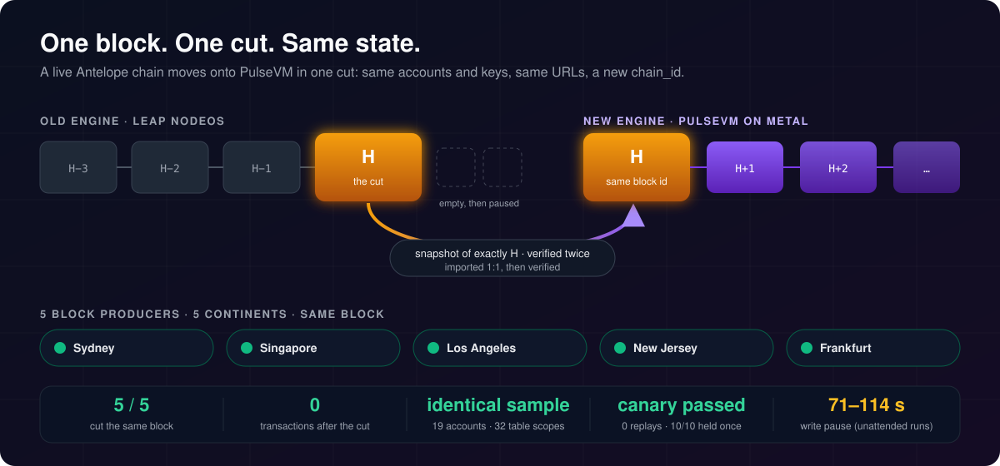
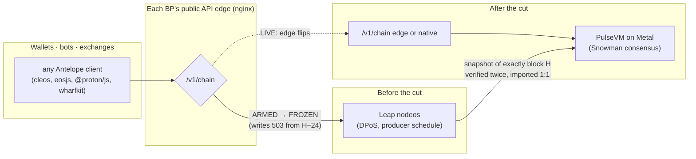

# pulse-cutover

<p align="center"></p>

[](https://pulsevm.dev/guide/migrate-antelope-chain)

*106-second explainer + full methodology and recorded numbers: [pulsevm.dev/guide/migrate-antelope-chain](https://pulsevm.dev/guide/migrate-antelope-chain)*

> **Status: proposed — community project.** This is a **proposed** migration approach, built and rehearsed by XPR Network block producer **protonnz** ([github.com/paulgnz](https://github.com/paulgnz)). It is **not an official Metallicus product and not an announced migration plan.** Core pieces are being contributed upstream to [MetalBlockchain/pulsevm](https://github.com/MetalBlockchain/pulsevm), and the **authoritative migration plan and documentation will come from Metallicus** — this repo is for demonstration, testing, and contribution in the meantime. Any production migration is subject to Metallicus and the relevant network's governance.

pulse-cutover moves a running Antelope chain (XPR Network) onto the PulseVM engine at one block, H: **the same
account state and the same public URLs, continuing at H+1 under a new chain_id** pinned in the coordinator's signed
event. Wallets and SDKs sign for the new id from LIVE on, and that change is what stops any transaction from replaying
across the cut. One binary drives the ceremony — freeze, snapshot, verify, ignite, flip — and records every step, with
evidence, in a journal you can hand to anyone.

Writes pause for the cut: 71–114 s in the unattended rehearsals on a small chain. For XPR mainnet the pause is
**estimated** (not measured end to end) at about 15 minutes: source finality, plus the state conversion measured at
9.6 min on a real mainnet snapshot (2026-10-13), plus ignition. Reads keep being served.

> [!IMPORTANT]
> **Status (2026-10-21, v0.5.0-rc.33)**
> - **Testing is paused pending upstream.** The rehearsal fleet was torn down on 2026-10-21; no mission control runs
>   between rehearsals.
> - **rc.33: all-producers gate.** The freeze is refused unless every producer that can produce before the pause runs
>   an armed agent with the admission lock on. On a 7-box fleet 6 of 7 gate scenarios passed; the 7th (a proposed
>   schedule inside the armed set) is fixed in code, not yet re-run
>   ([EVIDENCE](docs/EVIDENCE.md#7-bp-fleet-rc33-all-producers-gate-2026-10-19)).
> - **rc.32: producer admission lock**, then 8-BP fleet runs on upstream PulseVM v1.0.0: 0 transactions after H in
>   every run with the lock on, 8/8 LIVE in one run and 7/8 in six, where the slowest box halted on the rpcchainvm keepalive
>   ([EVIDENCE](docs/EVIDENCE.md#8-bp-fleet-rc32-fleet-step3-2026-10-16)).
> - **Blocked upstream** ([docs/UPSTREAM-ASKS.md](docs/UPSTREAM-ASKS.md)): a genesis-settable chain_id; a
>   content-based state root (roots diverge per node under load on v1.0.0); slow accepts that trip the rpcchainvm keepalive (#128);
>   CPU rescale at import; schedule-gated, per-producer signing. Until those land, any XPR mainnet ignite is refused.
> - **Not done yet**: fleet-wide all-or-nothing (no authority boundary; a partial abort can still split the network),
>   exact H in API mode and on restart under a real freeze, crash recovery on a fleet, validator registration and
>   funding, any run on Tahoe (the public Metal testnet) and any mainnet event. Earlier proof (September, 5 BPs on a
>   fork plugin) is in [EVIDENCE](docs/EVIDENCE.md#multi-producer-rehearsal-5-bps-september-2026). Every risk, its
>   safeguard and owner: [docs/RISK-REGISTER.md](docs/RISK-REGISTER.md); known limits:
>   [ATOMICITY.md](ATOMICITY.md#known-limits-independent-review-2026-09-29).

## Read first

- **[docs/HOW-IT-WORKS.md](docs/HOW-IT-WORKS.md)** — the whole cutover in plain terms, the measured mainnet numbers, what is proven and what is not.
- **[docs/PROCESS.md](docs/PROCESS.md)** — step by step with diagrams: who does what, the timeline around the cut, every gate, what apps see, rollback.
- **[ATOMICITY.md](ATOMICITY.md)** — five properties, the gate or tool for each, the recorded evidence, and what is still open.
- **[docs/RISK-REGISTER.md](docs/RISK-REGISTER.md)** — every known risk, its safeguard, evidence and owner.

## Block producers

Connect your node to the coordinator's [Cutover Mission Control](control/README.md) in two minutes. Download the installer from a
**release tag** (never `main` or `latest`: the tag is what was reviewed, and its pins arrive with it), read it, and
run it with the mission-control URL the coordinator publishes for the event (none runs between rehearsals; you can
also set `PULSE_CONTROL_URL`):

```bash
V=v0.5.0-rc.33
curl -fsSLO https://raw.githubusercontent.com/paulgnz/pulse-cutover/$V/tools/beacon-install.sh
less beacon-install.sh                                              # you are about to run it as root: read it
sudo bash beacon-install.sh --url <mission-control-url> --dry-run   # shows what it detected; changes nothing
sudo bash beacon-install.sh --url <mission-control-url>
```

The beacon only observes: installing it writes a binary, a readiness-only config, a token and a systemd service, and
it never touches nodeos. It detects your network and producer account and prints one `token_sha256=…` line to send
to the mission-control operator. Full guide: [docs/OPERATOR-QUICKSTART.md](docs/OPERATOR-QUICKSTART.md). Metal
validator and NodeID: [docs/METAL-QUICKSTART.md](docs/METAL-QUICKSTART.md). Using an AI agent to operate this?
[AGENTS.md](AGENTS.md).

## At a glance



| What stays the same for users | How it is proven |
|---|---|
| **Keys** — the same keys sign on the new chain; the **chain_id is new** (pinned in the signed event), so clients switch it at LIVE and nothing signed for the old chain replays | target must report exactly the event's pinned chain_id (rc.33; any other id halts), a height ≥ H and the same block id at H before anything flips |
| **Accounts, permissions, contracts and table rows** | snapshot imported twice; 19–21 table fingerprints or the official compare must match. `state-diff` compares a discovered sample against the old chain; a whole-state commitment is still open |
| **The URL** | producer mode: the edge swaps its backend at `on_live`. API mode: the flip happens before the FLIPPED/LIVE transitions |
| **Nothing is lost at the boundary** | admission lock + burn-off audit: zero transactions allowed after the cut, or the ceremony aborts |

---

## Start here — the operator walkthrough

Six steps for a rehearsal. Terms in *italics* are in the [Glossary](#glossary).

### Step 0 — what you need

- **A box**: a spare Ubuntu 20.04, 22.04 or 24.04 server, or your existing node box. `doctor` (Step 2) is strictly
  read-only and safe anywhere, including production; install and rehearsal belong on a spare/test box.
- **Rough specs**: 4+ cores, 16 GB RAM, 50 GB+ free disk — `doctor` checks all of it.
- **A running nodeos** on that box (native or docker), synced to the chain being migrated; a testnet node is perfect.
- **Time**: about 40 minutes for a first rehearsal.
- **What this touches in production: nothing.** Steps 1–3 only install and stage. The only user-visible moment is the
  *flip* in a ceremony you explicitly start in Step 4, and a rehearsal runs entirely on the rehearsal box.

### Step 1 — get the tools

Install the release binary (static musl, x86_64 + aarch64; never build on a producing node) and the scripts of the
same tag:

```sh
V=v0.5.0-rc.33   # an exact release tag, never "latest"
curl -fsSLO https://github.com/paulgnz/pulse-cutover/releases/download/$V/pulse-cutover-x86_64-unknown-linux-musl
curl -fsSLO https://github.com/paulgnz/pulse-cutover/releases/download/$V/sha256sums.txt
sha256sum -c sha256sums.txt --ignore-missing
sudo install -m 0755 pulse-cutover-x86_64-unknown-linux-musl /usr/local/bin/pulse-cutover
git clone --branch $V --depth 1 https://github.com/paulgnz/pulse-cutover   # install.sh / cutover.sh / examples
```

`install.sh` can fetch and verify the binary itself; how, and how to verify the scripts:
[docs/REFERENCE.md](docs/REFERENCE.md#getting-the-binary).

### Step 2 — survey the box: `pulse-cutover doctor`

```sh
pulse-cutover doctor
```

It reads how nodeos runs, what nginx/haproxy serve, disk and ports, and never writes or restarts anything. **You
should see `READY` for the mode you plan to run** ([Which mode am I?](#which-mode-am-i)). `NEEDS` with a list is
normal on a first run:

| doctor says | it means | fix |
|---|---|---|
| `producer_api_plugin (localhost-bound)` | the snapshot is taken through nodeos' producer API, and yours doesn't have it | add `plugin = eosio::producer_api_plugin`, restart nodeos. Keep it on 127.0.0.1 — it can pause your chain |
| `a running, synced nodeos ... serving /v1/chain/get_info` | no nodeos answered on this box | start your node, or run doctor where one runs |
| `50GB+ free disk` | the snapshot + new chain need room | free up or mount disk |
| `source.stop_cmd must be declared` | doctor couldn't work out how to stop your nodeos | add a `stop_cmd` to the manifest in Step 3 |

`UNSUPPORTED` means we can't drive your setup yet (e.g. apache or caddy on the edge, kubernetes-managed nodeos); the
verdict says why. Send us the Step 5 bundle — that is how setups get added. What doctor detects, sample output and
the support matrix: [docs/EDGES.md](docs/EDGES.md).

### Step 3 — stage everything: `./install.sh`

`install.sh` installs and configures every piece the ceremony needs from a *manifest*, without touching your running
nodeos or any public traffic. Start from [`examples/ceremony.json`](examples/ceremony.json): every field is
documented, the public values are filled in, and the values only a coordinator can supply are marked `REPLACE-ME`
(`install.sh` refuses a manifest that still has one). For a rehearsal with us, the
[Telegram group](https://t.me/+N1mAvoUDbtVmNTBh) publishes the current rehearsal bundle; in a real event the
coordinator publishes one manifest for every operator.

```sh
cp examples/ceremony.json ceremony.json && chmod 600 ceremony.json   # it will hold the producer key
$EDITOR ceremony.json                                               # fill in every REPLACE-ME
sudo ./install.sh --mode api --manifest ceremony.json
```

It re-runs `doctor`, refuses with reasons if the box isn't ready, and ends with an **ARMED-READY** banner listing
exactly what will happen at H. Every refusal prints the reason and the fix; fix it and re-run. Files it writes, a
sample banner and the internals: [docs/REFERENCE.md](docs/REFERENCE.md#files-on-the-box).

### Step 4 — run the ceremony: `./cutover.sh`

In a real event you run this when the coordinator says go; in a rehearsal, whenever you like:

```sh
./cutover.sh --manifest ceremony.json
```

It checks the manifest against the live chain, then prints each state (recorded single-box run, August 2026; the
IGNITED and LIVE lines are what `cutover.sh` prints today):

```
[ARMED]       watching the source chain; preflight passed.
[FROZEN]      the freeze height is final on the source chain — taking the state snapshot next.
[SNAPSHOTTED] state snapshot cut + pinned to one exact block.
[VERIFIED]    snapshot hash + state fingerprints check out; staged for PulseVM.
[IGNITED]     PulseVM is up, serving the event's NEW chain_id, continuing at the cut block.
[FLIPPED]     public /v1 now answered by PulseVM — this was the only user-visible change.
[LIVE]        ceremony complete. Source retired. Same URL and state, new engine, new chain_id.
```

Recorded on testnet-sized state: ARMED until H arrives; FROZEN → VERIFIED about 1–3 minutes; IGNITED about 15 s;
the API-mode flip took 0.75 s across 22 runs, with reads answered throughout.

**LIVE** means exit code 0: your public URL now serves the same state, continuing at H+1, under the new chain_id, and
the journal holds the evidence (hashes, block ids, timings) for every step.

**ABORTED** means the run stopped before ignition and rolled back (bp mode: your producer resumed; api mode: what it
changed reverted). After ignition starts a failure **HALTS** instead and a human decides; `./cutover.sh abort` then
refuses (exit 3). A local abort is not a fleet guarantee. After any non-zero exit, check the journal and the real
state of nodeos and the edge. Details: `pulse-cutover rollback --help`, [docs/DESIGN.md](docs/DESIGN.md#5-failure-and-rollback-table-rc21-chain-creation-is-past-the-point-of-no-return)
and [docs/REFERENCE.md](docs/REFERENCE.md#abort-and-rollback-in-detail). An aborted rehearsal is a useful one: go to
Step 5.

### Step 5 — share the evidence: `pulse-cutover report`

```sh
pulse-cutover report
```

Whether it went LIVE or ABORTED, this packs everything we need to debug your rehearsal or support your setup into
one tar.gz. Private keys, tokens and passwords are always redacted; chain ids, block ids and hashes are kept (they're
the evidence). It prints the file list and every redaction so you can review first; `--paranoid` also placeholders
hostnames and IPs. Share it, with the printed sha256, in the
[Telegram testing group](https://t.me/+N1mAvoUDbtVmNTBh) or a
[rehearsal-feedback issue](https://github.com/paulgnz/pulse-cutover/issues/new?template=rehearsal-feedback.md).

---

## Which mode am I?

One agent, one manifest format, three operator roles — pick with `install.sh --mode bp|api|hyperion`:

| | **bp** | **api** | **hyperion** |
|---|---|---|---|
| Who runs it | block producer | RPC/API provider | API provider w/ Hyperion |
| What freezes | the chain (writes at API edge) | observed only (LIB ≥ H) | observed only |
| Snapshot | at **exactly H** | at ~finality (R17) | at ~finality |
| What flips | via your hooks: `on_freeze` closes writes, `on_live` flips the edge | `/v1` upstream | `/v1` **and** `/v2` together |
| What continues | production and block numbering (under the new chain_id) | reads — zero gap | reads **and history** |

Each mode in detail: [docs/REFERENCE.md](docs/REFERENCE.md#modes-in-detail).

## Evidence

Rehearsals only, never mainnet. Every run, with what it proves **and does not**, is in
[docs/EVIDENCE.md](docs/EVIDENCE.md).

| Rehearsal | Result |
|---|---|
| [Single node, API mode, live XPR testnet](docs/EVIDENCE.md#api-mode-on-the-live-xpr-testnet-2026-08-21) (Aug) | **22/22 LIVE** in the loop, 99.8% read availability, 0.75 s flip |
| [History (`/v2`) via hyperion-rs + federating router](docs/EVIDENCE.md#hyperion-mode-runs) (Aug) | one URL serves pre- and post-cut history |
| [5 BPs on 5 continents, fork plugin](docs/EVIDENCE.md#multi-producer-rehearsal-5-bps-september-2026) (Sep) | run 1 aborted on all 5 as designed; runs 2–6 LIVE on all 5: same cut, byte-identical snapshot, 0 post-cut transactions, sampled state identical and replay canary passed (runs 5–6), a perps DEX and oracle carried across; one shared producer key |
| [5 BPs, upstream PulseVM v1.0.0](docs/EVIDENCE.md#upstream-stack-fleet-runs-october-2026) (Oct) | identical state at H on all 5 and against a reference nodeos; mixed LIVE/HALTED per node; one run split (33 writes after H), which led to STRANDED and `join` |
| [8 BPs, rc.32 admission lock](docs/EVIDENCE.md#8-bp-fleet-rc32-fleet-step3-2026-10-16) (Oct) | 0 transactions after H with up to 293 held at the lock; lock-off BP named and the fleet aborted; slowest box halted on #128 in 6 of 7 LIVE runs |
| [7 BPs, rc.33 gate](docs/EVIDENCE.md#7-bp-fleet-rc33-all-producers-gate-2026-10-19) + [target-chain checks](docs/EVIDENCE.md#target-chain-checks-on-the-7-box-fleet-2026-10-19) (Oct) | 6 of 7 gate scenarios pass; state roots diverge across validators under load; a CPU=0 freeze cannot be undone on-chain |


Things operators must know, from the [field notes](docs/EVIDENCE.md#field-notes-from-the-rehearsals) (the app-facing
ones are in the checklist below):

- **Head time is frozen at the cut** until the first new block.
- **Persist an edge flip in the config**: a runtime-only HAProxy flip was undone by a later routine reload.
- **The producer schedule after import is seeded from node config** (open upstream): today every validator must run
  the same producer name and key.

## Building apps that survive a cutover

What a bot, wallet or exchange integration should do; all of it was exercised by the rehearsal bots. Detail for
exchanges, wallets and indexers: [docs/EXCHANGES.md](docs/EXCHANGES.md).

- [x] **Treat HTTP 503 during a migration as "hold", not "failed"**. A 503 at the edge means the write was not accepted: retry later, under the same application-level operation id. **Reconcile before you re-sign.** After an ambiguous outcome (timeout, lost response, 5xx), look up the ORIGINAL transaction id first and keep an application-level operation id for every business action; build and sign a replacement only once the original is found (done) or provably expired and absent. A re-signed transaction has a new id, so id-based deduplication cannot stop it from executing the same transfer twice.
- [x] **Fail over across several BP endpoints.** During the rehearsals every edge answered reads throughout; writes resumed on all of them at the same moment.
- [x] **Use `expireSeconds` ≥ 120**, and don't derive expiration from an old block: head time is frozen at the cut until the first new block ([field note 4](docs/EVIDENCE.md#field-notes-from-the-rehearsals)).
- [x] **Confirm inclusion, not just acceptance.** An "admitted" response means accepted into the mempool; read your state back (or check the block) before treating it as final. Reconcile against a final chain read, not a short read-back timer, or you will report phantom drops; send a dependent transaction only after the first is included, since back-to-back sends can reach different producers out of order.
- [x] **Oracle-driven apps**: the chain clock jumps forward by the freeze length at the first new block. Contracts with a staleness window (e.g. 120 s) will see the last pre-freeze price as stale until a fresh one lands, so **push a fresh oracle update as the first post-cut write**. Liquidations and funding that are gated on freshness pause safely in the meantime.
- [ ] **The head block number goes back once, at the flip.** The source keeps producing empty burn-off blocks past H (about 330 in the rehearsals) until it pauses; they are discarded and the new chain reuses those heights from H+1 with different block ids. Indexers and deposit pollers must treat H as the end of the old chain and key blocks by id, not height alone.
- [ ] **Sign for the new chain_id from LIVE.** The keys are unchanged; the chain_id is new (published with the signed event).
- [x] **Contracts move as-is.** A perps contract, its oracle and token deployed with plain `cleos set contract` kept working on PulseVM after the cut with no contract or bot changes.
- [x] **Expect a short, bumpy restart.** Budget for about 1–2 minutes of 503s plus up to a minute of slow confirmations right after the flip (a ~50 s finality stall followed LIVE under load; open), and make your retry loop tolerate both.

Measured across the cut for three bots: [EVIDENCE.md, run 4](docs/EVIDENCE.md#multi-producer-rehearsal-5-bps-september-2026).

## Glossary

Plain-English versions of every term this repo uses:

- **Ceremony** — one scripted, journaled migration run, from watching the old chain to serving traffic from the new
  one. A rehearsal is a ceremony on a test box.
- **Manifest** (`ceremony.json`) — the one file describing a ceremony: which chain, the freeze height, which pinned
  binaries, where things live. In a real event everyone gets the same manifest from the coordinator.
- **H / freeze height** — the agreed block number where the old chain stops accepting writes. Everything before H
  migrates; H is the last migrated block.
- **The cut** — the exact block (number *and* id) the snapshot was taken at. The new chain continues from the cut:
  same numbering, a new chain_id (named in the signed event).
- **Snapshot** — nodeos' own binary export of the full chain state (every account, balance, contract, table) at one
  block.
- **Goldens / fingerprints** — checksums of the snapshot's state, computed per table. Everyone's snapshot must
  produce the same fingerprints as the published "golden" values — proof we're all migrating the same state.
- **States** — the ceremony's fixed path. `ARMED`: watching the old chain, waiting for H. `FROZEN`: H reached/final;
  writes are over. `SNAPSHOTTED`: state exported and pinned to the cut. `VERIFIED`: snapshot hashed, imported twice,
  fingerprints match. `IGNITED`: the new engine is up with the same state, continuing at H+1, under the new chain_id.
  `FLIPPED` (api modes): the public URL now points at the new engine. `LIVE`: done — new chain producing/serving, old
  node retired. `ABORTED`: this agent stopped and (in bp mode) resumed its old producer; whether the old chain is
  still the real one depends on the rest of the fleet (no fleet-wide authority boundary yet). `HALTED`: a failure
  after ignition started; sealed, nothing resumed, a human decides. `STRANDED`: stopped before chain creation with
  the source paused, waiting for a fleet decision.
- **Flip** — the public URL's edge (nginx or haproxy) is swapped so it answers from the new engine. (The write
  freeze before it is also visible to users: writes get HTTP 503.) Health-checked, instantly revertible. On nginx
  it's one upstream line + graceful reload; on haproxy an enable/disable server pair on the admin socket (or a
  `disabled`-marker swap + reload without one).
- **Edge** — the web server terminating your public URL (nginx or haproxy). Doctor detects and maps both; when a box
  runs both, the manifest's `flip.edge` declares which one the ceremony flips.
- **Admin socket (haproxy)** — haproxy's local control socket (`stats socket <path> ... level admin` in the `global`
  section). Lets the flip enable/disable backend servers instantly, transactionally, with zero reloads.
- **Admission lock** — from the freeze, the producer's own nodeos refuses transactions (its actor whitelist is set to
  a name no account can have), so nothing queued before the freeze lands after H.
- **Burn-off audit** — after the freeze the source keeps producing (empty) blocks past H until it pauses; the agent
  reads every block from H+1 to the pause head and aborts on any transaction or unreadable block, naming the
  producer of each offending block. The backstop behind the admission lock ([docs/DESIGN.md](docs/DESIGN.md), R2).
- **rpcchainvm keepalive** — MetalGo pings each VM plugin over gRPC every 30 s with a 10 s timeout (fixed, not
  configurable) and stops a plugin that misses one; a slow block accept can trip it and halt that validator
  (#128; [UPSTREAM-ASKS U-8](docs/UPSTREAM-ASKS.md#u-8-configurable-rpcchainvm-keepalive)).
- **Federator** — a small router that keeps one `/v2` history URL answering across the migration: old rows from the
  old archive, new rows from the new indexer.
- **Journal** — an append-only file (`journal.jsonl`) the agent writes every step to, with timestamps and evidence.
  Crash-safe: a restarted agent resumes from it. It's also the thing you share when something breaks.
- **R-numbers (R1, R10, R12...)** — findings from the design review and the rehearsals
  ([docs/DESIGN.md](docs/DESIGN.md#2-adversarial-review-findings-that-shaped-the-design), R13–R23 in
  [docs/EVIDENCE.md](docs/EVIDENCE.md#findings-r13r23)). When a message cites one, it's pointing at the *reason* a
  rule exists, e.g. R10 = "the producer API can pause your chain, keep it off the public internet"; R12 = "a stale
  staged snapshot must never pin a new chain to an old cut".

## Builders

- [docs/REFERENCE.md](docs/REFERENCE.md) — state machine, modes in detail, commands, production profile, the
  `ceremony.json` manifest and config keys, `install.sh` internals, `/v1` gateway modes (edge, native, legacy),
  `scan-contracts`, `report`, the loop harness, build.
- [docs/EDGES.md](docs/EDGES.md) — what `doctor` detects, the supported setups matrix, nginx and HAProxy flips.
- [docs/DESIGN.md](docs/DESIGN.md) — the reviewed design as of rc.33 (§2a–2c: admission lock, all-producers gate,
  new chain_id), failure/rollback table, and §8 upstream alignment and import backends.
- [docs/DESIGN-authority-boundary.md](docs/DESIGN-authority-boundary.md) — the fleet-wide commit-or-abort design
  (not implemented).
- [docs/EVIDENCE.md](docs/EVIDENCE.md) — every recorded run, field notes, findings R13–R23.
- [docs/UPSTREAM-ASKS.md](docs/UPSTREAM-ASKS.md) — what the cutover needs from PulseVM and MetalGo, each with an
  acceptance test.
- [docs/V1-COVERAGE.md](docs/V1-COVERAGE.md) — the Leap 5 `/v1` surface on the new chain.
- [CHANGELOG.md](CHANGELOG.md) — release notes per tag. Build: `cargo build --release --locked`.

## Testing and contact

We build operator confidence for a real migration one rehearsal at a time — different nodeos setups, edge layouts,
history stacks. **[TESTING.md](TESTING.md)** is the program: what a run involves, the guarantee that it never touches
production, what to share and what testers get. Questions and report bundles:
[Telegram](https://t.me/+N1mAvoUDbtVmNTBh) ·
[rehearsal-feedback issues](https://github.com/paulgnz/pulse-cutover/issues/new?template=rehearsal-feedback.md) ·
guide and video: [pulsevm.dev/guide/migrate-antelope-chain](https://pulsevm.dev/guide/migrate-antelope-chain).
