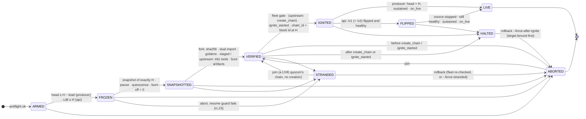

# Design: the pulse-cutover ceremony agent

This is the design of `pulse-cutover`, the agent each producer and API operator runs beside
their nodeos to move a running Antelope chain onto PulseVM at one block, H. It records why the
ceremony is shaped the way it is: the adversarial review that changed the design (the
**R-numbers** that appear in log messages, config comments and the README), the state machine,
the config format, the failure and rollback table, and a sketch of a faster v2.

It describes the code as of **v0.5.0-rc.33** (§2b is the rc.33 all-producers gate; §3 and §5 carry the rc.21–rc.28 changes; rc.29's guard, authorization and
relay changes are summarised in docs/OPERATOR-QUICKSTART.md §6 and ATOMICITY.md known limit 17; the
review table in §2 was last re-checked at rc.11 and its "Today" column is dated that way). The
first version of this design was written in August 2026, before the multi-producer rehearsal and
several review rounds; where that version differs from today's code, the code wins and the
difference is marked *historical*.

Other documents cover the rest, and this one does not repeat them:

| Document | What it covers |
|---|---|
| [PROCESS.md](PROCESS.md) | The cutover step by step: who does what, the timeline around H, each phase's gate, what apps see |
| [ATOMICITY.md](../ATOMICITY.md) | The five atomicity properties (A1–A5), the evidence for each, known limits, upstream re-qualification list |
| [DESIGN-authority-boundary.md](DESIGN-authority-boundary.md) | The fleet-wide commit-or-abort design (not implemented) |
| [EVIDENCE.md](EVIDENCE.md) | Every recorded rehearsal run, with what it proves and what it does not |
| [EXCHANGES.md](EXCHANGES.md) | For exchanges, wallets and indexers: the head-number step back at the flip, crediting deposits through the federated history, reconciling before re-signing |
| [`examples/*.toml`](../examples/) | Fully commented configs per mode; `src/config.rs` documents every field |

## 1. Scope and design rules

`pulse-cutover` is one Rust binary. Its fork-backend verification imports the snapshot through
the same crates a PulseVM node boots with (`pulsevm_snapshot`, `pulsevm_snapshot_import`,
`pulsevm_chaindb`), so the agent's check and the node's import cannot drift apart. The upstream
backend runs the official MetalBlockchain/pulsevm#61 tools instead (README, "Import backends").

The rules the design keeps to:

1. **Freeze writes, not blocks.** Writes stop at the API edge before H; producers keep making
   empty blocks until H is final (R1, R2).
2. **The cut is exactly H, pinned by height and block id.** Any other height aborts, except in
   explicitly flagged rehearsal modes (R4).
3. **Every node checks its own snapshot.** No trusted snapshot publisher; each operator verifies
   that others match them (R6).
4. **Nothing user-visible before the target is proven.** In producer mode the edge flips at LIVE;
   in API mode at FLIPPED, after ignition and a public health check (R5).
5. **Ignition start is the local point of no return.** Before it, a failure aborts and resumes
   the source; after it, a failure halts and a human decides (R5, as corrected; see §3).
6. **Record everything, fsynced, before acting.** The journal is the evidence and the resume
   mechanism.

## 2. Adversarial review: findings that shaped the design

The first design was attacked before it was built. R1–R10 came from that review; R11 and R12
were found in the first rehearsal; R13–R23 were found in later rehearsals and are listed with
their runs in [EVIDENCE.md](EVIDENCE.md#findings-r13r23). The "Today" column is the rc.11
behaviour.

| # | Attack | Finding | Design change | Today (rc.11) |
|---|---|---|---|---|
| **R1** | "Pause at H, then snapshot" | Deadlock. Leap writes a snapshot only once its block is irreversible, and a fully paused DPoS chain never finalizes H (LIB needs later confirmations). | Freeze writes at the edge; producers keep producing **empty** blocks through H; the snapshot is scheduled at exactly H and lands when H is final; producers pause **after**. | `freeze_strategy = "schedule_at_h"` (requires `snapshot.dir`). The agent schedules the snapshot at ARM and picks up `snapshot-<id of H>.bin` by exact name. If scheduling fails the ceremony aborts; there is no fallback to an immediate snapshot. |
| **R2** | Writes "into the void" around the freeze | A paused nodeos still accepts and acknowledges pushed transactions that are never included: silent write loss. | The freeze is an explicit reject at the API edge (HTTP 503 / tx-acceptance off). Pause alone is never the freeze. | `hooks.on_freeze` closes writes `freeze_lead_blocks` (default 24) before H; a failing hook aborts. rc.32: at the same moment the producer itself stops admitting transactions (the **admission lock**, §2a); rc.33: the freeze is refused unless every producer that can produce before the pause has an armed agent with that lock (the **all-producers gate**, §2b). The **burn-off audit** reads every block from H+1 to the pause head and aborts on any transaction or unreadable block (the backstop). |
| **R3** | nodeos version skew | Snapshot file bytes depend on the snapshot format version (Leap 5 writes v6, later versions v7+), so sha256 goldens are version-fragile. Table fingerprints over imported state are not. | Two tiers: fingerprints are the binding cross-node check; sha256 is a strict extra bound to the pinned nodeos version. | `snapshot.expected_sha256` (optional) and `snapshot.golden_roots`; either mismatch aborts. In the upstream backend the whole-state root from `xpr_state_fingerprint` can be compared to `[upstream] golden_state_root`. |
| **R4** | Microforks and late blocks at H | "Snapshot the current head" is ambiguous: a straggler block or an unpaused producer moves head; a node on a microfork snapshots a different block H. | Pin the cut by height **and** block id; after the pause, require a quiescence window of unchanged-head polls; assert the snapshot's block id equals the chain's block id at that height. | As designed. `quiescence_polls` (default 6); late blocks are journaled (first 10) and reset the window; since rc.12 the wait is bounded by `quiescence_timeout_secs` (default 120) and aborts on expiry. *Differs from the August design:* the cut is not re-pinned on late blocks (it is always the scheduled H). |
| **R5** | Partial quorum; the flip racing the target | Half the validators ignite and quorum never forms, or a gateway flips before the target produces. | Ratchet: the user-visible flip happens only after the target serves the source chain_id at the cut **and** its head advances past it. `quorum_timeout` bounds the wait. | LIVE now also needs `live_sustain_secs` (60) of progress with no gap over `live_max_gap_secs` (20). *Corrected since August:* "the source stays authoritative until LIVE" holds only before ignition. From `ignite_started` on, every failure HALTS instead of resuming the source (§3). Fleet-wide, the point of no return is target authorization, which is not implemented ([DESIGN-authority-boundary.md](DESIGN-authority-boundary.md)). |
| **R6** | Where H and goldens come from | An agent must not take H from a chat message, and goldens cannot exist before H. | Two phases: parameters declared before the freeze, goldens co-signed after the snapshot. Each node's trust anchor is its own snapshot. | *The on-chain msig declaration was never built.* H and parameters come from the config or from a signed coordinator event (`pulse-cutover await`: ed25519 keys listed in each node's own config, event/arm/abort messages, optional roster, quorum and plugin hash, arm bound to the event by hash). Goldens are a file (`golden_roots`) or captured with provenance (`capture_roots`). Co-signed goldens are not implemented; the fleet gate compares beacon reports through the relay. |
| **R7** | In-flight transactions at H | Do transactions not included by H replay? Can they be taken cross-chain? | The importer carries the unexpired-transaction dedupe set, so a transaction included at or before H cannot execute again; an unincluded signed transaction can be resubmitted after the cut. | The fork importer carries the dedupe set from the `.bin`; the upstream backend refuses to verify without the `deferred-transactions.json` sidecar that carries it. **TAPOS is not enforced by PulseVM**; enforcement is one of the upstream ignition prerequisites (`upstream::ignite_pending_reasons`). |
| **R8** | Clock assumptions | PulseVM's first block must be timestamped after H's. | NTP is a node requirement; the invariant is recorded, not assumed. | The journal records `last_source_block_time` and `first_post_cut_block_time`. |
| **R9** | A nondeterministic verifier | A flaky fingerprint is worse than none. | Import every snapshot into two fresh arenas and require identical roots before comparing to anything. | As designed (`NONDETERMINISTIC IMPORT` aborts with a per-table diff). Both imports run the same importer, so this catches nondeterminism, not a bug both runs share (ATOMICITY Known limits #5). |
| **R10** | Producer API exposure | `/v1/producer/pause` and `resume` can stop or restart a chain. | The producer API binds to localhost only; the agent runs on the same box; preflight fails at ARM if it is unreachable. | Preflight checks reachability. Since rc.11 the beacon reports `producer_api_private`, from a mission control probe of the node's own public addresses. |
| **R11** | Who may sign the first post-cut block | The target's producer schedule is seeded from its chain genesis `initial_key`, not from imported state. A `producer_key` that does not pair with it builds no blocks. | Pre-stage check that the staged key pairs with the genesis key; upstream: derive the schedule from imported state. | `install.sh` writes the pair from the manifest. Fork backend: the agent does not check it; the LIVE gate catches it (now as a HALT). Upstream backend, producer mode: checked at ARM and before ignition, together with the key `eosio/producers` registers (the migrated system contract re-elects the schedule from it at the first onblock; stage-2 run 1 halted at H+4 on that). Still open upstream: every validator must share one producer name and key (ATOMICITY Known limits #4). |
| **R12** | Stale staged snapshot | The target imports whatever sits at its `snapshot_path` when the chain first initializes. A file left from an earlier attempt pins the chain to the wrong cut. | Refuse to ARM if the staged path exists; the path stays empty until VERIFIED copies the verified file in. | As designed. On resume, a file matching this ceremony's journaled `staged_artifact` hash is accepted; every abort moves the staged file aside (never deletes it). |

## 2a. The admission lock (rc.32)

Fleet run s1 (8 BPs) showed what the edge freeze cannot stop: a transaction the producer already holds. nodeos 5.0.3
keeps a transaction it could not apply yet (block full, its speculative-block deadline, a subjective CPU limit) in its
unapplied queue, does not relay it, and retries it at the start of every block it builds until the transaction
expires. Expiry is the only objective limit, and on XPR it can be `max_transaction_lifetime` = 3,600 s away. In s1 one
producer held 3 transfers (120 s expiry) from before the freeze and put them in the first block of its next slot, H+25.

What nodeos 5.0.3 offers at runtime (Leap v5.0.3 source), and what each would do:

| Option | Verdict |
|---|---|
| `pause` + clear the queue | no API clears the unapplied queue; a paused producer keeps it and includes it on resume. Pausing before H also stops the finality the scheduled snapshot needs (R1) |
| `p2p-accept-transactions` / `api-accept-transactions = false` | startup-only options (chain_plugin, net_plugin): needs a nodeos restart in the middle of the cut, and neither empties the queue |
| empty blocks after the freeze | no producer option exists; `max_block_cpu_usage` is consensus state (setparams) and would be imported |
| `update_runtime_options` (`max_transaction_time` …) | a cheap transfer still fits; not a refusal |
| a freeze lead >= the longest expiry | objective (no producer can include an expired transaction), but only if EVERY admission path in the network is closed for that long: up to an hour more write gap (E-5), and third-party API nodes keep relaying |
| **subjective actor whitelist** (`set_whitelist_blacklist`) | **chosen**: enforced only for blocks this nodeos builds and its speculative execution (`is_speculative_block`), never when validating others' blocks, so consensus is unchanged |

At the freeze (head >= H − `freeze_lead_blocks`, before `on_freeze`), each producer's agent journals the current actor
whitelist (`side_effect: admission_lock`), sets it to `pulse.frozen1` and confirms it with a read. That name has 13
characters: native `newaccount` refuses names over 12, so no account and no authorization can ever carry it. From then
on every input or deferred transaction this producer would execute has an actor outside the list and fails with
`actor_whitelist_exception`:

- a queued transaction is a plain failure (not "exhausted"), so it is erased from the unapplied queue, whatever its
  expiry: it never lands, on either side of H;
- a new one is refused at this node's API (an explicit error, never a write into the void) and is never relayed;
- a deferred transaction fails subjectively and stays scheduled (it is in the cut state and the dedupe sidecar);
- `onblock` is implicit (`enforce_whiteblacklist = false`), so the block's action root is the same for validators.

Transactions between the freeze and H are therefore dropped, not included: the write gap starts at the freeze for the
producers too. A client must treat any transaction not in an irreversible block as not executed (EXCHANGES.md).

The original list is restored when a rollback reopens writes: only into a producing source (the same fresh read that
guards `on_abort`), only from the sentinel this journal set (a list someone else set is left alone and journaled), with
the restore journaled as `rollback_step: admission_unlock`. A STRANDED ceremony keeps it. After LIVE the old chain stays
locked; a nodeos restart reloads the config file's list.

**Airtight for:** every transaction held by, or sent to, a producer whose rc.32+ agent locked it before it built a
block after H. Two narrower residuals inside the lock itself, both left to the burn-off audit: nodeos' `check_actor_list` returns
early when the set of actors it is given is empty (an action with an empty authorization list, e.g. an inline action a
contract sends without authorization, is not checked on its own); and a deferred transaction whose sender is listed in
the producer's `sender-bypass-whiteblacklist` config is executed without the list (empty by default). The lock is
re-read on every poll tick from the lock to the pause, while H finalizes and the snapshot is written, and once more right
before the pause (a nodeos restart reloads the configured whitelist; the agent re-applies it within one tick and journals
`admission_lock_lost` with the height), and right before the burn-off audit (journaled, and part of the abort detail), and ARM fails if
the producer API does not answer `get_whitelist_blacklist`. **Residual:** a producer outside the ceremony (no agent, an older agent, `admission_lock = false`, or an
agent that froze late) can still include what it holds or receives over p2p; nothing at runtime lets one nodeos stop
another. The burn-off audit stays the backstop (it now names the producer of each offending block), and the fix is
procedural: every producer that can produce between the freeze and the pause, standby included, runs the agent. Making
it airtight without that needs an upstream nodeos change (a producer switch that refuses all input and deferred
transactions from block N), or a freeze lead of at least the longest expiry with every admission path in the network
closed for that time. RISK-REGISTER A-22. rc.33 closes the procedural part with a gate (§2b).

## 2b. The all-producers gate (rc.33)

The admission lock (§2a) protects only the producers whose agent applies it. A producer that is not running an
rc.32+ agent with the lock on (no agent, an older one, the lock turned off, an agent that arms late) can still put
transactions into its blocks between the freeze and the pause. The burn-off audit catches that and aborts, which is
safe, but the cut fails. rc.33 makes the ceremony unable to reach the freeze unless every producer that could produce a
block before the pause has an rc.33+ agent ARMED for this event, with `admission_lock = true` and a working lock probe.
If that stops being true after ARM (a schedule change, a member that disarms or goes stale), every agent aborts before
it freezes. Code: `src/producer_gate.rs`, `control/coordlib.mjs`, `control/lib.mjs` `producerGateView`.

**1. The set, bound into the signed event.** `coord.mjs event --producer-gate yes --source-rpc <nodeos>` reads the source's
`get_producer_schedule` and binds, as `producer_gate` in the signed payload:

- `required`: every producer that could produce before the pause: active ∪ pending ∪ proposed, plus the standbys the
  coordinator names (`--standby`);
- `cover`: the roster member (beacon producer account) that runs each one's agent. By default the name itself (one
  producer, one agent). Rehearsals where one server signs for several schedule names map them (`--cover name:member`);
- the bound `active`, `pending` and `proposed` schedules (version and order), `min_agent_version` (at least
  `0.5.0-rc.33`), and a sha256 over a canonical text that both sides compute. A shared vector checks they agree:
  `control/test/fixtures/producer-gate-vector.json`.

The coordinator refuses to sign when a required producer has no roster member. The arm binds the event's hash, so it
binds the set too. Mission control and every agent check the same set and hash.

**2. Each agent, at `await`.** An event whose gate is malformed, whose hash does not match, whose producers are not all
covered by its roster, or whose `min_agent_version` is newer than the agent, is refused. In producer mode outside a
rehearsal, an event without a gate is refused too: the production profile requires it, and XPR mainnet requires it at
ARM (D-10). The derived config carries the gate as `[coordination.producer_gate]`. The mainnet binding journaled at ARM
includes its hash. `coord-state.json` (the beacon's `coord`) records the accepted gate's hash, and the beacon adds
`arm_ready`: `auto_arm`, or the operator's `confirm-<event>` file.

**3. Mission control** refuses to relay the arm (409, not relayed, history `arm_refused`) until every required
producer's member has a fresh (≤ 60 s) producer-role report that:

- accepted this event under this gate;
- will start on the arm (`arm_ready`);
- runs an agent at least `min_agent_version`;
- shows the `admission_lock` check and the new `admission_lock_probe` check green.

The probe is a setup check: the beacon reads `get_whitelist_blacklist` on the producer API. It is a setup check so it
never excludes a report from the ignition fleet gate. A schedule mission control has read that is not the bound one
blocks the arm too. An unknown schedule does not, because the agents check the schedule themselves. The 409, the event
log and `fleet.producer_gate` name each producer that is not ready, and why. After the arm, the board shows
`PRODUCER GATE NOT READY (agents abort before the freeze)` while any member is not ARMED or FROZEN under the gate.
`coord.mjs arm --source-rpc` also refuses to sign when the live schedule has changed since the event.

**4. Each agent, at ARM and right before the freeze.**

- At ARM (and on a run resumed before the freeze), producer mode under a gate refuses when:
  - the lock is off;
  - the agent is older than `min_agent_version`;
  - the live schedule is not the bound one: the active or pending schedule changed, or a name in the active, pending or
    proposed schedule is outside `required`. A proposal among required producers only is tolerated, because it cannot
    bring in anyone else.
- At the freeze tick (head ≥ H − `freeze_lead_blocks`, after the production profile check, before the lock and
  `on_freeze`), the agent re-reads the schedule against the same rules. It then reads `/api/status` and needs every
  required producer's member to have a fresh report for this event:
  - in ARMED or FROZEN;
  - journaled under this gate (`producer_gate_sha256` in the ARMED evidence);
  - from an agent at least the minimum version;
  - with `admission_lock` and `admission_lock_probe` green.
- Each read is retried briefly (3 tries, 1 s apart), and an unanswered one counts as a failure: unknown is never yes.
- On any gap the agent aborts before it freezes or locks anything. The journal names the missing producers and why
  (`producer gate not met before the freeze`), with the schedule problems. A pass is journaled
  (`producer_gate: checked before the freeze`).

Every agent checks the same inputs (the chain's schedule and the relay's view), so the fleet normally decides the same
way. One agent that aborts while its peers freeze resumes its producer with admission open. Its transactions after H then
abort everyone at the burn-off audit: safe, and the same outcome the gate exists to avoid. That is why the relay
refuses the arm early.

**Limits (honest).**

- **Mission control is an unsigned relay.** The signed event fixes WHO must be ready, and the relay cannot change that.
  But "ready" comes from the relay's `/api/status`. A compromised or buggy relay can make the gate pass when it should
  not (then the burn-off audit decides), or fail when it should not (safe: no freeze). Per-producer signed
  acknowledgements would remove this trust (RISK-REGISTER D-1).
- **A producer can lie in its own report.** Reports are authenticated per producer by a bearer token (hashed on the
  relay), not signed, and they describe what that producer's agent says. A producer can report ARMED with the lock on
  while its signing node is not locked. Its agent may run on another box than the one that signs, or the coordinator's
  `cover` mapping may be wrong. The gate cannot tell. If the node is in fact locked the lie is harmless; if it is not,
  the burn-off audit aborts and names the producer (`tests/admission.rs`
  `rc33_gate_a_lying_producer_passes_the_gate_and_burn_off_stays_the_backstop`).
- **The burn-off audit stays the final backstop** and is unchanged: any transaction in H+1…pause, or an unreadable block,
  aborts.
- **Standbys** matter only if the schedule can change before the pause. A producer outside the schedule cannot produce.
  A new schedule must be proposed, become pending when its proposal block is irreversible, and become active when that
  block is irreversible: two finality delays (about 325 blocks each on XPR). The pause comes about one finality delay
  after H. So a schedule proposed after the freeze tick cannot become active before the pause, and anything that could
  is already visible as pending or proposed at the freeze tick, which the check refuses. This timing argument is
  analytical, not measured. The governance halt (no votes, no `regproducer` in the window) removes the proposals in the
  first place, and standbys are bound so that the gate also holds when the coordinator expects a schedule change. After
  the freeze the schedule is not watched again: that window is covered by the timing argument and the burn-off audit.
- **Every producer must upgrade** to rc.33+ and run its beacon. The gate is optional for rehearsals
  (`ceremony.rehearsal = true`), so fleets can still rehearse rc.32-style failures.

**Interaction with finality (LIB).** Leap 5.0 (legacy DPoS) makes a block irreversible once 2/3+1 of the active
producers have built on it. Participants pause only after H is irreversible. So:

- Blocks in H+1 … LIB-at-pause became irreversible while the participants were still producing. A transaction a
  non-participant put there is final on the old chain and absent from the new one: a real atomicity violation. This is
  exactly the window where every producer is still producing, which is why the gate has to act before the freeze and
  cannot rely on finality.
- Once more than 1/3 of the active producers are paused (the gate's case: all of them), LIB stops. Blocks after
  LIB-at-pause can never become irreversible on the old chain, so a transaction a non-participant or a liar put there is
  never final. A client that waits for irreversibility (EXCHANGES.md) sees it as not executed, which is also what the
  new chain says. It also cannot become final later unless the old chain resumes, and the old chain resumes only on an
  abort (when the old chain is the live one again).

So finality narrows the harmful window to H+1 … LIB-at-pause (the LIB advance during the snapshot wait and the pause),
and it explains why the after-pause tail is benign. It does not let the burn-off rule relax (unchanged: any
transaction in H+1…pause aborts), and it does not help before the pause, which is where the gate works.

## 3. State machine



- **Forward only.** Each transition is one fsynced JSONL journal line with its evidence
  (heights, block ids, hashes, fingerprints, durations). A crashed agent resumes in its last
  journaled state and re-runs that state's step, which is written to be idempotent.
- **Per mode.** Producer: ARMED → FROZEN → SNAPSHOTTED → VERIFIED → IGNITED → LIVE. API mode
  adds FLIPPED, because the source nodeos keeps serving reads until after the public flip.
  Hyperion mode is API mode plus a hydration gate inside IGNITED and a `/v2` flip in the same
  stage. The README's "How it works" section has the per-state detail.
- **Upstream backend.** SNAPSHOTTED → VERIFIED runs the #61 pipeline (export, import, 19-table
  compare, state fingerprint) and, when ignition is configured, builds the boot artifacts:
  the boot manifest anchored on the FULL packed cut block (its computed id must equal the cut
  block id), the migration genesis and the chain config, all hashed into the journal. In
  VERIFIED: refuse XPR mainnet while `ignite_pending_reasons()` is non-empty, journal those
  reasons as warnings otherwise, re-hash the artifacts, run the fleet gate, require a POSITIVE
  "no abort" answer from the coordinator relay (an unreachable relay is unknown, not consent),
  then `create_chain_cmd`. **Its intent record is the local point of no return** (rc.21): a
  creation hook can submit a chain that validators already tracking the subnet start, and its
  outcome can be lost, so from the moment it starts every failure (non-zero exit, no
  `BLOCKCHAIN_ID=`, config install failure, a restart without a journaled id) HALTS instead of
  resuming the source. Its blockchain id is journaled the moment it is printed, reused on
  resume, never created twice. Then bind `{blockchain_id}` /
  `{subnet_id}` / … into the target RPC, ignite command and hooks, install the chain config,
  and only then `ignite_started`. Rehearsal-only overrides (compare allowlist, target chain_id
  change) are refused for mainnet and journaled wherever they act.
- **Undo only what this journal did** (r30 rounds 6–8). Round 8 reduces it to two invariants, each checked at its
  action point: **R1** a rollback resumes the producer only if this journal durably recorded that pause as its own
  (`side_effect: source_pause`, written before the RPC; an old agent's journal only if it demonstrably reached its
  pause step); **R2** writes this journal froze reopen (`on_abort`) only if a fresh read right before shows the
  producer **producing**. Paused or unreadable: a performed rollback keeps writes frozen and seals (STRANDED,
  `writes_kept_frozen`, `on_halt` pages; the intent is journaled first and completed by the next run after a crash).
  A pause someone else made (found by a fresh read before this ceremony pauses, including during the snapshot wait)
  is adopted for the cut as evidence only; it is never paused again, recorded as ours or resumed, except by an
  operator's journaled release (`rollback --force-stranded --i-understand`), after which R2 still applies. The read and
  the pause RPC are not atomic: a pause made between them is indistinguishable from ours (R2 still never reopens into
  a paused chain).
  **Round 9 makes both precise.** *Pause episodes*: every pause (ours, journaled before the RPC, or someone else's,
  adopted as evidence), every journaled resume and every operator release carries an episode number; R1 resumes only
  when the LATEST open episode is ours, so a resume journaled earlier closes its episode and never authorizes resuming a
  later pause (review R9-2). *Journal segments*: a `join` that re-enters an ABORTED or STRANDED ceremony journals
  `segment_start` before its first side effect (the re-freeze, a pause, or its commit); rollback steps, `rollback_done`
  and a strand intent belong to one segment, so an earlier completed rollback never covers what the join did and an
  earlier strand intent never re-strands a valid join (R9-1, R9-3; a STRANDED transition also satisfies the intent it
  completes). With the fleet LIVE, rolling back after such a segment goes through the resume guard like any frozen
  ceremony (`--force-stranded` records the operator's decision). R2's fresh read is retried on ERRORS for up to 30 s
  after a resume of ours succeeded in this rollback (failed reads journaled about once a second), and so are the reads
  that decide ownership at the start of FROZEN and confirm our pause; a definite "paused" still seals at once. An
  operator rollback that ends STRANDED is reported as INCOMPLETE (exit 4), never as "rolled back" (R9-4); its forced
  release is journaled only after its `rollback_requested` intent (R9-6).
  **Round 10: a pause is ours only once acknowledged.** The randomized model checker (`tests/model.rs`) found that an
  intent alone is not enough: killed after the `source_pause` intent and before the pause RPC, then someone else
  pausing, a recovered run trusted the intent and resumed their pause. Journals armed from round 10 on (`pause_ack` on
  the arming record) write a `source_pause_ack` once the RPC succeeded **and** a read (retried on errors) confirmed the
  producer paused; an own episode counts as ours only with its ack. An intent without one is **ownership unknown**: R1
  never resumes it; with the producer producing there is nothing to undo, and the ceremony simply pauses again in a new
  episode; with the producer paused it is adopted as evidence (`pause_ownership_unknown: true`) and R2 keeps writes
  frozen and seals. The cost is conservative: a kill between a successful pause RPC and its ack leaves that pause to
  the operator (`rollback --force-stranded --i-understand`) instead of an automatic resume. Older journals keep their
  intent-only rule.
  **Round 11: a resume gives up ownership before its RPC** (the mirror of round 10, review R10-1). Every resume (a
  rollback's, an operator's forced release, the `pause_at_h` recovery resume for the snapshot) first journals a
  `side_effect: source_resume` intent: the episode becomes CLOSING and is no longer "ours". It closes when the resume's
  outcome is journaled (`rollback_step: resume`, or `resumed_production_for_snapshot` after a confirming read). A failed
  RPC is settled at once by a fresh read: producing = it happened (closed, `source_resume_applied_despite_error`);
  paused or unreadable = ownership unknown (round 12, below). A closing episode that was never settled (a crash, a lost response) is **ownership unknown**:
  never resumed again on this ceremony's own authority; with the producer producing there is nothing to undo and R2 may
  reopen writes; with it paused (still ours, or someone else's pause after our resume took effect: the agent cannot
  tell) a run adopts it with `pause_ownership_unknown`, and an abort or operator rollback keeps writes frozen (STRANDED,
  or the operator rollback's refusal) until `--force-stranded --i-understand`. The `pause_at_h` recovery resume (R10-2)
  now closes its episode, so the next pause needs a fresh intent and ack and a later pause by someone else is adopted,
  never taken for ours. Journals written before round 11 contain no resume intents and are folded exactly as before.
  **Round 13.** (a) A graceful stop: SIGTERM / SIGINT only set a flag, checked between states and inside the ARMED and
  snapshot waits, never inside a pause or resume episode; the run journals `stopped_by_signal` and exits 6.
  `cutover.sh abort` sends SIGTERM, waits (default 90 s since rc.30, longer than the 30 s producer-read retry window; `PULSE_CUTOVER_STOP_WAIT`) for the agent to exit and only
  then runs `rollback`; SIGKILL only after the wait, loudly. So the common operator abort can no longer leave the
  agent's own pause with "ownership unknown". (b) A resume whose RPC answers ok is confirmed by a (retried) read:
  still paused or unreadable is ownership unknown, as after a failed RPC. A producer rollback that resumed, or met an
  unknown pause, completes only after a confirming "producing" read, whatever hooks are configured (a resume that
  answered ok but did not take effect seals: STRANDED). A failed read never bypasses the unknown-pause refusal of an
  operator rollback. (c) Known limit, narrowed not closed: writes reopen (`on_abort`) after a fresh read made right
  before the hook, after the ABORTED record; a pause made by another process in the remaining instant between that
  read and the hook is not something this agent can prevent (RISK-REGISTER A-20).
  **Round 12 (model checker classes R10-2 and R11-A).** A paused (or unreadable) read after ANY resume attempt, whether
  the RPC answered or failed, is ownership unknown (`source_resume_outcome_unknown`), never "ours again": it cannot
  tell "our resume did not apply" from "it applied and someone else paused the producer since". A run adopts that
  pause for the cut; a rollback never resumes it on its own authority. An unknown pause on a producer is never left
  behind a "rolled back" verdict either: a plain operator rollback refuses with nothing changed (also when no writes
  would reopen), and `--force-stranded --i-understand` releases it. A release authorizes ONE resume, by the run that
  journaled it: a release recovered from the journal (a forced rollback killed before its resume settled, or whose
  resume did not take effect) authorizes nothing, and the next forced rollback journals its own.
- **ABORTED** is reachable only before `create_chain` (upstream) or `ignite_started` is journaled. It resumes the source
  producer (producer mode, if `target.auto_rollback`), restarts the source and reverts flips
  (API mode, if they ran), runs `on_abort`, and moves the staged snapshot aside. The rollback
  counts as complete only when a final `rollback_done` record follows every step.
- **HALTED** is a sealed stop after ignition may have started: nothing is rolled back, `on_halt`
  pages a human, and a restarted run refuses to continue until `pulse-cutover unhalt
  --i-understand`. `pulse-cutover rollback` refuses (exit 3) unless `--force-after-ignite`, which
  first stops this box's target (`target.stop_cmd`) and does not resume the source if that
  fails (exit 4). This is a local fence only.
- **Production profile** (rc.21). A ceremony config must meet one profile, on both backends, at
  load and again right before the write freeze: no rehearsal override, exact cut, no
  `simulate_freeze` or derived H, lineage check on, producer hooks `on_freeze` / `post_ignite` /
  `on_live` / `on_abort`, `schedule_at_h` without the `quiesce_cmd` stand-in,
  `live_sustain_secs` and `post_live_max_idle_secs` above 0, a `post_live_probe_cmd`, and a state
  comparison (upstream `compare_bin`; fork `golden_roots`). Anything else needs
  `[ceremony] rehearsal = true`, which is journaled, shown by `status`, failed as the beacon
  setup check `rehearsal_overrides`, labelled on mission control and refused for XPR mainnet.
- **STRANDED** (rc.23, fleet run r4). A coordinated producer that has to stop after its writes froze
  (FROZEN to VERIFIED, before its own chain creation) resumes the old chain only when its resume guard
  passes (`src/fleet.rs`): the event has a roster and quorum, the relay answered, no other roster member
  is missing, identity-conflicted or ever reported past chain creation (the relay keeps a per-event
  high-water mark per producer that replacing an instance cannot lower), and either fewer than `quorum`
  other members are still in the ceremony (fresh, not ABORTED / STRANDED: the quorum is unreachable
  without this node; with quorum = N any peer's abort suffices, with quorum < N a minority that aborts
  alone strands), or the coordinator signed an abort and every member has some report for the event.
  The check runs twice: after the first pass the agent journals an abort intent (its beacon reports
  `aborting`, which no peer's gate counts), waits until the relay shows that or `report_max_age_secs`
  passes, and re-runs the guard before resuming. This rests on unsigned relay reports at one moment: it
  narrows the r4 split, it does not prove no peer ignites. Anything else ends STRANDED: sealed like
  HALTED, nothing rolled back, `on_halt` pages a human, `run` refuses. It leaves by `pulse-cutover join`
  (see below) or `pulse-cutover rollback`, which re-runs the guard (`--force-stranded --i-understand`
  records an operator's fleet-wide decision with the fleet view it overrides). The agent recognizes its
  own roster entry by its `[beacon] producer` and instance id (derived from the machine id and the token,
  so the ceremony and its beacon agree). `await` refuses a producer-mode event without a roster. Since rc.25
  (fleet run c5) the guard also requires this node's OWN fresh, non-conflicted report for the event on the
  relay: under a signed abort a silent member used to resume while the visible ones stranded (they could not
  account for it). A roster without a `[beacon]`, or a beacon producer outside the roster, is a config warning.
- **Early abort when the quorum is provably unreachable** (rc.31, fleet runs h4/h5). **OFF by default.** It runs only
  when `[coordination] early_abort = true`, which `await` takes from the SIGNED event (`coord.mjs event --early-abort
  yes`; absent = off), so the whole fleet runs one setting. Round 5 (review MEDIUM-2): the setting is bound to the signed
  event: the agent turns it on at ARM only when its config says so AND the relay's signed event (verified with the
  configured keys and the accepted payload hash) says so, journals the result in its ARMED record (reported as ceremony
  evidence), refuses the ARM when the config asks for it but the relay does not answer, and runs it off (journaled)
  when the signed event says off; on XPR mainnet the binding check refuses any mismatch; a proof needs every roster
  member's ARMED evidence to say `early_abort: true`.
  **Flag off = rc.30 behaviour, plus the QUORUM UNREACHABLE alarm and stricter resume guards.** The relay sets exit
  marks, the re-entry alarm and the `conflict: true` projection ONLY for an event whose signed payload has
  `early_abort: true` (otherwise it only remembers `exit_seen` for its own alarm), and the agent's ARM refusals over exit
  marks and tombstones run only with the flag on, so an h5-style refuse → fix → re-ARM under the same event is counted
  at every gate as in rc.30 (`rc31_flag_off_a_refused_then_fixed_member_is_counted_as_in_rc30`, `control/test/rc31`).
  Remaining differences with the flag off, all in the stricter direction: the resume guard can STRAND where rc.30
  resumed: when this agent remembers a peer as VERIFIED-or-later (it stays "in the ceremony"), when the relay reports
  its marks incomplete or they went backwards (lost or restored relay state), or when at least `quorum` members may
  have verified under a signed abort; and the relay refuses an abort once the fleet demonstrably went forward (409).
  `rc31_flag_off_never_takes_an_early_abort_path` proves no early-abort path runs.
  **What mission control does either way** (review fix 4): when its own view proves the quorum unreachable (the
  rule below, on its marks), it raises "ALARM QUORUM UNREACHABLE: sign an abort" with the exact `coord.mjs abort`
  command. **Operating rule:** a signed abort is the safe way to end such an event (authenticated and final on every
  agent); any early abort is followed by a signed abort for the event.
  *With the flag on*, a coordinated producer that is **not yet VERIFIED itself** reads the relay while it waits: in the
  ARMED wait (every 10 s, and once more right before `on_freeze`), in the FROZEN wait for H to finalize (a fresh look on
  entering it, then every 10 s) and during the upstream verification. Once VERIFIED there is no early abort (a peer's gate
  may have counted it). `fleet::quorum_unreachable_with` returns a proof only when: the relay serves the event's
  `marks_state` with `complete: true` and its state id / generation have not gone backwards against what this agent
  journaled; every roster member's ceremony was RUN by an agent ≥ 0.5.0-rc.31 (the `agent_version` the runner writes
  into its ARMED record, reported as ceremony evidence; missing = no proof); this node's own fresh report is visible; no
  other member is known past creation; and at least `N − q + 1` other members are durably out: the relay's exit mark
  for the member and event, not re-entered, `verified_seen: false` explicitly and a high-water rank below VERIFIED (or
  STRANDED's own rank with a STRANDED exit), every report for it fresh, unconflicted, this H, ABORTED or STRANDED, never
  VERIFIED, and **this agent never saw it VERIFIED-or-later** (its journaled `peers_seen_verified`).
  *The relay's marks* (`control/lib.mjs`, `server.js`): `verified_seen` is sticky (any sign the member verified); an exit
  mark is set only by a `producer`-role report ending ABORTED / STRANDED without verifying and never while
  `verified_seen` is true. The server state carries a state id and a generation raised by every write; the coord file
  anchors the current event's marks on (state id, generation); a start on a lost, replaced or older server state marks
  the event's marks **lost** (sticky in the coord file) and serves `marks_state.complete: false`. Rules: (1) no rc.31 gate
  counts a marked member for that event again; the agent journals every mark it sees (`exit_marks_seen`, from every relay
  read: ARMED and FROZEN polls and the gate) and keeps excluding those members if the relay later forgets them; (2) a
  marked member that reports any other state is a re-entry: ALARM, and its later reports for the event are served with
  `conflict: true`, which every agent's gate since v0.5.0-rc.7 skips (rc.30: `src/machine.rs` `fleet_gate`,
  `reports_of`: `!conflict && fresh && !failing health`), so this holds for older agents too; (3) with the flag on, a
  fresh ARM refuses when this box's **local exit tombstone** says it already ended the event (written beside the beacon
  token, outside every run directory, fsynced, before any exit or early abort is reported; no tombstone, no early abort),
  when the relay's marks are incomplete or not served, and when the relay does not answer; the relay's exit mark for
  this producer refuses an ARM in any case. A new attempt needs a NEW event id.
  *Agent memory* (round 4): the agent journals peers it ever saw VERIFIED-or-later, the relay's marks state, and a
  regression (`relay_marks_regressed`); a remembered peer is never out and stays in the ceremony for the resume guard;
  a regressed or incomplete relay view proves nothing, and the resume guard refuses on it.
  *Why that is safe* (under the trust model: token-authenticated, unsigned reports and a relay that can lose state but
  says so): a member counted out never reached VERIFIED as far as the relay or this agent ever saw, so no peer's gate
  counted it; its exit stays permanent at every gate (marks, conflicts, journaled marks, local tombstones), so at most
  `N − out < q` members can ever be counted; a relay restart on lost or older state is detected (coord anchor, agent
  journal) and disables proofs and resumes for the event. After the freeze the early abort only decides WHEN: `abort()`
  and the resume guard are unchanged, and a guard refusal defers it. Defence in depth: the guard counts members that may
  have verified (relay mark or agent memory) as in the ceremony and, under a signed abort, refuses when at least `q` may
  have verified.
  *Residuals* (why D-13 is PARTIAL): marks are relay state from unsigned reports (D-1, D-2): a forged exit report sent
  before a member's first VERIFIED reaches the relay can mark it (a liveness cost; the mark also keeps it out of every
  gate); a relay that loses BOTH its server state and its coord file loses the anchor and the event itself (agents then
  fall back to their journals and local tombstones); the version gate trusts each member's reported runner version; the
  models run agents sequentially or interleaved at relay reads only (`fleet_model_never_splits_on_an_early_abort`,
  `interleaved_fleet_model_never_splits_after_a_member_was_counted`), and the interleaved one is not fully deterministic
  (some agent waits use wall-clock time). Measured: with the round-4 fixes (a)–(c) disabled and the relay losing or
  restoring state as members exit, the interleaved model splits 8 / 1,000; with them on 0 / 1,000. With the review fixes
  1 and 2 disabled and the relay losing state before an exited member re-ARMs, the sequential model splits 34 / 300;
  with them on 0 / 300. Risk register D-13.
- **Join** (rc.23). `pulse-cutover join --event <id>` lets a STRANDED or ABORTED producer (upstream backend,
  producer mode) track and ignite the chain a LIVE quorum of the roster runs (a unique group: two groups with a
  quorum are a split), without creating one. From ABORTED it first re-runs `on_freeze` (on_abort reopened writes)
  and refuses without one. A join that died after its `join` record is finished by running `join` again. Its boot
  artifacts must be unchanged since VERIFIED, the LIVE members' snapshot sha256, fingerprints and migration
  genesis hash must equal its own, and its source must not have produced past the journaled pause head or
  carry a transaction after H. The `join` record is a point of no return (like `create_chain`); the run then
  continues at VERIFIED without a fleet gate or abort check (the fleet already committed; an abort is not
  honoured after ignition) and goes through ignition, lineage, post_ignite and the LIVE gate.
  `join --reverify` (rc.25, fleet run c3a: a BP whose table compare broke had no route onto the LIVE chain) is for a
  ceremony without VERIFIED evidence only (a verified node uses a plain join). It refuses at once if the source moved
  past its pause head, then re-runs the upstream verification on the journaled cut snapshot (same pipeline, boot
  artifacts rebuilt) and requires all three of snapshot sha256, fingerprints and migration genesis to equal the LIVE
  quorum's. Only then is a `reverified` record journaled (the beacon reports it like VERIFIED evidence), just before
  the `join` record. A re-verification that fails, passes under a rehearsal compare override outside a rehearsal ceremony (rc.26: in a
  rehearsal it is accepted when the LIVE quorum verified under the same allowed set, `compare_allowed_digest` in the
  beacon evidence, and the record carries the override label like VERIFIED does; the same digest is compared on a
  plain join, so a rehearsal join under the allowlist needs rc.26+ beacons on the LIVE members and an rc.26+ relay,
  else it refuses with "compare_allowed_digest missing"; `join` refuses any rehearsal config on a journal whose source
  is XPR mainnet), lacks any of the
  three or does not match refuses with nothing changed on either chain and nothing journaled as evidence (only the
  node's verification work files were rewritten).
- **Degraded after ignition** (rc.23, fleet runs r2–r6). With a coordinated event, a local symptom after
  ignition (a gap in the sustained-LIVE window, the head not past the cut within `quorum_timeout_secs`, a
  failing `post_ignite` / `on_live` hook) consults the fleet first: while a quorum of the roster reports the
  same target chain (same first block after H, heads past it, the fleet's highest head moving within
  `fleet_stall_secs`), the ceremony journals and reports `degraded`, retries hooks with backoff
  (`degraded_retry_secs`, doubling to 120 s) and restarts the sustain window; it halts when the fleet view
  stops vouching, after `degraded_patience_secs` from the first symptom, or when an operator creates
  `operator-halt` next to the journal. It never resumes the source and never reopens writes by itself.
- **Aborts are final.** A signed abort is persisted as a tombstone next to the journal
  (`coord-tombstones.json`) the moment `await` or the ceremony sees it; neither will accept or
  arm that event id again, even if the relay later stops serving the abort or the process
  restarts. Future-dated ARMs are refused; an ARM whose window passed is recorded as `missed`
  and `await` exits 3.
- **Crash recovery.** Exclusive journal lock; torn-tail repair (only a fragment after the last
  newline; a complete corrupt record is fatal); side-effect records written before the effect
  (`staged_artifact`, `ignite_started`, `flip_cmd`, `source_stop_cmd`); hooks run in their own
  process group with a deadline (`hooks.timeout_secs`, default 300) and an orphaned group is
  killed before a resume or rollback. A resume that finds `ignite_started` without IGNITED,
  or `create_chain` without a journaled blockchain id, halts. The fault-injection results for this are in
  [EVIDENCE.md](EVIDENCE.md#linux-fault-injection-rc9-and-rc10).

*Historical:* the August design had no HALTED state. Every failure, including a LIVE-gate
timeout after ignition, rolled back and resumed the source. The single-node rehearsal aborts in
[EVIDENCE.md](EVIDENCE.md#single-producer-demo-dev-chain-2026-08-21) ran under that rule;
today the same failures halt.

## 4. Config format (the ceremony manifest)

On a single node the TOML config is the ceremony manifest. `install.sh` generates it from
`ceremony.json` (README, "The ceremony.json manifest"). The shape, abridged; every field is
documented in `src/config.rs` and the example files:

```toml
journal_path = "/var/lib/pulse-cutover/journal.jsonl"
poll_ms = 250

[ceremony]
mode = "producer"                  # | "api" (hyperion mode = "api" + a [hyperion] section)
freeze_height = 12345              # H; 0 only with derive_h_at_arm = true (rehearsals)
chain_id = "…"                     # pinned source chain id
import_cpu_scale = 143             # fork backend: chain identity, must equal the staged PulseVM chain config; upstream: ignored (warns)
freeze_strategy = "schedule_at_h"  # R1; "pause_at_h" is single-producer rehearsal only
freeze_lead_blocks = 24            # writes close this many blocks before H
admission_lock = true              # producer mode (rc.32): the producer refuses transactions from the freeze on (§2a)
quiescence_polls = 6               # R4
quiescence_timeout_secs = 120      # R4: abort if head never stops after the pause
import_backend = "fork"            # | "upstream" (ignites from the #61 checkpoint when configured, see README)
# allow_inexact_cut / simulate_freeze: rehearsal-only escapes from exact H, journaled loudly

[source]
rpc_url = "http://127.0.0.1:8888"
producer_api_url = "http://127.0.0.1:8888"   # localhost only (R10)
snapshot_timeout_secs = 600

[snapshot]
staged_path = "/var/lib/pulsevm/snapshot-cut.bin"   # the chain config's snapshot_path; must not exist (R12)
dir = "/var/lib/nodeos/snapshots"                   # where snapshot-<id of H>.bin lands
golden_roots = "golden-roots.txt"                   # verify mode, or:
# capture_roots = "captured-roots.txt"              # first node / rehearsal (mutually exclusive)
# expected_sha256 = "…"                             # strict tier (R3)

[target]
metalgo_unit = "metalgo-pulse"
rpc_url = "http://127.0.0.1:9650/ext/bc/<chainID>/rpc"
live_blocks = 1
quorum_timeout_secs = 600
live_sustain_secs = 60
live_max_gap_secs = 20
require_lineage_check = true

[hooks]
on_freeze   = "…"   # close writes at the edge (required to succeed)
post_ignite = "…"   # first transactions: PulseVM builds blocks on demand
on_live     = "…"   # flip the edge, reopen writes (producer mode)
on_abort    = "…"   # reopen writes on the old chain
on_halt     = "…"   # page a human; must not undo anything

[beacon]                           # mission control reporting; a coordinated producer needs it
url = "https://control.example/api/report"
producer = "bp1"                   # must be in the event's roster
network = "testnet"
token_file = "/etc/pulse-cutover/beacon.token"

[coordination]                     # signed arming (`await`) + the pre-ignite fleet gate
url = "https://control.example"
network = "testnet"
coordinator_keys = ["<ed25519 hex>"]
auto_arm = false                   # a signed ARM also needs confirm-<event_id> next to the journal
fleet_quorum = 3                   # roster/quorum come from the signed event; await writes them,
                                   # event_id and event_hash into the derived config
# [coordination.producer_gate]     # rc.33 (§2b): written by await from the signed event, never by hand
# [flip] / [hyperion]: api and hyperion modes. [upstream]: the #61 pipeline. [loop]: loop harness.
# Every field, with its default: examples/ceremony.toml.
```

*Historical:* in the August design `post_ignite` failures were journaled and ignored, and
`on_live` ran after LIVE. Since rc.6/rc.7 both must succeed: `post_ignite` runs after ignition
(so a failure halts), and `on_live` runs before LIVE is journaled (a failure halts rather than
recording a LIVE that never reached users). Run 5 of the multi-producer rehearsal is why.

**Trust model, multi-producer.** Each producer's agent takes its own snapshot from its own
nodeos, verifies it (dual import, fingerprints, optional goldens), and ignites only after its
own checks pass and, with `[coordination]`, after `fleet_quorum` roster members report the same
snapshot sha256 and fingerprint digest with fresh, healthy beacon reports. No snapshot is
downloaded from anyone. What is still missing (signed per-producer votes, threshold
coordinator keys, a durable certificate) is listed in ATOMICITY Known limits #1 and #3 and
designed in [DESIGN-authority-boundary.md](DESIGN-authority-boundary.md).

## 5. Failure and rollback table (rc.21: chain creation is past the point of no return)

"Abort" = ABORTED with rollback (§3). "Halt" = HALTED, sealed, nothing reverted.

| Failure | Detected by | State | Response |
|---|---|---|---|
| H not in the future (head for producers, LIB for API nodes); chain_id mismatch; producer already paused; producer API unreachable; public URL not serving the source (API mode); staged path exists; goldens file missing | preflight | ARMED | abort (nothing has changed yet) |
| Snapshot cannot be scheduled at H | `schedule_snapshot` error | ARMED | abort; no fallback to an inexact cut |
| Config does not meet the production profile and is not marked `rehearsal = true`; a rehearsal against XPR mainnet | config load; again before the freeze | — / ARMED | refused / abort |
| Signed coordinator abort (or an abort tombstone from earlier) | `[coordination]` poll (every 3 s while waiting; before every upstream pipeline step and while each tool runs, killing it) | ARMED–VERIFIED | abort |
| Coordinator relay does not answer when chain creation or ignition needs a positive "no abort" | 30 s of polls | VERIFIED | abort (before create / ignite_started) |
| Write freeze hook fails | `on_freeze` exit / timeout | ARMED | abort |
| H does not finalize, or the scheduled file never appears | `snapshot_timeout_secs` | FROZEN | abort |
| Snapshot not at H | exact-H check | FROZEN | abort (rehearsal flags journal and continue) |
| Pause does not take effect; `quiesce_cmd` fails | producer API; hook | FROZEN | abort |
| Producer found paused after this ceremony froze writes, not by this journal (an operator, a hook, a scheduler) | pause ownership check (r30 round 7) | FROZEN | adopted for the cut (journaled `adopted: true`), never re-paused or resumed; the cut continues |
| A performed rollback would reopen writes this journal froze, but a fresh read shows the producer paused (someone else's pause, or ours still paused) or unreadable | reopen invariant R2 (r30 round 8) | FROZEN–VERIFIED | STRANDED (`writes_kept_frozen`): no `on_abort`, someone else's pause never resumed, `on_halt` pages; `rollback --force-stranded --i-understand` releases an external pause (journaled after its rollback intent), then R2 again; an operator rollback that ends here exits 4 (round 9). A read ERROR after our own resume is retried for up to 30 s first |
| A `join` re-enters an ABORTED or STRANDED ceremony and dies (inside the re-freeze hook, after its own pause) | journal segment (r30 round 9) | ABORTED / STRANDED | `rollback` undoes what the join's segment did (reopens the re-frozen writes, resumes the join's own pause), never "already rolled back"; the resume guard applies (fleet LIVE: refused, or `--force-stranded`) |
| The resumed agent cannot read the producer state at the start of FROZEN or right after its pause | bounded retry (r30 round 9) | FROZEN | retried for up to 30 s (journaled), then the run stops with the error (nothing changed) |
| A resume of this ceremony's pause was started (`source_resume` intent) and its outcome never journaled (a crash, a lost response a read could not settle), then the producer is found paused | resume intent (r30 round 11) | FROZEN–VERIFIED / ABORTED | ownership unknown: never resumed on this ceremony's authority; adopted with `pause_ownership_unknown`; an abort keeps writes frozen (STRANDED), a plain operator rollback refuses; `--force-stranded --i-understand` releases it. Producer found producing instead: nothing to resume, R2 may reopen writes |
| The resume RPC fails, or answers but the producer is still paused | resume settlement read (r30 rounds 11–12) | any rollback / FROZEN | a fresh read decides: producing = the resume happened (episode closed); paused or unreadable = ownership unknown (`source_resume_outcome_unknown`, never ours again): never resumed on this ceremony's authority; a plain operator rollback refuses (nothing changed); `--force-stranded --i-understand` releases it |
| A forced rollback is killed after journaling `external_pause_release`, before its resume settled | release scoping (r30 round 12) | any rollback | the recovered release authorizes nothing (the pause is ownership unknown); a later forced rollback journals a new release |
| `cutover.sh abort` / SIGTERM while the agent runs | stop flag (r30 round 13) | any | the agent stops at the next safe point (never inside a pause or resume), journals `stopped_by_signal`, exits 6; `cutover.sh` then runs `rollback`; SIGKILL only after a bounded wait |
| A resume RPC answers ok but the producer stays paused | confirming read (r30 round 13) | rollback | ownership unknown; the rollback seals (STRANDED, on_halt pages) instead of recording `rollback_done` |
| The producer is paused by someone else between the reopen check and `on_abort` | read right before the hook (r30 round 13) | rollback | `on_abort_withheld`: writes stay frozen, the rollback stays incomplete (exit 4); a pause in the remaining instant cannot be prevented (A-20) |
| A rollback of a ceremony that froze writes (its on_freeze ran or started) finds the producer paused or unreadable, with or without an `on_abort` hook | confirming read (r30 round 14, model F1-A) | rollback | never `rollback_done` over a paused producer: STRANDED (`writes_kept_frozen`), on_halt pages; a refused ARM that never froze stays `nothing_to_undo` |
| Someone else un-pauses this ceremony's acknowledged pause | every producer-state read, and a read on each late block during quiescence (r30 round 14, model R13-A) | any | `own_pause_released_externally`: the episode closes, any later pause is someone else's and is never resumed on this ceremony's authority. An un-pause AND re-pause between two reads cannot be seen (A-21; operating rule: no pause/resume by hand during a ceremony). A read ERROR on a late block during quiescence is journaled and the run continues (it never ends the run mid-FROZEN) |
| This agent opens a journal written by an agent older than round 6 | `legacy_takeover` record (r30 round 14, model R13-B) | first open | the older agent's pause and freeze ownership is derived once, from the journal as that agent left it, and journaled as the first record of `run`, `rollback` or `join`; if that record cannot be written (e.g. a full disk) the command refuses with nothing changed; a strand this agent writes later is never read as the older agent's pause |
| This agent opens a journal written by a NEWER agent (a record kind it does not know) | journal replay (rc.30) | any | refused on open, nothing folded or changed; operating rule: never run an older agent version on a journal a newer one wrote |
| Head keeps moving after the pause | quiescence window | FROZEN | late blocks journaled; the window waits up to `quiescence_timeout_secs` (default 120), then ABORT (before ignition: `on_abort` reopens writes) |
| Snapshot block id ≠ chain's block id at H (fork at the cut); chain_id changed | block lookup | FROZEN | abort |
| A transient source error (connection refused or reset, timeout, HTTP 5xx: a nodeos restart) in the freeze window | `source.rpc_retry_secs` retry with backoff, also for the pause and the producer-paused reads around it (rc.32, fleet run r3: it killed the agent) | FROZEN | retried and journaled (`source_rpc_retry` / `source_rpc_recovered`); the next tick re-applies a dropped admission lock; past the bound, abort (or STRANDED), never a bare exit; the lock is never lifted while the source cannot be read, and a strand re-applies it |
| A nodeos restart after the pause clears the runtime pause and the lock (fleet run r3b: 234 ms after `pause()`, 14 blocks produced unpaused and unlocked) | `hold_source_sealed` on every tick from the pause to chain creation (quiescence, verification incl. the upstream tools' poll, VERIFIED, the fleet gate) and the burn-off re-check (rc.32) | FROZEN–VERIFIED | re-paused and re-locked at once (`source_unpaused`, `admission_lock_lost`, with the height); the existing refusals still decide: a head past the pause head refuses creation and aborts |
| The admission lock cannot be set or confirmed (producer API unreachable, a list other than the sentinel read back, the sentinel already in place from another journal) | admission lock (rc.32) | ARMED | abort (before `on_freeze`) |
| A producer that could produce before the pause has no ready agent (missing, stale, disarmed, older than the event's minimum, lock off or probe red), the schedule changed since the event, or the schedule or relay cannot be read at the freeze tick | all-producers gate (rc.33, §2b) | ARMED | abort before the freeze (nothing frozen or locked); the journal names each producer and why. At ARM the same schedule problems refuse ARM |
| Any transaction in H+1…pause, or an unreadable block, or an answer that is not that block with a `transactions` array | burn-off audit (fails closed) | FROZEN | abort; the detail names the producer of each offending block (rc.32) |
| sha256 ≠ manifest; imported head, chain_id or block id ≠ the pinned cut; fingerprints ≠ goldens; staged copy hash differs | verify | SNAPSHOTTED | abort |
| Two imports disagree | dual import (R9) | SNAPSHOTTED | abort; a VM bug to report upstream |
| Upstream: export/import/fingerprint fails; sidecar missing or inconsistent; artifact not bound to the cut; no `compare_bin`; `xpr_19_table_compare` fails (on a table not in `rehearsal_allow_compare_mismatch`, with a signature other than that table's known difference, or naming no table) or exits 0 without a matching line for every required table; no non-empty `state_root` | upstream pipeline | SNAPSHOTTED | abort |
| Signer material: chain config would land in a group/world-writable or foreign-owned directory; a private key in `genesis_base` (shared) | preflight; write time | ARMED / SNAPSHOTTED | abort |
| Upstream: the full cut block cannot be fetched, does not pack, or its computed id ≠ the cut block id; boot artifacts cannot be written | boot artifacts | SNAPSHOTTED | abort |
| Rehearsal override configured for XPR mainnet | config load / preflight | — / ARMED | refused / abort |
| Upstream, verify-only config (no `genesis_base` + `create_chain_cmd`); XPR mainnet while `ignite_pending_reasons()` is non-empty | upstream ignite preflight | VERIFIED | abort with the remaining list |
| Upstream, producer mode: the signing key (chain config `producer_key` = genesis `initial_key`) is not what `eosio/producers` registers for `producer_name`, or that producer is unregistered / inactive | producer key check | ARMED, VERIFIED | abort |
| Upstream: a boot artifact missing or changed since VERIFIED | re-hash | VERIFIED | abort |
| Fleet does not agree before `fleet_timeout_secs` (default 900 s since rc.32; warned when under 1.5 x the drill's conversion time) | fleet gate | VERIFIED | abort (rc.23, coordinated: only if the resume guard passes; else STRANDED) |
| Enough roster members carry the relay's durable exit mark (ended the event without ever verifying) that fewer than `quorum` can still be counted (rc.31) | ARMED wait, right before `on_freeze`, FROZEN finality wait, upstream verification, fleet gate | ARMED–VERIFIED | abort at once (before the freeze: nothing frozen); after it only through the resume guard; guard would refuse: keep waiting (`early_abort: deferred`) |
| This producer already exited the event without verifying (relay exit mark), e.g. a re-run on a fresh journal under the same event id (rc.31) | preflight (fresh ARM) | — | refused: a new attempt needs a new event id |
| Any abort after FROZEN in a coordinated producer ceremony, when the event has no roster, the relay does not answer, a roster member is missing, stale, conflicted or ever reported past chain creation, or at least `quorum` other members are still in the ceremony (no signed abort) | resume guard (rc.23, checked twice around the abort intent) | FROZEN–VERIFIED | STRANDED: source stays paused, writes frozen, `on_halt`; `join` or `rollback` (re-checked / `--force-stranded`) |
| — `create_chain` journaled (upstream) — | | | |
| Upstream: `create_chain_cmd` fails or prints no `BLOCKCHAIN_ID=`; a previous run started it without journaling an id; the chain config cannot be installed; a signed abort after creation | create_chain | VERIFIED | halt (a chain may exist and be starting: fleet decision) |
| — `ignite_started` journaled — | | | |
| Ignite command fails; target not up before `quorum_timeout_secs`; target chain_id ≠ source (unless `rehearsal_allow_chain_id_change`: accepted, both ids journaled) | ignition | VERIFIED | halt |
| Target block id at H ≠ cut block id, or not verifiable with `require_lineage_check` | lineage check | VERIFIED | halt |
| `post_ignite` fails; head never passes H + `live_blocks`; a gap over `live_max_gap_secs` in the sustain window; `on_live` fails | LIVE gate | IGNITED / FLIPPED | halt; rc.23, coordinated: degraded (wait, retry hooks) while a quorum reports the same target chain, halt when that stops, patience ends or `operator-halt` exists |
| Hyperion does not hydrate; flip command fails; public URL does not serve the target's block at a common height above H; `/v2` gate fails (no live local source or no VALID boundary); boundary file cannot be written; source stop fails | api/hyperion stages | IGNITED / FLIPPED | halt |
| No new target block for `post_live_max_idle_secs` (unless the probe passes on a quiet chain), `post_live_probe_cmd` fails, head goes backwards, or the target RPC serves another chain_id | beacon / `status` after LIVE | LIVE | reported only: HEALTH check `target_live` fails (mission control red); never an automatic rollback |
| Agent crash | journal replay | any | resume the current step; halt if `ignite_started` has no IGNITED, or `create_chain` has no journaled id |
| Operator `rollback` after ignition | `past_point_of_no_return` | IGNITED+ | refused (exit 3) unless `--force-after-ignite`, which fences this box's target first |

The invariant behind the table: before chain creation or ignition starts, resuming the paused
producer and reopening writes is the whole source-side rollback; after it, only a fleet-wide
decision may resume the source. That decision has no protocol yet. Moving the local boundary
before chain creation (rc.21) stops ONE agent from resuming its source next to a chain that may
already exist; it does not make the boundary fleet-wide: another producer that aborted before its
own boundary still resumes its source. A fleet-wide point of no return needs an upstream
**sealed start** (a target that cannot produce until a durable, fleet-signed commit exists) and
durable source fencing. Until both exist, a public cut must not be scheduled (ATOMICITY Known
limits #1).

The 5-BP fleet run on the upstream stack (2026-10-06) showed both halves of this: every healthy run
ended with LIVE and HALTED BPs on one target chain (each BP judged liveness on its own view), and in
run r4 a BP that lost the relay before its chain creation aborted at its fleet timeout and resumed
the old chain while its four peers had ignited (33 writes after H). rc.23 changes the local rules so
that each agent consults the fleet before the two decisions that split it: before resuming the old
chain after the freeze (resume guard, STRANDED, `join`) and before halting after ignition (degraded).
It does not change what the boundary is: those rules read unsigned relay reports, an agent that
cannot reach the relay strands rather than decides, and nothing stops the old chain continuing after
H. The upstream sealed start, a fleet-signed COMMIT/ABORT certificate the agents verify, and a
protocol guard against the old chain producing after H are still what a public cut needs
(ATOMICITY Known limits #14).

Mission control's fleet verdict watches the old chain without a fixed burn-off bound (rc.24): a source head above the
highest published pause head (only when every paused member published one), or the source head moving after every
member has paused and one is past chain creation (the relay keeps each member's first and highest source head from
that point). A fixed bound (rc.23: cut + 360) cannot fit real finality lag: the 5-BP rehearsal paused correctly at
cut + 377 and latched a false SPLIT. This is display evidence only, as above.

rc.27: the verdict is **STALLED** when a quorum of the LIVE members' beacons report `target_live` failing (fleet run
f1 halted the target with a schedule change while the board kept showing LIVE), and `warnings` list members whose
target loaded a different protocol upgrade schedule or cannot run the next scheduled protocol version. The agent side
of the protocol schedule (`upstream.protocol_upgrades_file`): validated with PulseVM's rules and kept
`protocol_upgrade_margin_blocks` clear of H at ARM and at verification, its canonical hash (PulseVM's `PVMUPG01`
encoding) is VERIFIED evidence the fleet gate and `join` compare, it is installed as `upgrade.json` next to the
chain config, and after ignition the target's `getInfo` must report the same hash and a `supported_protocol_version`
at least the highest scheduled one, else the ceremony halts before IGNITED (a target that does not report the fields,
or cannot be read, halts too when any version > 1 is scheduled). rc.27 is a fleet-wide upgrade: on the upstream
backend a peer without `protocol_schedule_hash` (an older agent) never agrees at the gate, and the gate journals
"evidence differs from ours: protocol_schedule_hash missing" for it; a VERIFIED journal from an older agent must use
`join --reverify`. The schedule may not schedule a version above the pinned PulseVM's `supported_protocol_version`
(stricter than PulseVM, which allows future entries before activation), and `protocol_upgrade_margin_blocks = 0` allows
an activation at H+1, the first new block. Past-creation evidence counts from ANY of a producer's instances, not only
its freshest report; a report for another H that is past creation blocks a resume (agent) and is a warning on the
board, never a clean ABORTED/STRANDED verdict. rc.28: mission control keeps a **creation-evidence log** per producer
(`creation_evidence` in `/api/status`): every accepted report past chain creation is an observation {id, event_id, H,
state, instance, target chain, block after the cut}, whether or not its event is published and whatever its H. The
log is persisted with the server state (independent of the coordinator store), never trimmed and never changed by
later reports; at 128 observations per producer it sets `overflow`, which blocks like an observation. The agents'
resume guard blocks on any observation for its event (any H) and on an overflowed log; the verdict treats a same-H
observation as past creation and another-H ones or overflow as warnings that rule out a clean ABORTED/STRANDED.
Retiring evidence is an explicit operator act on the mission-control host, after checking THAT target is fenced:
`POST /api/admin/clear-server` (an obsolete instance) and `POST /api/admin/retire-evidence?net=&producer=&id=` (exactly
one observation, by id; `&overflow=1` for the flag); every other observation keeps blocking. Observations at this
event's H from another event, and unattributed ones (no event id, quarantined), block too; a report that is ABORTED
after creation / ignition / a join started is logged; retiring an event's last observation clears its `past_create`
mark; a malformed log refuses startup, and after a failed write the relay refuses changes until restarted. Until then a
STRANDED agent stays sealed (or the operator records a fleet decision with `rollback --force-stranded`). The
post-ignition protocol check uses the schedule VERIFIED journaled (entries, highest version, emptiness), never the
file as it is now; a JSON-RPC error from getInfo is retried like a transport failure (5 reads, up to ~80 s with the
client timeouts) before the ceremony halts.

rc.25 (fleet run c1): with quorum = N the verdict flapped LIVE↔DEGRADED whenever one beacon's target read timed out,
because the beacon then also dropped its block after the cut. The beacon keeps that block id (it never changes on one
chain) and reports `target.unread_for_ms`; mission control and the agent's live view count such a member on its chain
for up to 60 s of failed reads (`UNREAD_GRACE_MS`), then drop it. In degraded mode (rc.25 F2) a fleet view merely
short of quorum gets a bounded grace (`degraded_fleet_short`, at most 120 s per agent run: it is not journaled, so a
restart grants it again), HALTED members count when their beacon still reads a target head past the cut (a halt
never stops the validator, so in practice they still run the chain), and an `unhalt` restarts the degraded patience.
A fork of this node ends degraded mode at once only when its own block after the cut can be read. HALTED members
count in the agent's live view but not in mission control's LIVE group or in `join`, so an agent can see a healthy
fleet while the board shows DEGRADED.

## 6. v2 "shadow mirror" (sketch, not implemented)

In v1 the write gap is dominated by the source chain's finality wait plus snapshot and
verification time. On the live XPR testnet the finality wait alone was about 93% of a
~190 s API-mode gap ([EVIDENCE.md](EVIDENCE.md#api-mode-loop-statistics-n22)),
and snapshot creation grows with state size. v2 would take both off the critical path:

- **Baseline.** Each PulseVM node boots its arena from a recent snapshot (v1 machinery,
  unchanged), then continuously applies the source chain's SHiP state deltas, **irreversible
  deltas only** (fork-safe by construction; mirror lag ≈ LIB lag).
- **Checkpoints.** At every periodic source snapshot the mirror computes its table roots and
  compares them with a fresh import of that snapshot. Divergence detection reuses the
  fingerprint primitive. On divergence: discard the mirror, rebaseline from the latest snapshot,
  report the delta trace upstream.
- **At H.** The mirror drains deltas to exactly H, runs the golden check and ignites. The write
  gap becomes the final drain plus fingerprint time.
- **Fallback.** The v1 path stays staged for every ceremony. A mirror that fails its final check
  falls back to v1 at the v1 cost. v2 is an optimization, never a new trust root.
- **Needs.** A SHiP state-delta reader keyed to the pinned nodeos version (delta schemas are
  version-coupled); the existing arena writers; TAPOS block-summary import (R7) so the mirror
  carries it before PulseVM enforces TAPOS; schedule derivation from imported state (R11); and,
  optionally, restart-less ignition (load the snapshot on chain retry instead of restarting
  metalgo), which would also cut the ignite step (8.3–14.4 s in the single-node runs).

None of this is scheduled.

## 7. Readiness drill (r30, risk register D-7)

**Purpose.** Rung 4 of the mainnet test ladder ([HOW-IT-WORKS.md](HOW-IT-WORKS.md#7-how-it-gets-proven-before-mainnet)):
every producer proves, on the live chain and with no state or write impact on it, that its own infrastructure cuts exactly H and
converts it to the same state as everyone else, and measures how long that takes. Nothing else can show this
before a real event: rehearsals use rehearsal nodes, a drill uses each producer's real nodeos and hardware.

**Shape.** A separate command, `pulse-cutover drill --config <ceremony.toml> --height H`, in its own module
(`src/drill.rs`). It does not go through the state machine and never opens the ceremony journal for writing.

1. Refuse unless the config uses the upstream backend with `compare_bin` and `snapshot.dir`, and (round 4) the
   drill's own structural requirements hold: `[upstream] export_image` (a plain image reference),
   `export_tools_dir` (an absolute real directory whose `export.sh` is a plain single-named file) and
   `chain_state_db_size_mb` are set; `import_bin`, `compare_bin` and `fingerprint_bin` are absolute paths to
   single-named regular files that are native executables (ELF, or Mach-O on macOS), not scripts, not links, not
   writable by group or others; and `source.producer_api_url` has no query, fragment or credentials. Before creating anything, refuse when any path the drill writes
   overlaps (after resolving symlinks) `snapshot.staged_path`, the journal, `upstream.work_dir` or `snapshot.dir`:
   the whole drill root (each drill's work files, `latest.json` and its temp file, the cancel and lock files) and
   the journal's lock file; and (round 3) refuse when any of those paths already exists as a symlink or a file with
   other names (a hard link), since writing through it could overwrite a protected file. The drill never writes
   through a link: its log is opened with `O_NOFOLLOW`, and `latest.json.tmp`, the cancel file and the copied evidence
   are written as fresh inodes (any old name unlinked first, then `O_EXCL | O_NOFOLLOW`). Then take the ceremony's own exclusive journal lock (`<journal>.lock`) AND the drill
   root's lock (`drill/drill.lock`, because configs that share a journal directory share `latest.json` whatever
   their journal file names), and hold both for the whole drill, so a ceremony and a drill, or two drills, exclude
   each other atomically. Refuse while the ceremony journal is in progress, sealed, unfinished or LIVE
   (only no journal, an empty one or a finished ABORTED may run next to a drill), while another drill is RUNNING,
   for H < head + 20, and for an H already drilled on this box (the
   `drill/<H>` directory is claimed with an atomic create).
2. `schedule_snapshot(H)` (the same producer-API call ARM makes), recording the producer API's
   `snapshot_request_id` in the drill log and `latest.json` together with the producer API it was made on
   (normalised) and its height: a producer-local id means nothing on another node (round 3). No freeze, no pause, no burn-off gate: the chain
   keeps producing, and the blocks after H are recorded as information only.
3. Wait for LIB ≥ H, pin H's block id, pick up `snapshot-<id of H>.bin`, hash it.
4. Run the upstream pipeline (export → import → compare → fingerprint) in `<journal dir>/drill/<H>/work` in its
   ARGUMENT-VECTOR mode (`upstream::run_pipeline_exec` with `PipelineExec::Argv`; the ceremony's `run_pipeline` is
   unchanged and still runs its shell strings): the export is the fixed vector `docker run --rm --network none
   -v <export dir>:/out -v <snapshot>:/in/cut.bin:ro -v <export_tools_dir>:/xce:ro --entrypoint bash <export_image>
   /xce/export.sh --nodeos /usr/local/bin/nodeos --xpr-core /src/leap --snapshot /in/cut.bin --work-dir /out/export
   --chain-state-db-size-mb <n> --timeout-seconds 7200 --deferred-sidecar /out/deferred-transactions.json`
   (`upstream::drill_export_argv`), and the three tools run by argument vector with the pipeline's arguments. No
   shell runs anywhere, and `upstream.export_cmd` is never used by a drill. The rehearsal compare allowlist and any
   pinned `golden_state_root` are cleared: the drill reports the TRUE compare result. When the compare fails, the
   drill still fingerprints the checkpoint (same tool and arguments, by vector), because comparing producers' state
   is half of what it measures.
5. Journal every step in `<journal dir>/drill/<H>/drill.jsonl` (`kind = "readiness_drill"` on every line), publish
   `<journal dir>/drill/latest.json`, keep the compare report and checkpoint manifest, delete the multi-GB work
   files unless `--keep-work`.

**What it costs.** No state or write impact, but CPU, RAM (13.7 GB peak on mainnet state) and disk, and nodeos
writes the snapshot at H synchronously: on a producing node that can cost blocks in its own round. Prefer a
non-producing node with the same snapshot directory, or an H outside the producer's round. A drill that fails or
is cancelled before H is final removes its pending request, by the request id it recorded and never by height (a
ceremony may hold its own request at the same height): the guard refuses an unschedule by height outright and an
unschedule of any id but the drill's own. Without a recorded id nothing is removed (recorded; the operator removes
it by hand).

**No shell, by construction (round 4).** Rounds 1–3 scanned the configured conversion commands and the wrapper
scripts they named for references to hooks or stop/create/ignite commands; every review round found another way past
the scan (quotes, `cd` and relative wrappers, `..` through a symlink, hard links, variables, `PATH`). The scanner is
gone. A drill runs no configured text at all: the export is the fixed `docker run` vector above, built only from the
validated `export_image`, `export_tools_dir` and `chain_state_db_size_mb`, and the three tools must be native
executables run by argument vector. The guard refuses `run_long` / `run_long_cancellable` (shell) outright and lets
`run_argv_cancellable` start only `docker` and the three validated tool paths. What remains trusted is what any
operator trusts: the published sidecar image, the official `export.sh`, and the official tool binaries.

**Pinned content, local daemon, no inherited environment (round 5).** A native-executable check alone still
admitted `/bin/bash` as a "tool" (the import step would then run the export-produced log as shell). A drill now runs a
program only when its content matches a configured pin: `import_bin_sha256`, `compare_bin_sha256`,
`fingerprint_bin_sha256` and `docker_bin_sha256` (64 lowercase hex), checked at load and again by the guard right
before each run, and the export image only by digest (`name@sha256:<64 hex>`; a tag can be moved). Docker is run by
absolute path (`docker_bin`, never looked up through PATH) and always with `--host unix://<docker_socket>`
(default `/var/run/docker.sock`, which must be a unix socket, not a link); the guard refuses a docker vector without
it. Every argument-vector run gets a cleared environment (a fixed PATH, HOME and LC_ALL only), so no `DOCKER_HOST`,
`DOCKER_CONTEXT`, `DOCKER_CONFIG` or `LD_PRELOAD` reaches it. Residual: a file could change between the guard's hash
and the exec; each pinned file must be single-named and not writable by group or others (checked again at that
moment), so only its owner could swap it, and the owner can already run anything (exec through the hashed file
descriptor is not portable). The beacon reports the pins and their digest (`tools.tools_digest`); mission control
calls producers in agreement only when they ran identical pinned tools on identical state.

**The export container (round 5).** Killing the docker CLI does not stop the daemon-managed container. The drill
names the container (`pulse-drill-<H>-<random>`, `--cidfile` in the drill directory) and records the name before it
can exist (`export_container` in `latest.json`, `export_container_gone: false`). After the pipeline, whatever its
outcome, and on every failure or cancel, it runs `docker kill` and `docker rm -f` on that name through the pinned CLI
and the local socket, then `docker inspect` until the daemon answers "No such object" (any other answer is unknown,
never gone). Until then `activity` reports the drill RUNNING whatever `latest.json` says (a ceremony's ARM keeps
refusing), the drill ends FAILED-INCOMPLETE, and `--cancel` of a dead drill retries the stop and reports INCOMPLETE
until the container is verified gone.

**One producer, one lock (round 5).** Configs on the same producer but with different journal directories took
different journal and drill-root locks and read different `latest.json` files. A third lock is keyed by the
normalised `source.producer_api_url` and lives in nodeos's snapshot directory
(`<snapshot.dir>/.pulse-cutover-producer-<16 hex>.lock`): the one resource a drill and a ceremony on one producer
necessarily share, the same path for every process (a `/run` path would differ between root and non-root agents).
Without a snapshot directory it falls back to the journal directory. A drill and `--cancel` hold it with the other two
for their whole run; a ceremony takes it at ARM and holds it for its run (a fresh ARM, or one resumed while ARMED,
refuses while it is held; after the freeze a busy lock is a loud warning, the cut continues). Lock order everywhere:
journal lock, drill-root lock, producer lock; every acquisition is a bounded try-lock, so nothing can deadlock.

**Process groups (round 4).** The drill's tools run in their own process group with a record written as a fresh
inode (`O_CREAT | O_EXCL | O_NOFOLLOW`, exactly one name; an old name is unlinked first, never written through).
A tool run ends only when `ps` positively shows its whole group gone: a group that survives the kill (self-cancel,
timeout, or descendants still running after the tool exits), or whose state `ps` cannot report (missing, refused,
non-zero, unparseable: "unknown" is never "stopped"), KEEPS its record and the run fails as INCOMPLETE. The drill
then stays RUNNING (`stage = stop_incomplete`, work files kept) and `activity` reports it RUNNING whatever
`latest.json` says while the recorded group is alive or unknown, so a ceremony's ARM keeps refusing until
`pulse-cutover drill --cancel` has really stopped it. The ceremony's shell steps keep their behaviour, except that
their process-group record is also written as a fresh inode (never through a symlink).

**Both ways exclusive.** A fresh ceremony's ARM preflight refuses while `drill/latest.json` is RUNNING with a live
drill process (same pid and start time) or a live pipeline process group; a RUNNING record with nothing alive is
journaled as `readiness_drill_stale` and does not block. While a drill runs it also holds the journal lock, so
`run` cannot even open the journal. `pulse-cutover drill --cancel` writes `drill/<H>/cancel` (the drill checks it
while waiting for H and as the pipeline's cancel check, which stops the running tool), waits up to 60 s, then stops
the pipeline's recorded process group (start-time checked, never pgid 0 or 1) and verifies it is gone. If the kill
failed or the group is still alive, the cancel is INCOMPLETE: nothing is marked finished (the record stays RUNNING,
so a ceremony's ARM keeps refusing) and the command exits non-zero. If no drill process is left, it takes the same
two locks a drill takes (a ceremony or another drill holding them refuses the cancel), refuses next to a ceremony
in progress, removes only the snapshot request id that drill recorded, and marks it FAILED (cancelled).

Round 3: `--cancel` makes every check before writing anything (the output-path overlap and link checks; for a drill
whose process is not alive, the two locks, the ceremony check, and the request's binding: it must have been made on
this config's producer API, for this drill's H). A refused cancel writes nothing. An incomplete cancel KEEPS the
pipeline's process-group record (it is removed only when the group is verified gone), so the drill keeps showing as
RUNNING and a ceremony's ARM keeps refusing until the work is really gone. The request is removed only while it is
still the single-block request at the recorded H on that node.

**The ceremony holds the drill-root lock too** (round 3). Configs that share a journal directory share
`drill/latest.json` but lock different journal files, so a drill under another journal name could start next to a
ceremony (or be starting, not yet RUNNING in `latest.json`, when the ceremony's ARM checked). A ceremony's run takes
`drill/drill.lock` before its drill check and holds it for the whole run: a fresh ARM refuses when it is held; a
resumed ceremony is never refused for it mid-cut (it journals `readiness_drill_lock_busy` and continues). Lock order
everywhere: the journal lock, then the drill-root lock (drill, `drill --cancel`, ceremony), so there is no cycle;
every acquisition is a bounded try-lock.

**Why it cannot change anything.** The drill never holds the raw `ChainOps`: every call goes through `DrillGuard`,
which passes read-only calls, `schedule_snapshot` and the four validated programs by argument vector, and refuses (and records) every shell command and (and records) pause,
resume, `create_snapshot`, ignite, hooks, orphan-hook kills, target reads and target binding. A drill that even
tried one fails. It runs no hook, so no write freeze, flip, stop or chain creation can happen; it never reads or
writes `snapshot.staged_path`; its pipeline uses its own work dir and its own process-group file, so a ceremony's
orphan-hook cleanup and a drill cannot kill each other's processes.

**Mainnet.** A drill is allowed on XPR mainnet without any override; the config is loaded with the normal rules, so
rehearsal overrides stay refused for mainnet. A readiness-profile config (the one `beacon-install.sh` writes) can run
a drill once it has `[upstream]` and `snapshot.dir`.

**Reporting.** The beacon publishes `latest.json` as a top-level `drill` field (never inside `ceremony`). Its
`fingerprints_digest` is computed exactly as a real VERIFIED record's (`{"upstream_state_root": root}`), so drills
and ceremonies compare directly. Mission control validates the field (`projectDrill`), compares producers per drill
height (`drillComparison`: same block at H, snapshot, state root, compare result, timings) and shows a separate
READINESS DRILL panel. Drill data never feeds the fleet verdict, the agreement table, the creation-evidence log or
any agent decision; an invalid `drill` field is dropped on its own (`drill_invalid`), never the whole report, and a
DONE drill counts toward agreement only with a block id at H, a snapshot hash and a fingerprint digest. `status` prints the latest drill on its own line, labelled as not a ceremony, and `report`
bundles `drill-latest.json`.

**Exit codes.** 0 = evidence complete and the compare matched; 5 = evidence complete, the compare did not match;
7 = evidence complete, the compare did not match ONLY on the known PulseVM v1.0.0 gaps; 1 = the drill failed.

**Known gaps vs a real mismatch** (rc.31; the rc.30 fleet drills all exited 5 on the two known v1.0.0 gaps, which a
service manager shows as a failure exactly like a real mismatch). A drill never applies the rehearsal allowlist and
never reports a mismatch as a match: `compare` stays `MISMATCH`. It adds `compare_class`: `match`, `mismatch`, or
`known_gaps_only` when every failing table is in `upstream::KNOWN_COMPARE_DIFFERENCES` (contract_index_double,
global_property) AND its failure equals that table's recorded signature (`known_compare_difference`: Arena has no
contract_index_double while nodeos has rows; global_property one row each side, Arena exactly 14 bytes shorter) AND
every other required table matched. Anything else, the same tables failing in another way included, is `mismatch`
(exit 5). Since rc.31 review L3 the global_property signature is judged on the row bytes, only inside that table's
section of the output: with the 14 bytes v1.0.0 omits removed (6 after the first byte, 8 at Arena offset 54) the
printed rows must be equal over at least 70 bytes (the chain parameters and the chain_id prefix), so another chain or
other parameters with the same size never match; the ceremony's rehearsal allowlist uses the same matcher. Round 3: the
omitted spans are pinned to their recorded values (6 zero bytes; `58 02 00 00 80 53 3b 00`), and the chain_id in the
Arena row is compared with the configured source chain_id. **Unchecked with v1.0.0's tool:** it prints only the first
96 bytes of each row, so Arena bytes 96–142 (the last 2 bytes of the chain_id and the 45-byte tail) and nodeos bytes
96–156 are not compared. Round 4 (review LOW-1): when a compare tool prints WHOLE rows, the matcher compares the whole
rows after the transformation, the full 32-byte chain_id, and binds both rows to the printed table digests (sha256 over
the tool's framing); v1.0.0 cannot, so its signature says "of 143: the tool prints 96 per row"; rehearsal-only (the allowlist is refused for XPR mainnet, and a drill's class never
turns a mismatch into a match). The
signatures are those of the v1.0.0 tools; a fixed upstream compare stops producing them, and the class
disappears by itself. Operators who want a service to treat 7 as success can say so in their unit
(`SuccessExitStatus=7`); the agent does not.

**Not covered.** The finality wait it measures is the live chain's, not a frozen fleet's; the snapshot write is
timed as "LIB ≥ H → file present". Peak memory is not measured by the agent (use the host's own monitoring). H is
typed by each operator; a signed coordinator drill event is a possible follow-up.

**A ceremony and a drill on one box** (rc.30 round 4). A fresh ceremony, or one resumed while still ARMED, refuses to
arm while a drill holds the drill lock or is running. A ceremony resumed **after its freeze** is never refused: it
stops the drill (cancel file, then a kill of the drill's recorded process group that keeps the record unless the group
is proven gone), re-takes the lock and journals `readiness_drill_stopped_for_the_cut`, or a loud
`readiness_drill_not_stopped` if it cannot confirm the drill stopped. A cut in progress is never stranded by a drill. The
cancel file is written as a fresh inode inside the journal directory (whatever name sits there, a symlink or a hard
link to the journal, is unlinked first, never truncated through; every directory on the way must be a real directory;
round 5).

**Round 6 (rc.30).** *Undo only what this journal did*: a source pause and a write freeze are journaled as side
effects (`source_pause`, `write_freeze`) before they happen; a rollback resumes only a producer this journal paused,
runs `on_abort` only after its own freeze, and moves a staged file aside only for a ceremony that could have staged
it. A ceremony refused at ARM (a busy lock, a producer someone else paused) ends ABORTED with `nothing_to_undo` and
touches nothing; a later `rollback` is a no-op. Journals from older agents (no `undo_tracking` on their arming
record) keep the previous behaviour. The per-producer lock moved from nodeos's `snapshot.dir` into an agent-owned
`lock_dir`, keyed on the canonical snapshot directory (producer API spellings collapse); only "held by another
process" refuses an ARM. A drill writes a work marker beside that lock (`<lock>.work.json`, fresh inode) before its
work starts and removes it only once its work is verified gone, so a ceremony in another journal directory still
sees an export container or pipeline group that outlived the drill process: it refuses to ARM next to it, and after
its freeze asks it to stop and warns. `loop` fails closed on a source that does not answer (unless
`reset_when_source_down`, refused for mainnet) and holds the producer lock through `reset_cmd`.

**Work markers belong to their drill** (rc.30 round 7). Every work marker names its drill (`drill_id`, also in that
drill's `latest.json`) and the export container it starts. A drill removes only its own marker, while it still holds
the journal, drill-root and producer locks, so a newer drill's marker can never be deleted by an older drill's
cleanup. A marker whose drill never published and is not running is **unknown**, never "done": it blocks a fresh ARM
on that producer from any journal directory. `pulse-cutover drill --clear-marker`, run with any config on the same
producer, removes such an orphan only when the drill process, its pipeline group and its export container (asked
through the pinned docker CLI on the local socket) are all proven gone, and records the removal; anything unknown
refuses with nothing changed. `status` and the beacon show the marker before an event.
