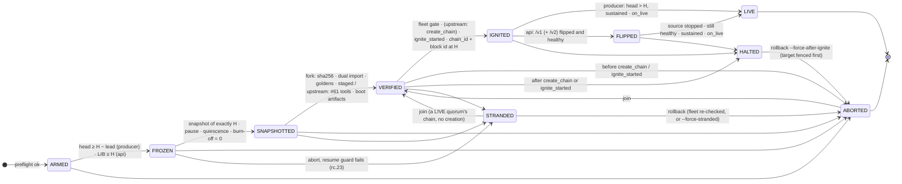

# Design: the pulse-cutover ceremony agent

This is the design of `pulse-cutover`, the agent each producer and API operator runs beside
their nodeos to move a running Antelope chain onto PulseVM at one block, H. It records why the
ceremony is shaped the way it is: the adversarial review that changed the design (the
**R-numbers** that appear in log messages, config comments and the README), the state machine,
the config format, the failure and rollback table, and a sketch of a faster v2.

It describes the code as of **v0.5.0-rc.29** (§3 and §5 carry the rc.21–rc.28 changes; rc.29's guard, authorization and
relay changes are summarised in docs/OPERATOR-QUICKSTART.md §6 and ATOMICITY.md known limit 17; the
review table in §2 was last re-checked at rc.11 and its "Today" column is dated that way). The
first version of this design was written in August 2026, before the multi-producer rehearsal and
several review rounds; where that version differs from today's code, the code wins and the
difference is marked *historical*.

Other documents cover the rest, and this one does not repeat them:

| Document | What it covers |
|---|---|
| [PROCESS.md](PROCESS.md) | The cutover step by step: who does what, the timeline around H, each phase's gate, what apps see |
| [ATOMICITY.md](../ATOMICITY.md) | The five atomicity properties (A1–A5), the evidence for each, known limits, upstream re-qualification list |
| [DESIGN-authority-boundary.md](DESIGN-authority-boundary.md) | The fleet-wide commit-or-abort design (not implemented) |
| [EVIDENCE.md](EVIDENCE.md) | Every recorded rehearsal run, with what it proves and what it does not |
| [EXCHANGES.md](EXCHANGES.md) | For exchanges, wallets and indexers: the head-number step back at the flip, crediting deposits through the federated history, reconciling before re-signing |
| [`examples/*.toml`](../examples/) | Fully commented configs per mode; `src/config.rs` documents every field |

## 1. Scope and design rules

`pulse-cutover` is one Rust binary. Its fork-backend verification imports the snapshot through
the same crates a PulseVM node boots with (`pulsevm_snapshot`, `pulsevm_snapshot_import`,
`pulsevm_chaindb`), so the agent's check and the node's import cannot drift apart. The upstream
backend runs the official MetalBlockchain/pulsevm#61 tools instead (README, "Import backends").

The rules the design keeps to:

1. **Freeze writes, not blocks.** Writes stop at the API edge before H; producers keep making
   empty blocks until H is final (R1, R2).
2. **The cut is exactly H, pinned by height and block id.** Any other height aborts, except in
   explicitly flagged rehearsal modes (R4).
3. **Every node checks its own snapshot.** No trusted snapshot publisher; each operator verifies
   that others match them (R6).
4. **Nothing user-visible before the target is proven.** In producer mode the edge flips at LIVE;
   in API mode at FLIPPED, after ignition and a public health check (R5).
5. **Ignition start is the local point of no return.** Before it, a failure aborts and resumes
   the source; after it, a failure halts and a human decides (R5, as corrected; see §3).
6. **Record everything, fsynced, before acting.** The journal is the evidence and the resume
   mechanism.

## 2. Adversarial review: findings that shaped the design

The first design was attacked before it was built. R1–R10 came from that review; R11 and R12
were found in the first rehearsal; R13–R23 were found in later rehearsals and are listed with
their runs in [EVIDENCE.md](EVIDENCE.md#findings-r13r23). The "Today" column is the rc.11
behaviour.

| # | Attack | Finding | Design change | Today (rc.11) |
|---|---|---|---|---|
| **R1** | "Pause at H, then snapshot" | Deadlock. Leap writes a snapshot only once its block is irreversible, and a fully paused DPoS chain never finalizes H (LIB needs later confirmations). | Freeze writes at the edge; producers keep producing **empty** blocks through H; the snapshot is scheduled at exactly H and lands when H is final; producers pause **after**. | `freeze_strategy = "schedule_at_h"` (requires `snapshot.dir`). The agent schedules the snapshot at ARM and picks up `snapshot-<id of H>.bin` by exact name. If scheduling fails the ceremony aborts; there is no fallback to an immediate snapshot. |
| **R2** | Writes "into the void" around the freeze | A paused nodeos still accepts and acknowledges pushed transactions that are never included: silent write loss. | The freeze is an explicit reject at the API edge (HTTP 503 / tx-acceptance off). Pause alone is never the freeze. | `hooks.on_freeze` closes writes `freeze_lead_blocks` (default 24) before H; a failing hook aborts. The **burn-off audit** reads every block from H+1 to the pause head and aborts on any transaction or unreadable block. |
| **R3** | nodeos version skew | Snapshot file bytes depend on the snapshot format version (Leap 5 writes v6, later versions v7+), so sha256 goldens are version-fragile. Table fingerprints over imported state are not. | Two tiers: fingerprints are the binding cross-node check; sha256 is a strict extra bound to the pinned nodeos version. | `snapshot.expected_sha256` (optional) and `snapshot.golden_roots`; either mismatch aborts. In the upstream backend the whole-state root from `xpr_state_fingerprint` can be compared to `[upstream] golden_state_root`. |
| **R4** | Microforks and late blocks at H | "Snapshot the current head" is ambiguous: a straggler block or an unpaused producer moves head; a node on a microfork snapshots a different block H. | Pin the cut by height **and** block id; after the pause, require a quiescence window of unchanged-head polls; assert the snapshot's block id equals the chain's block id at that height. | As designed. `quiescence_polls` (default 6); late blocks are journaled (first 10) and reset the window; since rc.12 the wait is bounded by `quiescence_timeout_secs` (default 120) and aborts on expiry. *Differs from the August design:* the cut is not re-pinned on late blocks (it is always the scheduled H). |
| **R5** | Partial quorum; the flip racing the target | Half the validators ignite and quorum never forms, or a gateway flips before the target produces. | Ratchet: the user-visible flip happens only after the target serves the source chain_id at the cut **and** its head advances past it. `quorum_timeout` bounds the wait. | LIVE now also needs `live_sustain_secs` (60) of progress with no gap over `live_max_gap_secs` (20). *Corrected since August:* "the source stays authoritative until LIVE" holds only before ignition. From `ignite_started` on, every failure HALTS instead of resuming the source (§3). Fleet-wide, the point of no return is target authorization, which is not implemented ([DESIGN-authority-boundary.md](DESIGN-authority-boundary.md)). |
| **R6** | Where H and goldens come from | An agent must not take H from a chat message, and goldens cannot exist before H. | Two phases: parameters declared before the freeze, goldens co-signed after the snapshot. Each node's trust anchor is its own snapshot. | *The on-chain msig declaration was never built.* H and parameters come from the config or from a signed coordinator event (`pulse-cutover await`: ed25519 keys listed in each node's own config, event/arm/abort messages, optional roster, quorum and plugin hash, arm bound to the event by hash). Goldens are a file (`golden_roots`) or captured with provenance (`capture_roots`). Co-signed goldens are not implemented; the fleet gate compares beacon reports through the relay. |
| **R7** | In-flight transactions at H | Do transactions not included by H replay? Can they be taken cross-chain? | The importer carries the unexpired-transaction dedupe set, so a transaction included at or before H cannot execute again; an unincluded signed transaction can be resubmitted after the cut. | The fork importer carries the dedupe set from the `.bin`; the upstream backend refuses to verify without the `deferred-transactions.json` sidecar that carries it. **TAPOS is not enforced by PulseVM**; enforcement is one of the upstream ignition prerequisites (`upstream::ignite_pending_reasons`). |
| **R8** | Clock assumptions | PulseVM's first block must be timestamped after H's. | NTP is a node requirement; the invariant is recorded, not assumed. | The journal records `last_source_block_time` and `first_post_cut_block_time`. |
| **R9** | A nondeterministic verifier | A flaky fingerprint is worse than none. | Import every snapshot into two fresh arenas and require identical roots before comparing to anything. | As designed (`NONDETERMINISTIC IMPORT` aborts with a per-table diff). Both imports run the same importer, so this catches nondeterminism, not a bug both runs share (ATOMICITY Known limits #5). |
| **R10** | Producer API exposure | `/v1/producer/pause` and `resume` can stop or restart a chain. | The producer API binds to localhost only; the agent runs on the same box; preflight fails at ARM if it is unreachable. | Preflight checks reachability. Since rc.11 the beacon reports `producer_api_private`, from a mission control probe of the node's own public addresses. |
| **R11** | Who may sign the first post-cut block | The target's producer schedule is seeded from its chain genesis `initial_key`, not from imported state. A `producer_key` that does not pair with it builds no blocks. | Pre-stage check that the staged key pairs with the genesis key; upstream: derive the schedule from imported state. | `install.sh` writes the pair from the manifest. Fork backend: the agent does not check it; the LIVE gate catches it (now as a HALT). Upstream backend, producer mode: checked at ARM and before ignition, together with the key `eosio/producers` registers (the migrated system contract re-elects the schedule from it at the first onblock; stage-2 run 1 halted at H+4 on that). Still open upstream: every validator must share one producer name and key (ATOMICITY Known limits #4). |
| **R12** | Stale staged snapshot | The target imports whatever sits at its `snapshot_path` when the chain first initializes. A file left from an earlier attempt pins the chain to the wrong cut. | Refuse to ARM if the staged path exists; the path stays empty until VERIFIED copies the verified file in. | As designed. On resume, a file matching this ceremony's journaled `staged_artifact` hash is accepted; every abort moves the staged file aside (never deletes it). |

## 3. State machine



- **Forward only.** Each transition is one fsynced JSONL journal line with its evidence
  (heights, block ids, hashes, fingerprints, durations). A crashed agent resumes in its last
  journaled state and re-runs that state's step, which is written to be idempotent.
- **Per mode.** Producer: ARMED → FROZEN → SNAPSHOTTED → VERIFIED → IGNITED → LIVE. API mode
  adds FLIPPED, because the source nodeos keeps serving reads until after the public flip.
  Hyperion mode is API mode plus a hydration gate inside IGNITED and a `/v2` flip in the same
  stage. The README's "How it works" section has the per-state detail.
- **Upstream backend.** SNAPSHOTTED → VERIFIED runs the #61 pipeline (export, import, 19-table
  compare, state fingerprint) and, when ignition is configured, builds the boot artifacts:
  the boot manifest anchored on the FULL packed cut block (its computed id must equal the cut
  block id), the migration genesis and the chain config, all hashed into the journal. In
  VERIFIED: refuse XPR mainnet while `ignite_pending_reasons()` is non-empty, journal those
  reasons as warnings otherwise, re-hash the artifacts, run the fleet gate, require a POSITIVE
  "no abort" answer from the coordinator relay (an unreachable relay is unknown, not consent),
  then `create_chain_cmd`. **Its intent record is the local point of no return** (rc.21): a
  creation hook can submit a chain that validators already tracking the subnet start, and its
  outcome can be lost, so from the moment it starts every failure (non-zero exit, no
  `BLOCKCHAIN_ID=`, config install failure, a restart without a journaled id) HALTS instead of
  resuming the source. Its blockchain id is journaled the moment it is printed, reused on
  resume, never created twice. Then bind `{blockchain_id}` /
  `{subnet_id}` / … into the target RPC, ignite command and hooks, install the chain config,
  and only then `ignite_started`. Rehearsal-only overrides (compare allowlist, target chain_id
  change) are refused for mainnet and journaled wherever they act.
- **ABORTED** is reachable only before `create_chain` (upstream) or `ignite_started` is journaled. It resumes the source
  producer (producer mode, if `target.auto_rollback`), restarts the source and reverts flips
  (API mode, if they ran), runs `on_abort`, and moves the staged snapshot aside. The rollback
  counts as complete only when a final `rollback_done` record follows every step.
- **HALTED** is a sealed stop after ignition may have started: nothing is rolled back, `on_halt`
  pages a human, and a restarted run refuses to continue until `pulse-cutover unhalt
  --i-understand`. `pulse-cutover rollback` refuses (exit 3) unless `--force-after-ignite`, which
  first stops this box's target (`target.stop_cmd`) and does not resume the source if that
  fails (exit 4). This is a local fence only.
- **Production profile** (rc.21). A ceremony config must meet one profile, on both backends, at
  load and again right before the write freeze: no rehearsal override, exact cut, no
  `simulate_freeze` or derived H, lineage check on, producer hooks `on_freeze` / `post_ignite` /
  `on_live` / `on_abort`, `schedule_at_h` without the `quiesce_cmd` stand-in,
  `live_sustain_secs` and `post_live_max_idle_secs` above 0, a `post_live_probe_cmd`, and a state
  comparison (upstream `compare_bin`; fork `golden_roots`). Anything else needs
  `[ceremony] rehearsal = true`, which is journaled, shown by `status`, failed as the beacon
  setup check `rehearsal_overrides`, labelled on mission control and refused for XPR mainnet.
- **STRANDED** (rc.23, fleet run r4). A coordinated producer that has to stop after its writes froze
  (FROZEN to VERIFIED, before its own chain creation) resumes the old chain only when its resume guard
  passes (`src/fleet.rs`): the event has a roster and quorum, the relay answered, no other roster member
  is missing, identity-conflicted or ever reported past chain creation (the relay keeps a per-event
  high-water mark per producer that replacing an instance cannot lower), and either fewer than `quorum`
  other members are still in the ceremony (fresh, not ABORTED / STRANDED: the quorum is unreachable
  without this node; with quorum = N any peer's abort suffices, with quorum < N a minority that aborts
  alone strands), or the coordinator signed an abort and every member has some report for the event.
  The check runs twice: after the first pass the agent journals an abort intent (its beacon reports
  `aborting`, which no peer's gate counts), waits until the relay shows that or `report_max_age_secs`
  passes, and re-runs the guard before resuming. This rests on unsigned relay reports at one moment: it
  narrows the r4 split, it does not prove no peer ignites. Anything else ends STRANDED: sealed like
  HALTED, nothing rolled back, `on_halt` pages a human, `run` refuses. It leaves by `pulse-cutover join`
  (see below) or `pulse-cutover rollback`, which re-runs the guard (`--force-stranded --i-understand`
  records an operator's fleet-wide decision with the fleet view it overrides). The agent recognizes its
  own roster entry by its `[beacon] producer` and instance id (derived from the machine id and the token,
  so the ceremony and its beacon agree). `await` refuses a producer-mode event without a roster. Since rc.25
  (fleet run c5) the guard also requires this node's OWN fresh, non-conflicted report for the event on the
  relay: under a signed abort a silent member used to resume while the visible ones stranded (they could not
  account for it). A roster without a `[beacon]`, or a beacon producer outside the roster, is a config warning.
- **Join** (rc.23). `pulse-cutover join --event <id>` lets a STRANDED or ABORTED producer (upstream backend,
  producer mode) track and ignite the chain a LIVE quorum of the roster runs (a unique group: two groups with a
  quorum are a split), without creating one. From ABORTED it first re-runs `on_freeze` (on_abort reopened writes)
  and refuses without one. A join that died after its `join` record is finished by running `join` again. Its boot
  artifacts must be unchanged since VERIFIED, the LIVE members' snapshot sha256, fingerprints and migration
  genesis hash must equal its own, and its source must not have produced past the journaled pause head or
  carry a transaction after H. The `join` record is a point of no return (like `create_chain`); the run then
  continues at VERIFIED without a fleet gate or abort check (the fleet already committed; an abort is not
  honoured after ignition) and goes through ignition, lineage, post_ignite and the LIVE gate.
  `join --reverify` (rc.25, fleet run c3a: a BP whose table compare broke had no route onto the LIVE chain) is for a
  ceremony without VERIFIED evidence only (a verified node uses a plain join). It refuses at once if the source moved
  past its pause head, then re-runs the upstream verification on the journaled cut snapshot (same pipeline, boot
  artifacts rebuilt) and requires all three of snapshot sha256, fingerprints and migration genesis to equal the LIVE
  quorum's. Only then is a `reverified` record journaled (the beacon reports it like VERIFIED evidence), just before
  the `join` record. A re-verification that fails, passes under a rehearsal compare override outside a rehearsal ceremony (rc.26: in a
  rehearsal it is accepted when the LIVE quorum verified under the same allowed set, `compare_allowed_digest` in the
  beacon evidence, and the record carries the override label like VERIFIED does; the same digest is compared on a
  plain join, so a rehearsal join under the allowlist needs rc.26+ beacons on the LIVE members and an rc.26+ relay,
  else it refuses with "compare_allowed_digest missing"; `join` refuses any rehearsal config on a journal whose source
  is XPR mainnet), lacks any of the
  three or does not match refuses with nothing changed on either chain and nothing journaled as evidence (only the
  node's verification work files were rewritten).
- **Degraded after ignition** (rc.23, fleet runs r2–r6). With a coordinated event, a local symptom after
  ignition (a gap in the sustained-LIVE window, the head not past the cut within `quorum_timeout_secs`, a
  failing `post_ignite` / `on_live` hook) consults the fleet first: while a quorum of the roster reports the
  same target chain (same first block after H, heads past it, the fleet's highest head moving within
  `fleet_stall_secs`), the ceremony journals and reports `degraded`, retries hooks with backoff
  (`degraded_retry_secs`, doubling to 120 s) and restarts the sustain window; it halts when the fleet view
  stops vouching, after `degraded_patience_secs` from the first symptom, or when an operator creates
  `operator-halt` next to the journal. It never resumes the source and never reopens writes by itself.
- **Aborts are final.** A signed abort is persisted as a tombstone next to the journal
  (`coord-tombstones.json`) the moment `await` or the ceremony sees it; neither will accept or
  arm that event id again, even if the relay later stops serving the abort or the process
  restarts. Future-dated ARMs are refused; an ARM whose window passed is recorded as `missed`
  and `await` exits 3.
- **Crash recovery.** Exclusive journal lock; torn-tail repair (only a fragment after the last
  newline; a complete corrupt record is fatal); side-effect records written before the effect
  (`staged_artifact`, `ignite_started`, `flip_cmd`, `source_stop_cmd`); hooks run in their own
  process group with a deadline (`hooks.timeout_secs`, default 300) and an orphaned group is
  killed before a resume or rollback. A resume that finds `ignite_started` without IGNITED,
  or `create_chain` without a journaled blockchain id, halts. The fault-injection results for this are in
  [EVIDENCE.md](EVIDENCE.md#linux-fault-injection-rc9-and-rc10).

*Historical:* the August design had no HALTED state. Every failure, including a LIVE-gate
timeout after ignition, rolled back and resumed the source. The single-node rehearsal aborts in
[EVIDENCE.md](EVIDENCE.md#single-producer-demo-dev-chain-2026-08-21) ran under that rule;
today the same failures halt.

## 4. Config format (the ceremony manifest)

On a single node the TOML config is the ceremony manifest. `install.sh` generates it from
`ceremony.json` (README, "The ceremony.json manifest"). The shape, abridged; every field is
documented in `src/config.rs` and the example files:

```toml
journal_path = "/var/lib/pulse-cutover/journal.jsonl"
poll_ms = 250

[ceremony]
mode = "producer"                  # | "api" (hyperion mode = "api" + a [hyperion] section)
freeze_height = 12345              # H; 0 only with derive_h_at_arm = true (rehearsals)
chain_id = "…"                     # pinned source chain id
import_cpu_scale = 143             # fork backend: chain identity, must equal the staged PulseVM chain config; upstream: ignored (warns)
freeze_strategy = "schedule_at_h"  # R1; "pause_at_h" is single-producer rehearsal only
freeze_lead_blocks = 24            # writes close this many blocks before H
quiescence_polls = 6               # R4
quiescence_timeout_secs = 120      # R4: abort if head never stops after the pause
import_backend = "fork"            # | "upstream" (ignites from the #61 checkpoint when configured, see README)
# allow_inexact_cut / simulate_freeze: rehearsal-only escapes from exact H, journaled loudly

[source]
rpc_url = "http://127.0.0.1:8888"
producer_api_url = "http://127.0.0.1:8888"   # localhost only (R10)
snapshot_timeout_secs = 600

[snapshot]
staged_path = "/var/lib/pulsevm/snapshot-cut.bin"   # the chain config's snapshot_path; must not exist (R12)
dir = "/var/lib/nodeos/snapshots"                   # where snapshot-<id of H>.bin lands
golden_roots = "golden-roots.txt"                   # verify mode, or:
# capture_roots = "captured-roots.txt"              # first node / rehearsal (mutually exclusive)
# expected_sha256 = "…"                             # strict tier (R3)

[target]
metalgo_unit = "metalgo-pulse"
rpc_url = "http://127.0.0.1:9650/ext/bc/<chainID>/rpc"
live_blocks = 1
quorum_timeout_secs = 600
live_sustain_secs = 60
live_max_gap_secs = 20
require_lineage_check = true

[hooks]
on_freeze   = "…"   # close writes at the edge (required to succeed)
post_ignite = "…"   # first transactions: PulseVM builds blocks on demand
on_live     = "…"   # flip the edge, reopen writes (producer mode)
on_abort    = "…"   # reopen writes on the old chain
on_halt     = "…"   # page a human; must not undo anything

[beacon]                           # mission control reporting; a coordinated producer needs it
url = "https://control.example/api/report"
producer = "bp1"                   # must be in the event's roster
network = "testnet"
token_file = "/etc/pulse-cutover/beacon.token"

[coordination]                     # signed arming (`await`) + the pre-ignite fleet gate
url = "https://control.example"
network = "testnet"
coordinator_keys = ["<ed25519 hex>"]
auto_arm = false                   # a signed ARM also needs confirm-<event_id> next to the journal
fleet_quorum = 3                   # roster/quorum come from the signed event; await writes them,
                                   # event_id and event_hash into the derived config
# [flip] / [hyperion]: api and hyperion modes. [upstream]: the #61 pipeline. [loop]: loop harness.
# Every field, with its default: examples/ceremony.toml.
```

*Historical:* in the August design `post_ignite` failures were journaled and ignored, and
`on_live` ran after LIVE. Since rc.6/rc.7 both must succeed: `post_ignite` runs after ignition
(so a failure halts), and `on_live` runs before LIVE is journaled (a failure halts rather than
recording a LIVE that never reached users). Run 5 of the multi-producer rehearsal is why.

**Trust model, multi-producer.** Each producer's agent takes its own snapshot from its own
nodeos, verifies it (dual import, fingerprints, optional goldens), and ignites only after its
own checks pass and, with `[coordination]`, after `fleet_quorum` roster members report the same
snapshot sha256 and fingerprint digest with fresh, healthy beacon reports. No snapshot is
downloaded from anyone. What is still missing (signed per-producer votes, threshold
coordinator keys, a durable certificate) is listed in ATOMICITY Known limits #1 and #3 and
designed in [DESIGN-authority-boundary.md](DESIGN-authority-boundary.md).

## 5. Failure and rollback table (rc.21: chain creation is past the point of no return)

"Abort" = ABORTED with rollback (§3). "Halt" = HALTED, sealed, nothing reverted.

| Failure | Detected by | State | Response |
|---|---|---|---|
| H not in the future (head for producers, LIB for API nodes); chain_id mismatch; producer already paused; producer API unreachable; public URL not serving the source (API mode); staged path exists; goldens file missing | preflight | ARMED | abort (nothing has changed yet) |
| Snapshot cannot be scheduled at H | `schedule_snapshot` error | ARMED | abort; no fallback to an inexact cut |
| Config does not meet the production profile and is not marked `rehearsal = true`; a rehearsal against XPR mainnet | config load; again before the freeze | — / ARMED | refused / abort |
| Signed coordinator abort (or an abort tombstone from earlier) | `[coordination]` poll (every 3 s while waiting; before every upstream pipeline step and while each tool runs, killing it) | ARMED–VERIFIED | abort |
| Coordinator relay does not answer when chain creation or ignition needs a positive "no abort" | 30 s of polls | VERIFIED | abort (before create / ignite_started) |
| Write freeze hook fails | `on_freeze` exit / timeout | ARMED | abort |
| H does not finalize, or the scheduled file never appears | `snapshot_timeout_secs` | FROZEN | abort |
| Snapshot not at H | exact-H check | FROZEN | abort (rehearsal flags journal and continue) |
| Pause does not take effect; `quiesce_cmd` fails | producer API; hook | FROZEN | abort |
| Head keeps moving after the pause | quiescence window | FROZEN | late blocks journaled; the window waits up to `quiescence_timeout_secs` (default 120), then ABORT (before ignition: `on_abort` reopens writes) |
| Snapshot block id ≠ chain's block id at H (fork at the cut); chain_id changed | block lookup | FROZEN | abort |
| Any transaction in H+1…pause, or an unreadable block, or an answer that is not that block with a `transactions` array | burn-off audit (fails closed) | FROZEN | abort |
| sha256 ≠ manifest; imported head, chain_id or block id ≠ the pinned cut; fingerprints ≠ goldens; staged copy hash differs | verify | SNAPSHOTTED | abort |
| Two imports disagree | dual import (R9) | SNAPSHOTTED | abort; a VM bug to report upstream |
| Upstream: export/import/fingerprint fails; sidecar missing or inconsistent; artifact not bound to the cut; no `compare_bin`; `xpr_19_table_compare` fails (on a table not in `rehearsal_allow_compare_mismatch`, with a signature other than that table's known difference, or naming no table) or exits 0 without a matching line for every required table; no non-empty `state_root` | upstream pipeline | SNAPSHOTTED | abort |
| Signer material: chain config would land in a group/world-writable or foreign-owned directory; a private key in `genesis_base` (shared) | preflight; write time | ARMED / SNAPSHOTTED | abort |
| Upstream: the full cut block cannot be fetched, does not pack, or its computed id ≠ the cut block id; boot artifacts cannot be written | boot artifacts | SNAPSHOTTED | abort |
| Rehearsal override configured for XPR mainnet | config load / preflight | — / ARMED | refused / abort |
| Upstream, verify-only config (no `genesis_base` + `create_chain_cmd`); XPR mainnet while `ignite_pending_reasons()` is non-empty | upstream ignite preflight | VERIFIED | abort with the remaining list |
| Upstream, producer mode: the signing key (chain config `producer_key` = genesis `initial_key`) is not what `eosio/producers` registers for `producer_name`, or that producer is unregistered / inactive | producer key check | ARMED, VERIFIED | abort |
| Upstream: a boot artifact missing or changed since VERIFIED | re-hash | VERIFIED | abort |
| Fleet does not agree before `fleet_timeout_secs` | fleet gate | VERIFIED | abort (rc.23, coordinated: only if the resume guard passes; else STRANDED) |
| Any abort after FROZEN in a coordinated producer ceremony, when the event has no roster, the relay does not answer, a roster member is missing, stale, conflicted or ever reported past chain creation, or at least `quorum` other members are still in the ceremony (no signed abort) | resume guard (rc.23, checked twice around the abort intent) | FROZEN–VERIFIED | STRANDED: source stays paused, writes frozen, `on_halt`; `join` or `rollback` (re-checked / `--force-stranded`) |
| — `create_chain` journaled (upstream) — | | | |
| Upstream: `create_chain_cmd` fails or prints no `BLOCKCHAIN_ID=`; a previous run started it without journaling an id; the chain config cannot be installed; a signed abort after creation | create_chain | VERIFIED | halt (a chain may exist and be starting: fleet decision) |
| — `ignite_started` journaled — | | | |
| Ignite command fails; target not up before `quorum_timeout_secs`; target chain_id ≠ source (unless `rehearsal_allow_chain_id_change`: accepted, both ids journaled) | ignition | VERIFIED | halt |
| Target block id at H ≠ cut block id, or not verifiable with `require_lineage_check` | lineage check | VERIFIED | halt |
| `post_ignite` fails; head never passes H + `live_blocks`; a gap over `live_max_gap_secs` in the sustain window; `on_live` fails | LIVE gate | IGNITED / FLIPPED | halt; rc.23, coordinated: degraded (wait, retry hooks) while a quorum reports the same target chain, halt when that stops, patience ends or `operator-halt` exists |
| Hyperion does not hydrate; flip command fails; public URL does not serve the target's block at a common height above H; `/v2` gate fails (no live local source or no VALID boundary); boundary file cannot be written; source stop fails | api/hyperion stages | IGNITED / FLIPPED | halt |
| No new target block for `post_live_max_idle_secs` (unless the probe passes on a quiet chain), `post_live_probe_cmd` fails, head goes backwards, or the target RPC serves another chain_id | beacon / `status` after LIVE | LIVE | reported only: HEALTH check `target_live` fails (mission control red); never an automatic rollback |
| Agent crash | journal replay | any | resume the current step; halt if `ignite_started` has no IGNITED, or `create_chain` has no journaled id |
| Operator `rollback` after ignition | `past_point_of_no_return` | IGNITED+ | refused (exit 3) unless `--force-after-ignite`, which fences this box's target first |

The invariant behind the table: before chain creation or ignition starts, resuming the paused
producer and reopening writes is the whole source-side rollback; after it, only a fleet-wide
decision may resume the source. That decision has no protocol yet. Moving the local boundary
before chain creation (rc.21) stops ONE agent from resuming its source next to a chain that may
already exist; it does not make the boundary fleet-wide: another producer that aborted before its
own boundary still resumes its source. A fleet-wide point of no return needs an upstream
**sealed start** (a target that cannot produce until a durable, fleet-signed commit exists) and
durable source fencing. Until both exist, a public cut must not be scheduled (ATOMICITY Known
limits #1).

The 5-BP fleet run on the upstream stack (2026-10-06) showed both halves of this: every healthy run
ended with LIVE and HALTED BPs on one target chain (each BP judged liveness on its own view), and in
run r4 a BP that lost the relay before its chain creation aborted at its fleet timeout and resumed
the old chain while its four peers had ignited (33 writes after H). rc.23 changes the local rules so
that each agent consults the fleet before the two decisions that split it: before resuming the old
chain after the freeze (resume guard, STRANDED, `join`) and before halting after ignition (degraded).
It does not change what the boundary is: those rules read unsigned relay reports, an agent that
cannot reach the relay strands rather than decides, and nothing stops the old chain continuing after
H. The upstream sealed start, a fleet-signed COMMIT/ABORT certificate the agents verify, and a
protocol guard against the old chain producing after H are still what a public cut needs
(ATOMICITY Known limits #14).

Mission control's fleet verdict watches the old chain without a fixed burn-off bound (rc.24): a source head above the
highest published pause head (only when every paused member published one), or the source head moving after every
member has paused and one is past chain creation (the relay keeps each member's first and highest source head from
that point). A fixed bound (rc.23: cut + 360) cannot fit real finality lag: the 5-BP rehearsal paused correctly at
cut + 377 and latched a false SPLIT. This is display evidence only, as above.

rc.27: the verdict is **STALLED** when a quorum of the LIVE members' beacons report `target_live` failing (fleet run
f1 halted the target with a schedule change while the board kept showing LIVE), and `warnings` list members whose
target loaded a different protocol upgrade schedule or cannot run the next scheduled protocol version. The agent side
of the protocol schedule (`upstream.protocol_upgrades_file`): validated with PulseVM's rules and kept
`protocol_upgrade_margin_blocks` clear of H at ARM and at verification, its canonical hash (PulseVM's `PVMUPG01`
encoding) is VERIFIED evidence the fleet gate and `join` compare, it is installed as `upgrade.json` next to the
chain config, and after ignition the target's `getInfo` must report the same hash and a `supported_protocol_version`
at least the highest scheduled one, else the ceremony halts before IGNITED (a target that does not report the fields,
or cannot be read, halts too when any version > 1 is scheduled). rc.27 is a fleet-wide upgrade: on the upstream
backend a peer without `protocol_schedule_hash` (an older agent) never agrees at the gate, and the gate journals
"evidence differs from ours: protocol_schedule_hash missing" for it; a VERIFIED journal from an older agent must use
`join --reverify`. The schedule may not schedule a version above the pinned PulseVM's `supported_protocol_version`
(stricter than PulseVM, which allows future entries before activation), and `protocol_upgrade_margin_blocks = 0` allows
an activation at H+1, the first new block. Past-creation evidence counts from ANY of a producer's instances, not only
its freshest report; a report for another H that is past creation blocks a resume (agent) and is a warning on the
board, never a clean ABORTED/STRANDED verdict. rc.28: mission control keeps a **creation-evidence log** per producer
(`creation_evidence` in `/api/status`): every accepted report past chain creation is an observation {id, event_id, H,
state, instance, target chain, block after the cut}, whether or not its event is published and whatever its H. The
log is persisted with the server state (independent of the coordinator store), never trimmed and never changed by
later reports; at 128 observations per producer it sets `overflow`, which blocks like an observation. The agents'
resume guard blocks on any observation for its event (any H) and on an overflowed log; the verdict treats a same-H
observation as past creation and another-H ones or overflow as warnings that rule out a clean ABORTED/STRANDED.
Retiring evidence is an explicit operator act on the mission-control host, after checking THAT target is fenced:
`POST /api/admin/clear-server` (an obsolete instance) and `POST /api/admin/retire-evidence?net=&producer=&id=` (exactly
one observation, by id; `&overflow=1` for the flag); every other observation keeps blocking. Observations at this
event's H from another event, and unattributed ones (no event id, quarantined), block too; a report that is ABORTED
after creation / ignition / a join started is logged; retiring an event's last observation clears its `past_create`
mark; a malformed log refuses startup, and after a failed write the relay refuses changes until restarted. Until then a
STRANDED agent stays sealed (or the operator records a fleet decision with `rollback --force-stranded`). The
post-ignition protocol check uses the schedule VERIFIED journaled (entries, highest version, emptiness), never the
file as it is now; a JSON-RPC error from getInfo is retried like a transport failure (5 reads, up to ~80 s with the
client timeouts) before the ceremony halts.

rc.25 (fleet run c1): with quorum = N the verdict flapped LIVE↔DEGRADED whenever one beacon's target read timed out,
because the beacon then also dropped its block after the cut. The beacon keeps that block id (it never changes on one
chain) and reports `target.unread_for_ms`; mission control and the agent's live view count such a member on its chain
for up to 60 s of failed reads (`UNREAD_GRACE_MS`), then drop it. In degraded mode (rc.25 F2) a fleet view merely
short of quorum gets a bounded grace (`degraded_fleet_short`, at most 120 s per agent run: it is not journaled, so a
restart grants it again), HALTED members count when their beacon still reads a target head past the cut (a halt
never stops the validator, so in practice they still run the chain), and an `unhalt` restarts the degraded patience.
A fork of this node ends degraded mode at once only when its own block after the cut can be read. HALTED members
count in the agent's live view but not in mission control's LIVE group or in `join`, so an agent can see a healthy
fleet while the board shows DEGRADED.

## 6. v2 "shadow mirror" (sketch, not implemented)

In v1 the write gap is dominated by the source chain's finality wait plus snapshot and
verification time. On the live XPR testnet the finality wait alone was about 93% of a
~190 s API-mode gap ([EVIDENCE.md](EVIDENCE.md#api-mode-loop-statistics-n22)),
and snapshot creation grows with state size. v2 would take both off the critical path:

- **Baseline.** Each PulseVM node boots its arena from a recent snapshot (v1 machinery,
  unchanged), then continuously applies the source chain's SHiP state deltas, **irreversible
  deltas only** (fork-safe by construction; mirror lag ≈ LIB lag).
- **Checkpoints.** At every periodic source snapshot the mirror computes its table roots and
  compares them with a fresh import of that snapshot. Divergence detection reuses the
  fingerprint primitive. On divergence: discard the mirror, rebaseline from the latest snapshot,
  report the delta trace upstream.
- **At H.** The mirror drains deltas to exactly H, runs the golden check and ignites. The write
  gap becomes the final drain plus fingerprint time.
- **Fallback.** The v1 path stays staged for every ceremony. A mirror that fails its final check
  falls back to v1 at the v1 cost. v2 is an optimization, never a new trust root.
- **Needs.** A SHiP state-delta reader keyed to the pinned nodeos version (delta schemas are
  version-coupled); the existing arena writers; TAPOS block-summary import (R7) so the mirror
  carries it before PulseVM enforces TAPOS; schedule derivation from imported state (R11); and,
  optionally, restart-less ignition (load the snapshot on chain retry instead of restarting
  metalgo), which would also cut the ignite step (8.3–14.4 s in the single-node runs).

None of this is scheduled.

## 7. Readiness drill (r30, risk register D-7)

**Purpose.** Rung 4 of the mainnet test ladder ([HOW-IT-WORKS.md](HOW-IT-WORKS.md#7-how-it-gets-proven-before-mainnet)):
every producer proves, on the live chain and with no state or write impact on it, that its own infrastructure cuts exactly H and
converts it to the same state as everyone else, and measures how long that takes. Nothing else can show this
before a real event: rehearsals use rehearsal nodes, a drill uses each producer's real nodeos and hardware.

**Shape.** A separate command, `pulse-cutover drill --config <ceremony.toml> --height H`, in its own module
(`src/drill.rs`). It does not go through the state machine and never opens the ceremony journal for writing.

1. Refuse unless the config uses the upstream backend with `compare_bin` and `snapshot.dir`, and (round 4) the
   drill's own structural requirements hold: `[upstream] export_image` (a plain image reference),
   `export_tools_dir` (an absolute real directory whose `export.sh` is a plain single-named file) and
   `chain_state_db_size_mb` are set; `import_bin`, `compare_bin` and `fingerprint_bin` are absolute paths to
   single-named regular files that are native executables (ELF, or Mach-O on macOS), not scripts, not links, not
   writable by group or others; and `source.producer_api_url` has no query, fragment or credentials. Before creating anything, refuse when any path the drill writes
   overlaps (after resolving symlinks) `snapshot.staged_path`, the journal, `upstream.work_dir` or `snapshot.dir`:
   the whole drill root (each drill's work files, `latest.json` and its temp file, the cancel and lock files) and
   the journal's lock file; and (round 3) refuse when any of those paths already exists as a symlink or a file with
   other names (a hard link), since writing through it could overwrite a protected file. The drill never writes
   through a link: its log is opened with `O_NOFOLLOW`, and `latest.json.tmp`, the cancel file and the copied evidence
   are written as fresh inodes (any old name unlinked first, then `O_EXCL | O_NOFOLLOW`). Then take the ceremony's own exclusive journal lock (`<journal>.lock`) AND the drill
   root's lock (`drill/drill.lock`, because configs that share a journal directory share `latest.json` whatever
   their journal file names), and hold both for the whole drill, so a ceremony and a drill, or two drills, exclude
   each other atomically. Refuse while the ceremony journal is in progress, sealed, unfinished or LIVE
   (only no journal, an empty one or a finished ABORTED may run next to a drill), while another drill is RUNNING,
   for H < head + 20, and for an H already drilled on this box (the
   `drill/<H>` directory is claimed with an atomic create).
2. `schedule_snapshot(H)` (the same producer-API call ARM makes), recording the producer API's
   `snapshot_request_id` in the drill log and `latest.json` together with the producer API it was made on
   (normalised) and its height: a producer-local id means nothing on another node (round 3). No freeze, no pause, no burn-off gate: the chain
   keeps producing, and the blocks after H are recorded as information only.
3. Wait for LIB ≥ H, pin H's block id, pick up `snapshot-<id of H>.bin`, hash it.
4. Run the upstream pipeline (export → import → compare → fingerprint) in `<journal dir>/drill/<H>/work` in its
   ARGUMENT-VECTOR mode (`upstream::run_pipeline_exec` with `PipelineExec::Argv`; the ceremony's `run_pipeline` is
   unchanged and still runs its shell strings): the export is the fixed vector `docker run --rm --network none
   -v <export dir>:/out -v <snapshot>:/in/cut.bin:ro -v <export_tools_dir>:/xce:ro --entrypoint bash <export_image>
   /xce/export.sh --nodeos /usr/local/bin/nodeos --xpr-core /src/leap --snapshot /in/cut.bin --work-dir /out/export
   --chain-state-db-size-mb <n> --timeout-seconds 7200 --deferred-sidecar /out/deferred-transactions.json`
   (`upstream::drill_export_argv`), and the three tools run by argument vector with the pipeline's arguments. No
   shell runs anywhere, and `upstream.export_cmd` is never used by a drill. The rehearsal compare allowlist and any
   pinned `golden_state_root` are cleared: the drill reports the TRUE compare result. When the compare fails, the
   drill still fingerprints the checkpoint (same tool and arguments, by vector), because comparing producers' state
   is half of what it measures.
5. Journal every step in `<journal dir>/drill/<H>/drill.jsonl` (`kind = "readiness_drill"` on every line), publish
   `<journal dir>/drill/latest.json`, keep the compare report and checkpoint manifest, delete the multi-GB work
   files unless `--keep-work`.

**What it costs.** No state or write impact, but CPU, RAM (13.7 GB peak on mainnet state) and disk, and nodeos
writes the snapshot at H synchronously: on a producing node that can cost blocks in its own round. Prefer a
non-producing node with the same snapshot directory, or an H outside the producer's round. A drill that fails or
is cancelled before H is final removes its pending request, by the request id it recorded and never by height (a
ceremony may hold its own request at the same height): the guard refuses an unschedule by height outright and an
unschedule of any id but the drill's own. Without a recorded id nothing is removed (recorded; the operator removes
it by hand).

**No shell, by construction (round 4).** Rounds 1–3 scanned the configured conversion commands and the wrapper
scripts they named for references to hooks or stop/create/ignite commands; every review round found another way past
the scan (quotes, `cd` and relative wrappers, `..` through a symlink, hard links, variables, `PATH`). The scanner is
gone. A drill runs no configured text at all: the export is the fixed `docker run` vector above, built only from the
validated `export_image`, `export_tools_dir` and `chain_state_db_size_mb`, and the three tools must be native
executables run by argument vector. The guard refuses `run_long` / `run_long_cancellable` (shell) outright and lets
`run_argv_cancellable` start only `docker` and the three validated tool paths. What remains trusted is what any
operator trusts: the published sidecar image, the official `export.sh`, and the official tool binaries.

**Pinned content, local daemon, no inherited environment (round 5).** A native-executable check alone still
admitted `/bin/bash` as a "tool" (the import step would then run the export-produced log as shell). A drill now runs a
program only when its content matches a configured pin: `import_bin_sha256`, `compare_bin_sha256`,
`fingerprint_bin_sha256` and `docker_bin_sha256` (64 lowercase hex), checked at load and again by the guard right
before each run, and the export image only by digest (`name@sha256:<64 hex>`; a tag can be moved). Docker is run by
absolute path (`docker_bin`, never looked up through PATH) and always with `--host unix://<docker_socket>`
(default `/var/run/docker.sock`, which must be a unix socket, not a link); the guard refuses a docker vector without
it. Every argument-vector run gets a cleared environment (a fixed PATH, HOME and LC_ALL only), so no `DOCKER_HOST`,
`DOCKER_CONTEXT`, `DOCKER_CONFIG` or `LD_PRELOAD` reaches it. Residual: a file could change between the guard's hash
and the exec; each pinned file must be single-named and not writable by group or others (checked again at that
moment), so only its owner could swap it, and the owner can already run anything (exec through the hashed file
descriptor is not portable). The beacon reports the pins and their digest (`tools.tools_digest`); mission control
calls producers in agreement only when they ran identical pinned tools on identical state.

**The export container (round 5).** Killing the docker CLI does not stop the daemon-managed container. The drill
names the container (`pulse-drill-<H>-<random>`, `--cidfile` in the drill directory) and records the name before it
can exist (`export_container` in `latest.json`, `export_container_gone: false`). After the pipeline, whatever its
outcome, and on every failure or cancel, it runs `docker kill` and `docker rm -f` on that name through the pinned CLI
and the local socket, then `docker inspect` until the daemon answers "No such object" (any other answer is unknown,
never gone). Until then `activity` reports the drill RUNNING whatever `latest.json` says (a ceremony's ARM keeps
refusing), the drill ends FAILED-INCOMPLETE, and `--cancel` of a dead drill retries the stop and reports INCOMPLETE
until the container is verified gone.

**One producer, one lock (round 5).** Configs on the same producer but with different journal directories took
different journal and drill-root locks and read different `latest.json` files. A third lock is keyed by the
normalised `source.producer_api_url` and lives in nodeos's snapshot directory
(`<snapshot.dir>/.pulse-cutover-producer-<16 hex>.lock`): the one resource a drill and a ceremony on one producer
necessarily share, the same path for every process (a `/run` path would differ between root and non-root agents).
Without a snapshot directory it falls back to the journal directory. A drill and `--cancel` hold it with the other two
for their whole run; a ceremony takes it at ARM and holds it for its run (a fresh ARM, or one resumed while ARMED,
refuses while it is held; after the freeze a busy lock is a loud warning, the cut continues). Lock order everywhere:
journal lock, drill-root lock, producer lock; every acquisition is a bounded try-lock, so nothing can deadlock.

**Process groups (round 4).** The drill's tools run in their own process group with a record written as a fresh
inode (`O_CREAT | O_EXCL | O_NOFOLLOW`, exactly one name; an old name is unlinked first, never written through).
A tool run ends only when `ps` positively shows its whole group gone: a group that survives the kill (self-cancel,
timeout, or descendants still running after the tool exits), or whose state `ps` cannot report (missing, refused,
non-zero, unparseable: "unknown" is never "stopped"), KEEPS its record and the run fails as INCOMPLETE. The drill
then stays RUNNING (`stage = stop_incomplete`, work files kept) and `activity` reports it RUNNING whatever
`latest.json` says while the recorded group is alive or unknown, so a ceremony's ARM keeps refusing until
`pulse-cutover drill --cancel` has really stopped it. The ceremony's shell steps keep their behaviour, except that
their process-group record is also written as a fresh inode (never through a symlink).

**Both ways exclusive.** A fresh ceremony's ARM preflight refuses while `drill/latest.json` is RUNNING with a live
drill process (same pid and start time) or a live pipeline process group; a RUNNING record with nothing alive is
journaled as `readiness_drill_stale` and does not block. While a drill runs it also holds the journal lock, so
`run` cannot even open the journal. `pulse-cutover drill --cancel` writes `drill/<H>/cancel` (the drill checks it
while waiting for H and as the pipeline's cancel check, which stops the running tool), waits up to 60 s, then stops
the pipeline's recorded process group (start-time checked, never pgid 0 or 1) and verifies it is gone. If the kill
failed or the group is still alive, the cancel is INCOMPLETE: nothing is marked finished (the record stays RUNNING,
so a ceremony's ARM keeps refusing) and the command exits non-zero. If no drill process is left, it takes the same
two locks a drill takes (a ceremony or another drill holding them refuses the cancel), refuses next to a ceremony
in progress, removes only the snapshot request id that drill recorded, and marks it FAILED (cancelled).

Round 3: `--cancel` makes every check before writing anything (the output-path overlap and link checks; for a drill
whose process is not alive, the two locks, the ceremony check, and the request's binding: it must have been made on
this config's producer API, for this drill's H). A refused cancel writes nothing. An incomplete cancel KEEPS the
pipeline's process-group record (it is removed only when the group is verified gone), so the drill keeps showing as
RUNNING and a ceremony's ARM keeps refusing until the work is really gone. The request is removed only while it is
still the single-block request at the recorded H on that node.

**The ceremony holds the drill-root lock too** (round 3). Configs that share a journal directory share
`drill/latest.json` but lock different journal files, so a drill under another journal name could start next to a
ceremony (or be starting, not yet RUNNING in `latest.json`, when the ceremony's ARM checked). A ceremony's run takes
`drill/drill.lock` before its drill check and holds it for the whole run: a fresh ARM refuses when it is held; a
resumed ceremony is never refused for it mid-cut (it journals `readiness_drill_lock_busy` and continues). Lock order
everywhere: the journal lock, then the drill-root lock (drill, `drill --cancel`, ceremony), so there is no cycle;
every acquisition is a bounded try-lock.

**Why it cannot change anything.** The drill never holds the raw `ChainOps`: every call goes through `DrillGuard`,
which passes read-only calls, `schedule_snapshot` and the four validated programs by argument vector, and refuses (and records) every shell command and (and records) pause,
resume, `create_snapshot`, ignite, hooks, orphan-hook kills, target reads and target binding. A drill that even
tried one fails. It runs no hook, so no write freeze, flip, stop or chain creation can happen; it never reads or
writes `snapshot.staged_path`; its pipeline uses its own work dir and its own process-group file, so a ceremony's
orphan-hook cleanup and a drill cannot kill each other's processes.

**Mainnet.** A drill is allowed on XPR mainnet without any override; the config is loaded with the normal rules, so
rehearsal overrides stay refused for mainnet. A readiness-profile config (the one `beacon-install.sh` writes) can run
a drill once it has `[upstream]` and `snapshot.dir`.

**Reporting.** The beacon publishes `latest.json` as a top-level `drill` field (never inside `ceremony`). Its
`fingerprints_digest` is computed exactly as a real VERIFIED record's (`{"upstream_state_root": root}`), so drills
and ceremonies compare directly. Mission control validates the field (`projectDrill`), compares producers per drill
height (`drillComparison`: same block at H, snapshot, state root, compare result, timings) and shows a separate
READINESS DRILL panel. Drill data never feeds the fleet verdict, the agreement table, the creation-evidence log or
any agent decision; an invalid `drill` field is dropped on its own (`drill_invalid`), never the whole report, and a
DONE drill counts toward agreement only with a block id at H, a snapshot hash and a fingerprint digest. `status` prints the latest drill on its own line, labelled as not a ceremony, and `report`
bundles `drill-latest.json`.

**Exit codes.** 0 = evidence complete and the compare matched; 5 = evidence complete, the compare did not match;
1 = the drill failed.

**Not covered.** The finality wait it measures is the live chain's, not a frozen fleet's; the snapshot write is
timed as "LIB ≥ H → file present". Peak memory is not measured by the agent (use the host's own monitoring). H is
typed by each operator; a signed coordinator drill event is a possible follow-up.

**A ceremony and a drill on one box** (rc.30 round 4). A fresh ceremony, or one resumed while still ARMED, refuses to
arm while a drill holds the drill lock or is running. A ceremony resumed **after its freeze** is never refused: it
stops the drill (cancel file, then a kill of the drill's recorded process group that keeps the record unless the group
is proven gone), re-takes the lock and journals `readiness_drill_stopped_for_the_cut`, or a loud
`readiness_drill_not_stopped` if it cannot confirm the drill stopped. A cut in progress is never stranded by a drill. The
cancel file is written as a fresh inode inside the journal directory (whatever name sits there, a symlink or a hard
link to the journal, is unlinked first, never truncated through; every directory on the way must be a real directory;
round 5).

**Round 6 (rc.30).** *Undo only what this journal did*: a source pause and a write freeze are journaled as side
effects (`source_pause`, `write_freeze`) before they happen; a rollback resumes only a producer this journal paused,
runs `on_abort` only after its own freeze, and moves a staged file aside only for a ceremony that could have staged
it. A ceremony refused at ARM (a busy lock, a producer someone else paused) ends ABORTED with `nothing_to_undo` and
touches nothing; a later `rollback` is a no-op. Journals from older agents (no `undo_tracking` on their arming
record) keep the previous behaviour. The per-producer lock moved from nodeos's `snapshot.dir` into an agent-owned
`lock_dir`, keyed on the canonical snapshot directory (producer API spellings collapse); only "held by another
process" refuses an ARM. A drill writes a work marker beside that lock (`<lock>.work.json`, fresh inode) before its
work starts and removes it only once its work is verified gone, so a ceremony in another journal directory still
sees an export container or pipeline group that outlived the drill process: it refuses to ARM next to it, and after
its freeze asks it to stop and warns. `loop` fails closed on a source that does not answer (unless
`reset_when_source_down`, refused for mainnet) and holds the producer lock through `reset_cmd`.
