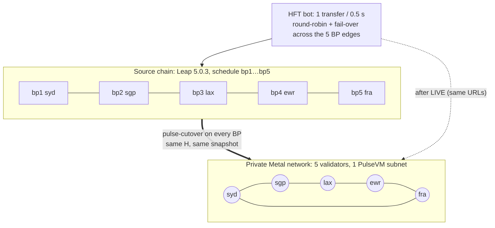
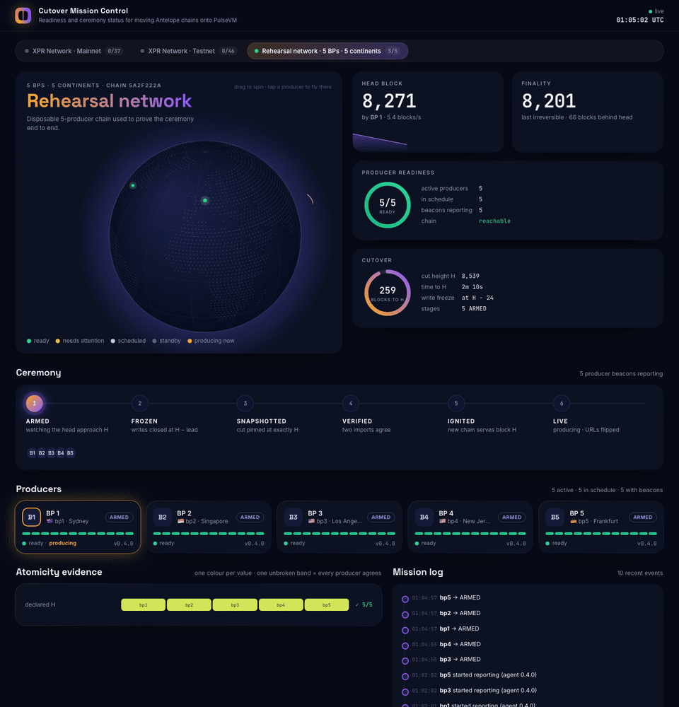
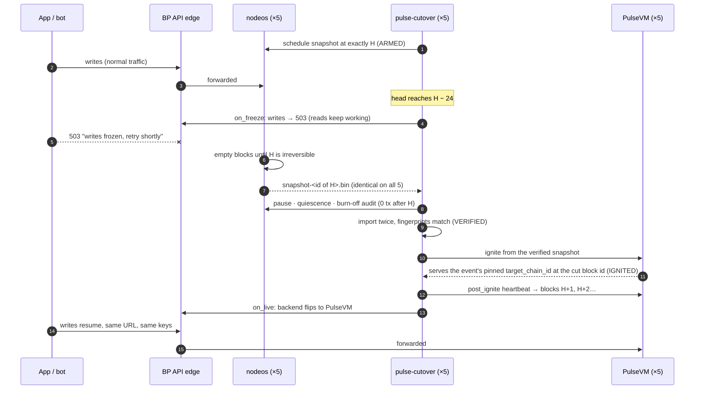

# Recorded evidence

Every rehearsal run behind the numbers in the README, [PROCESS.md](PROCESS.md) and
[ATOMICITY.md](../ATOMICITY.md), with what each one proves **and what it does not**. All
figures are read from the runs' fsynced journals or, for client-side availability, from an
external probe that ran off the box. The journals and logs are kept with the rehearsal notes;
this page is the public record of what they show.

Design context (state machine, R-numbers, failure table): [DESIGN.md](DESIGN.md).

## Read this first: what none of these runs cover

Every run below used a **fork build** of the PulseVM plugin (the `feat/arena-snapshot-import`
branch; the multi-producer runs used the `v0.0.0-arena-mempoolfix.1` lineage) on **metalgo
1.13.5, plugin protocol 43**. None ran upstream PulseVM **v1.0.0** (protocol 45, metalgo 1.14.x). The exception is the [upstream-stack fleet runs](#upstream-stack-fleet-runs-october-2026) of October 2026
and the [target-chain checks](#target-chain-checks-on-the-7-box-fleet-2026-10-19), which ran upstream v1.0.0 on metalgo 1.14.2.
The multi-producer runs used a **private** Metal network, not Tahoe, and every validator
**shared one producer name and key**. No mainnet event has run. The re-qualification list for
the intended stack is in [ATOMICITY.md](../ATOMICITY.md#upstream-stack-re-qualification).

The agent has also changed since most of these runs. The main differences, noted per run:

- Since rc.6, a failure after ignition starts **halts** (sealed; the source is not resumed). The
  August runs predate this: their post-ignition aborts rolled back automatically.
- Since late September (just before the multi-producer rehearsal), **any** transaction in the
  burn-off window aborts. After run 5 of that rehearsal, `post_ignite` and `on_live` were made required.
- Since rc.5/rc.6, every mode must cut at **exactly H**, API mode schedules its snapshot at H,
  and the target's block id at H is checked. None of this has run against a real chain yet
  (ATOMICITY Known limits #2).
- The LIVE gate now requires `live_sustain_secs` (60 s) of progress with no gap over
  `live_max_gap_secs` (20 s). The August runs and the multi-producer runs passed LIVE on the
  first block past the cut.

## Summary

| Run set | Date | Source chain | Target | Mode | Result |
|---|---|---|---|---|---|
| [Single-producer demo](#single-producer-demo-dev-chain-2026-08-21) | 2026-08-21 | Leap 5.0.3 dev chain, 1 producer | fresh Tahoe subnet | producer (`pause_at_h`) | 1 LIVE (cut = H, write gap 15.0 s), 2 correct aborts |
| [API mode, live XPR testnet](#api-mode-on-the-live-xpr-testnet-2026-08-21) | 2026-08-21 | node synced to the live XPR testnet | Tahoe (headline), local 1-node network (loop) | api (`simulate_freeze`) | LIVE; 99.81% read availability; 12/12 loop runs |
| [Hyperion and bp mode](#hyperion-mode-and-bp-mode-2026-08-21-second-session) | 2026-08-21 | same | Tahoe (hyperion), local 1-node network (bp, loop) | hyperion, producer (`schedule_at_h`) | hyperion: 1 correct abort, 1 LIVE; bp: LIVE at exactly H; loop 22/22 |
| [Multi-producer rehearsal](#multi-producer-rehearsal-5-bps-september-2026) | 2026-09-28/29 | Leap 5.0.3, 5 producers | private 5-validator Metal network | producer, 5 BPs | run 1 aborted on all 5; runs 2–6 LIVE on all 5 |
| [Linux fault injection](#linux-fault-injection-rc9-and-rc10) | 2026-09-29/30 | stubbed nodeos | stubbed metalgo | producer and api | rc.9: 83/83 with a shim, critical BUG-1 found; rc.10: 49/49 with no shim |
| [Upstream-stack fleet runs](#upstream-stack-fleet-runs-october-2026) | 2026-10-06 to 10-19 | XPR testnet state (rewritten test keys), 5-BP Leap 5.0.3 mesh, 21 scheduled names | upstream PulseVM v1.0.0, metalgo 1.14.2, private 5-validator Metal network | producer, 5 BPs, signed events, rc.22–rc.27; then 8 BPs (rc.31, rc.32) and 7 BPs (rc.33) through 2026-10-19 | 18 five-BP runs: happy paths, split (r4), stranding, join, partition, crash, schedule checks; rc.32: admission lock 0 after H, slowest box halted on #128 in 6 of 7 LIVE runs; rc.33: gate 6 of 7 scenarios PASS, g3b fixed in code |
| [Target-chain checks](#target-chain-checks-on-the-7-box-fleet-2026-10-19) | 2026-10-19 | rekeyed XPR testnet state, 7-BP Leap 5.0.3 mesh | upstream PulseVM v1.0.0, private 7-validator Metal network | state roots under load; CPU=0 `setparams` freeze | roots diverge across validators without restarts; CPU=0 freeze has no on-chain unfreeze |
| [Mainnet conversion](#mainnet-conversion-2026-10-13) | 2026-10-13 | a real XPR mainnet snapshot | none (conversion only) | the upstream pipeline, timed per stage | 9.6 min, 13.7 GB peak; compare fails on 3 tables |

---

## Single-producer demo (dev chain, 2026-08-21)

**Setup.** Source: a fresh Leap 5.0.3 dev chain (nodeos in an Ubuntu 22.04 container), single
producer `eosio`, `eosio.token`, three funded test accounts, and a traffic generator sending one
transfer every 2 s. Target: a fresh PulseVM chain on a fresh Tahoe subnet, on a second, isolated
metalgo instance, chain config pre-staged with `snapshot_path` and `import_cpu_scale = 143`. The
agent ran unattended from ARM to a terminal state in all three runs.

**Run 3 (headline): declared H = 3405, cut at exactly H.**

| Time (UTC) | State | Δ | Evidence journaled |
|---|---|---|---|
| 01:49:25.961 | ARMED | — | head 3165, H = 3405, preflight ok (incl. the R12 stage-path check) |
| 01:51:25.445 | FROZEN | +119.5 s (waiting for H) | write-freeze hook ran; last accepted user transaction at 01:51:24.802; production continues (R1) |
| 01:51:28.319 | SNAPSHOTTED | +2.9 s | create_snapshot 380 ms; cut pinned at 3405 = H, id `00000d4daad8…`; pause + 8-poll quiescence; burn-off 2 blocks, 0 transactions |
| 01:51:28.328 | VERIFIED | +9 ms | sha256 `370c0b7b…`; two fresh-arena imports identical; 19 roots captured; 7 accounts, 1 code object, 16 permissions |
| 01:51:39.373 | IGNITED | +11.0 s | metalgo restart; target serves the source chain_id at head 3405 = the cut block id |
| 01:51:40.478 | LIVE | +1.1 s | traffic repointed to PulseVM; block 3406 minted (`00000d4eda87…`) |

- **Write gap 15.0 s** wall clock (`write_gap_ms_wallclock: 15033`). Block timestamps: last source
  block 01:51:25.500, first PulseVM block 01:51:39.500 (14.0 s). Reads never stopped: nodeos kept
  serving them, paused.
- The gap was dominated by the metalgo restart (11 s); snapshot and verification took under 3 s
  at dev-chain scale.
- **Continuity.** Same chain_id served by PulseVM; numbering continued 3405 → 3406; the same keys
  that signed cleos transfers before the cut signed pulsevm-js transfers after it (28+ post-cut
  transfers, head 3434 when sampled). The `eosio` balance matched exactly (997000.0000 SYS) and
  the test accounts' sum was conserved at 3000.0000 SYS.

**Runs 1 and 2: correct aborts.** Both reached IGNITED with a dual-import-verified cut at H
(run 1: 2576), but the target's producer key did not pair with its genesis `initial_key` (R11),
so it presented the cut and never produced. The LIVE gate refused, `quorum_timeout` expired, the
agent aborted and resumed the source producer; nothing public had flipped. Run 2 also exposed
R12 (a stale staged snapshot pre-pinned a fresh chain). Both led to preflight or install checks.

**Proves:** the state machine end to end on one node: exact-H cut, dual-import verification,
ignition from the verified snapshot, same chain_id and block numbering, same keys, and aborts
that left the source chain running.

**Does not prove:** anything at scale (7 accounts) or with more than one producer; the
`schedule_at_h` path; any current behaviour after ignition. Under rc.11 the run 1 and run 2
failures would **halt** (sealed, source not resumed), not roll back, because they happened after
ignition started.

---

## API mode on the live XPR testnet (2026-08-21)

API mode is the ceremony an RPC provider runs: nodeos serving a public `/v1` URL until the new
chain serves the same URL. API nodes do not produce, so this could run against the live XPR
testnet: `simulate_freeze = true` declares H := LIB + margin and proceeds when LIB ≥ H, as if
the producers had frozen. The chain did not actually stop, so the cut lands wherever the next
snapshot finalizes, and the journal records the real cut.

**Setup.** Source: nodeos 5.0.3 (Ubuntu 22.04 container) restored from a standard public XPR
testnet snapshot and synced live to the testnet (chain_id `71ee83bc…`), behind nginx serving
`/v1/chain`. Target: a fresh Tahoe subnet and chain, chain config staged with `snapshot_path`
declared and the file absent (R12). The box was prepared by `./install.sh --mode api` and the
ceremony driven by `./cutover.sh`, unattended.

| Time (UTC) | State | Δ | Evidence |
|---|---|---|---|
| 03:16:19.990 | ARMED | — | head 401579134, LIB 401578805, H = 401579045 (LIB + 240) |
| 03:18:24.162 | FROZEN | +124.2 s | LIB reached H; simulated freeze journaled as such |
| 03:21:18.086 | SNAPSHOTTED | +173.9 s | create_snapshot waits until the snapshot block is irreversible (R17); cut 401579370 = H + 325, id `17ef9d6a…` |
| 03:21:22.151 | VERIFIED | +4.1 s | sha256 `1e56fb1b…`; dual import identical; 19 roots; 32,513 accounts, 636 code objects, 65,804 permissions (180 MB snapshot) |
| 03:21:36.584 | IGNITED | +14.4 s | metalgo restart; target serves chain_id `71ee83bc…` at head = cut id |
| 03:21:37.731 | FLIPPED | +1.1 s | nginx upstream swapped to the gateway; health 4/4: public head = target head = cut |
| 03:21:38.733 | LIVE | +1.0 s | operator's own `systemctl stop nodeos`; public re-check 4/4 |

**Read availability.** An external probe sent `POST /v1/chain/get_info` to the public URL every
250 ms for 13.5 min, from before ARM to 5 min after LIVE: **3,229 requests, 3,223 OK, 99.81%**
(1 non-200, 5 transport errors). At the flip, the last nodeos-served read was 03:21:36.245 and
the first PulseVM-served read 03:21:36.999: a **0.75 s gap** (2 failed probes) during the nginx
reload. The largest gap in the whole trace (1.26 s) happened before the ceremony froze, from
ordinary internet noise between the probe and the box.

**Write path.** After LIVE, a transfer signed on a separate machine (key never exported) and sent
to the public `/v1/chain/push_transaction` (nginx → REST gateway → `pulsevm.issueTx`) executed in
block **401579371** (numbering continues from the cut), tx `c2266af5…`. The receiving test
account was then exactly 0.1000 XPR higher on PulseVM than on the real testnet: the source chain
did not see the transaction.

**Loop harness, N = 12.** `pulse-cutover loop` restored both sides each iteration: the source
nodeos restarted and kept live-syncing the real testnet (every iteration cut at a fresh real
LIB); the target was a fresh subnet and chain on a **local single-node metalgo network** (about
11 s to create). Same ceremony code as on Tahoe; only the consensus substrate differed (run 1:
194.66 s locally vs 194.57 s on Tahoe). Result: **12 LIVE, 0 failures**; ceremony gap
(FROZEN → LIVE) mean 190.0 s, median 187.8 s, p95 194.7 s, max 199.5 s.

**Proves:** zero-read-downtime `/v1` continuity through the same URL on real XPR testnet state
(32,513 accounts); a health-gated flip that can tell two engines apart without the chain_id;
writes through the unchanged public URL landing on PulseVM; repeatability of the API-mode
sequence (12/12).

**Does not prove:** a real freeze. The cut was H + 325, not H, because the testnet kept running;
today's API mode without `simulate_freeze` schedules the snapshot at exactly H, which has not
been rehearsed against a real chain. One API node, not a fleet. The loop ran on a local 1-node
network, not Tahoe. A failure at FLIPPED would now halt rather than revert the flip.

---

## Hyperion mode and bp mode (2026-08-21, second session)

Same box and same live-syncing testnet replica as the API-mode runs.

### Hyperion-mode runs

Hyperion mode is API mode plus `/v2` history: after IGNITED the agent starts hyperion-rs against
the new chain's SHiP, writes the cut boundary for the federating router
([federator/README.md](../federator/README.md)), waits for hydration, and flips `/v1` and `/v2`
in one stage. Setup: an Elasticsearch 8.17.4 container (2 GB heap), hyperion-rs, the federator
and the nginx `/v2` surface, all staged by `install.sh --mode hyperion`. The legacy (pre-cut)
source was a public XPR testnet Hyperion archive. A fresh Tahoe subnet and chain per run.

**Run 1: correct abort.** The ceremony passed IGNITED and hydration, both surfaces flipped, then
the public `/v2` gate refused: hyperion-rs reports `Indexer: Warning, last_indexed_block: 0` on an
idle imported chain, and the federator counted that as unhealthy (R20). The agent aborted, both
flips were reverted automatically, and nodeos was still authoritative. The external probe
measured **98.6% `/v1` availability through the flip, abort and revert**.

**Run 2: LIVE.** Cut 401597934 (id `17efe5ee…`), 32,513 accounts / 636 code objects, dual
import identical.

| Time (UTC) | State | Δ | Evidence |
|---|---|---|---|
| 05:58:52.921 | ARMED | — | head 401597704, LIB 401597369, H = LIB + 240 = 401597609 |
| 06:00:54.090 | FROZEN | +121.2 s | LIB ≥ H (simulated freeze) |
| 06:03:48.153 | SNAPSHOTTED | +174.1 s | snapshot at finality (R17); cut 401597934 = H + 325 |
| 06:03:52.115 | VERIFIED | +4.0 s | sha256 + dual import identical; 19 roots |
| 06:04:02.486 | IGNITED | +10.4 s | target serves the source chain_id at the cut |
| 06:04:02.783 | (hydrated) | +0.25 s | boundary staged; hyperion-rs healthy via the idle-at-cut rule |
| 06:04:04.089 | FLIPPED | +1.6 s | `/v1` → gateway and `/v2` → federator, both gates green |
| 06:04:05.280 | LIVE | +1.2 s | nodeos stopped last; ceremony gap 191.2 s |

**History continuity.** Minutes after the cut, after one post-cut transfer, a single public call
`GET /v2/history/get_actions?account=<test account>&limit=5` returned `total 3207 (= 1 local +
3206 legacy)` with boundary `cut_block 401597934`: the post-cut transfer (block 401597935) from
the local hyperion-rs, then pre-cut actions from the legacy archive. `get_transaction` federated
the same way: a post-cut id answered locally, a pre-cut id answered by the legacy archive with
`_premigration: true`. The post-cut write (tx `9736dced…`, block 401597935) exists only on
PulseVM; a control transaction that went to the real testnet by mistake (R22) exists only there.

**Availability.** External probe over 25.6 min spanning both runs (`/v1` get_info at 4 Hz, `/v2`
health at 4 Hz, `/v2` get_actions at 1 Hz; 9,923 probes):

| Surface | Result |
|---|---|
| `/v1` | 99.43% raw; 99.52% excluding two outages on the probe's own uplink (all endpoints failed together while the box journal shows it healthy). No non-200 from the box across two flips, one abort and revert, and one source shutdown. Run 2 flip: 0.50 s gap on both surfaces (2 probes) |
| `/v2` before the flip | 93.3%; every failure a 429 from the legacy archive rate-limiting the 4 Hz passthrough (R23) |
| `/v2` after the flip, through the federator | 99.76% health, 100% get_actions |

### bp-mode run

Source: the same live-syncing testnet replica (real 32,513-account state). Target: the loop
harness's local single-node network, with this box as the new chain's only producer and
validator. Exercised `freeze_strategy = "schedule_at_h"` and `source.quiesce_cmd` (which severs
p2p so a single node can stand in for "every producer paused"; a real fleet does not need it).

| Time (UTC) | State | Δ | Evidence |
|---|---|---|---|
| 06:20:54.781 | ARMED | — | head 401600323, LIB 401599997, H = LIB + 420 = 401600417; snapshot scheduled at exactly H |
| 06:21:41.661 | FROZEN | +46.9 s | head = H; write-freeze hook ran |
| 06:24:27.790 | SNAPSHOTTED | +166.1 s | LIB reached H; scheduled file picked up (file wait 0 ms); cut pinned to exactly H (id `17efefa1…`); pause; p2p severed; 2 late blocks absorbed; burn-off audit journaled 327 blocks, 2,789 transactions |
| 06:24:32.376 | VERIFIED | +4.6 s | sha256 + dual import identical; 32,513 accounts / 636 code objects |
| 06:24:41.001 | IGNITED | +8.6 s | target presents the source chain_id at head = H |
| 06:24:58.708 | LIVE | +17.7 s | block 401600418 minted (first post-cut block 06:24:56.500) by a signed transfer via the gateway; write gap 197.0 s |

bp mode cut at exactly H (the scheduled snapshot), API mode at H + ~325 (whatever finalizes
next); both waited about the same ~166–175 s for finality.

**Proves (both):** `/v2` history continuity through one URL across the cut; that the ratchet
held when the last gate failed (run 1); that a scheduled snapshot lands at exactly H on real
state.

**Does not prove:** the burn-off transactions in the bp run came from the live testnet, which
did not freeze; under today's code any burn-off transaction **aborts**, so that run would abort
at SNAPSHOTTED. Single node, local network for the bp target. The hyperion run 1 abort reverted
public flips after ignition; today that failure would halt. Federator hardening for R23 shipped
after these numbers were taken.

### API-mode loop statistics (N=22)

Two batches on identical substrate and config (batch A n = 12 above, batch B n = 10; batch
means differ by 0.3%). **22/22 LIVE, zero failures, zero aborts.** Every run cut at a fresh real
LIB of the live testnet; target on the local single-node network.

| Metric (ms) | mean | median | p95 | min | max |
|---|---|---|---|---|---|
| **ceremony gap (FROZEN → LIVE)** | **190,229** | 188,046 | 194,657 | 186,977 | 199,502 |
| total (ARMED → LIVE) | 218,253 | 219,213 | 223,413 | 212,646 | 225,345 |
| ARMED → FROZEN (wait for LIB ≥ H) | 28,023 | 26,600 | 32,877 | 24,585 | 34,873 |
| FROZEN → SNAPSHOTTED (snapshot at finality) | 176,613 | 173,985 | 179,964 | 173,693 | 186,063 |
| SNAPSHOTTED → VERIFIED (sha256 + dual import) | 3,077 | 2,875 | 3,989 | 2,727 | 4,100 |
| VERIFIED → IGNITED | 8,494 | 8,562 | 8,605 | 8,314 | 8,608 |
| IGNITED → FLIPPED | 1,048 | 1,055 | 1,063 | 791 | 1,183 |
| FLIPPED → LIVE (stop source + re-check) | 995 | 992 | 1,074 | 919 | 1,093 |

About 93% of the gap is the source chain's own finality wait (R17), invisible to readers but
part of the write-freeze window; the tooling (verify + ignite + flip + stop) is about 13.6 s.

**Proves:** the API-mode sequence is repeatable on real state (22/22). **Does not prove:** the
loop target was a local single-node network; the loop used `simulate_freeze` (inexact cut) and
the pre-rc.6 single-block LIVE gate.

---

## Multi-producer rehearsal (5 BPs, September 2026)

**Setup.** Five BPs in Sydney, Singapore, Los Angeles, New Jersey and Frankfurt. Each ran a Leap
5.0.3 producer of a small source chain (bios + `eosio.token`, schedule bp1…bp5) **and** a
metalgo 1.13.5 validator on a private Metal network (a custom network id, 5 subnet validators,
weight 100 each), with the fork PulseVM plugin (protocol 43). Producer mode, `schedule_at_h`,
live transfer traffic until each BP's `on_freeze`. From run 3, each BP also had a public TLS API
edge and bots wrote through the edges throughout; run 5 mixed nginx and HAProxy edges; run 6
put all five behind one public URL (one rehearsal DNS name across all BPs, real TLS). Each BP ran its own
`pulse-cutover` with the same declared `H`; nobody coordinated at runtime (the signed-event path came later). The
configs are reproducible from `examples/ceremony-bp.toml`. Atomicity view:
[ATOMICITY.md](../ATOMICITY.md#evidence-from-the-5-bp-rehearsal). This section also holds the topology, recordings
and timeline that used to be in the README.

*Recorded live, run 4 at 6× speed ([asciinema cast](media/multibp-cutover.cast)). Each row is one BP's public API edge:
it serves nodeos, answers writes with 503 from H−24, then flips to PulseVM at LIVE. Underneath, three bots keep
writing through those same edges: an HFT transfer bot, a perps order bot and an oracle feeder. The recording ends
inside the ~50 s post-LIVE stall described in [field note 10](#field-notes-from-the-rehearsals).*

**What happens, in order** (as run in September; since rc.33 the target must serve the event's pinned chain_id,
[DESIGN.md §2c](DESIGN.md#2c-a-new-chain_id-pinned-in-the-signed-event-rc33); these runs kept the source id):

**Real timeline, run 3** (all 5 BPs within ±1 s of each other):

```mermaid
gantt
    title Run 3: write freeze to LIVE (UTC)
    dateFormat HH:mm:ss
    axisFormat %H:%M:%S
    section Writes
    open on Leap                         :done, 22:59:40, 23:00:13
    frozen at the edge (503)             :crit, 23:00:13, 23:01:26
    open on PulseVM                      :active, 23:01:26, 23:02:00
    section Ceremony
    empty blocks until H is final        :23:00:13, 23:01:02
    verify (2 imports + fingerprints)    :23:01:02, 23:01:03
    ignite (metalgo restart + import)    :23:01:03, 23:01:20
    heartbeat → LIVE → edge flip         :23:01:20, 23:01:26
```

| Run | H | Result | Write gap (s, min–max over 5 BPs) | Unattended? |
|---|---|---|---|---|
| 1 | 1368 | all 5 ABORTED, source resumed | n/a | yes |
| 2 | 2240 | all 5 LIVE | 242.3–243.0 | no: LIVE waited on manual post-ignite traffic |
| 3 | 3086 | all 5 LIVE | 71.8–72.4 | yes, but the plugin's mempool panics dropped admitted transactions |
| 4 | 5299 | all 5 LIVE | 70.5–71.0 | yes; ~50 s post-LIVE stall |
| 5 | 6220 | all 5 LIVE | 552.4–553.0 | no: `post_ignite` hook not executable; heartbeat sent by hand |
| 6 | 8539 | all 5 LIVE | 101.0–114.3 | yes |

- **Run 1.** All 5 wrote a byte-identical snapshot at exactly H (sha `e5e622f5…`). Writes froze
  at head ≥ H, so 3 in-flight transfers landed in block 1369 (H + 1). The burn-off audit caught
  it on all 5, every BP aborted and resumed its producer, and the source chain kept running. →
  `freeze_lead_blocks` (writes close at H − 24; the cut stays H).
- **Run 2.** Freeze at 2216; burn-off 70 blocks, 0 transactions. Identical staged snapshot on all
  5 (sha `9089d4c2…`), identical fingerprints. The target served the source chain_id at 2240 = the
  cut block id; all 5 validators later agreed on head 2249. A test balance continued from the cut
  through 9 post-cut transfers signed with the migrated key. PulseVM builds blocks on demand, so
  LIVE waited for manual traffic. → `post_ignite` heartbeat hook.
- **Run 3.** Freeze at 3062; burn-off 70 blocks, 0 transactions. FROZEN 23:00:13.5 → LIVE
  23:01:25.5 on all 5; client-side write gap 73.5 s; 143 HTTP 503s from the five edges. Only
  108 of 193 transactions admitted on PulseVM landed: the fork plugin panicked in the mempool on
  the block-verify path. Already fixed upstream; the fork was rebuilt with the fix
  (`v0.0.0-arena-mempoolfix.1`).
- **Run 4.** Rebuilt plugin, 0 panics; 79/79 admitted transfers landed. A perps DEX contract
  deployed on the source kept taking orders on PulseVM unchanged: 0 duplicate orders, 16/17
  post-cut orders landed, the oracle's newest price aged to ~72 s (under its 120 s limit).
  **New: a ~50 s stall right after LIVE** — blocks 5300–5303 accepted within 5 s, then nothing
  accepted until 5304 about 50 s later, while the validators were still re-peering after their
  ignite restarts, under four bots' backlog. Not seen in run 3 (lighter load). Unexplained.
- **Run 5.** Cut `0000184cbaf7c1cd…`; burn-off 62 blocks, 0 transactions; IGNITED spread 1.6 s.
  The `post_ignite` hook shipped without its execute bit and the ceremony did not stop on it, so
  every BP held the new chain at exactly H for about 8 minutes until the heartbeat was sent by
  hand. The A3 state diff was taken in that window: identical on all 5 over 19 accounts,
  5 contracts and 32 table scopes. The replay canary passed. → `post_ignite` and `on_live` are
  now required to succeed. The mixed nginx + HAProxy edges froze and flipped; the HAProxy ones through the runtime
  socket with **zero reloads**.
- **Run 6.** Cut `0000215bde3e2263…`; burn-off 73 blocks, 0 transactions. FROZEN 01:07:00 →
  IGNITED 01:08:00.6–01:08:03.4 → LIVE 01:08:41.3–01:08:54.6 (local LIVE spread ~13 s). No
  manual step. The state diff ran automatically on every BP (identical, digest `df0f4017…`, same
  19/5/32 sample); the replay canary through the public URL accepted 0 pre-cut replays and landed
  10/10 held transfers once. Every client used one public URL; on Cutover Mission Control all 7 evidence rows agreed
  5/5. The post-LIVE stall reproduced (92 expired + 12 timeouts after the flip).

**Apps across the cut (run 4):**

| App | Before the cut | During the freeze | After the flip |
|---|---|---|---|
| HFT transfer bot (0.5 s) | 309 executed, ~30 ms | 140 × HTTP 503 from all 5 edges | 79 admitted, **79 landed**; 57 expired + 31 timeouts during the stall |
| Perps order bot (place → crank → cancel) | 293 orders, all landed | 21 rejected (503), 2 landed just before the cut | 16/17 landed on PulseVM; **0 duplicate orders** (TAPOS double-apply check) |
| Oracle (BTC, 120 s staleness limit) | fresh | newest price aged to ~72 s | fresh again within seconds of the flip; **never stale**, so liquidations and funding never paused |

**Proves:** `schedule_at_h` gives the same cut block, byte-identical snapshot and identical
fingerprints on five producers on five continents (A1); zero transactions after H with the write
lead (A2); state equality and exactly-once on the sampled state (A3, A4, runs 5–6); a symmetric
abort that left the source chain running (run 1); contracts and bots carrying on across the cut.

**Does not prove:**

- Fleet-wide all-or-nothing (A5). Only symmetric outcomes occurred (all abort, all LIVE); a
  partial abort or a partition was never exercised.
- Per-validator identity: all validators shared one producer name and key, because the plugin
  seeds its schedule from node config and genesis (R11). Per-BP keys were not run.
- Upstream PulseVM v1.0.0 / protocol 45 / metalgo 1.14.x / Tahoe.
- Whole-state equality: the state diff is a sample, and fingerprints are 64-bit.
- The signed-coordination path (`pulse-cutover await`) and the fleet gate post-date these runs.
- The ~50 s post-LIVE stall is unexplained. Under rc.11 defaults (`live_max_gap_secs = 20`) a
  stall like run 4's would be expected to halt the ceremony during the sustain window.

---

## Field notes from the rehearsals

Things you only find by running it, from the August single-box runs and the September 5-BP rehearsal (moved here
from the README). Each one is fixed in this repo, fixed upstream, or an open item with a workaround. The general ones
apps and operators must know are summarised in the README.

| # | Finding | Impact | Status |
|---|---|---|---|
| 1 | **Freezing writes *at* H leaks in-flight transactions into H+1** | Those transactions would vanish from the migrated state | ✅ `freeze_lead_blocks` (default 24): writes close before H, cut stays exactly H |
| 2 | **Pause-then-snapshot deadlocks** on Leap 5 (snapshots wait for finality; a paused DPoS chain never finalizes) | Ceremony hangs | ✅ `schedule_at_h`: keep producing empty blocks, snapshot at finality, pause after |
| 3 | **PulseVM builds blocks on demand**; an idle new chain never passes the cut | LIVE gate times out → abort | ✅ `post_ignite` heartbeat hook; flip only `on_live` |
| 4 | **Head time is frozen at the cut** until the first new block, and on any idle PulseVM chain | Clients set `expiration = head_time + 30s`, so transactions arrive already expired | ⚠ the edge reports the REAL head time by default (rc.21; an idle chain looks idle). `FRESH_HEAD_TIME=1` is an opt-in client workaround that synthesizes a fresh `head_block_time` (true value in `pulsevm_head_block_time`, header `x-pulse-synthesized`); ⚠ libraries that take the time of the block 3 behind head (eosjs/@proton/js `blocksBehind: 3`) can still fail the first transaction. Use `expireSeconds ≥ 120` |
| 5 | Our fork build of the plugin **panicked in the mempool while verifying peers' blocks** (`mempool.rs:180`) | Transactions admitted by one validator silently dropped (108 of 193 landed in run 3) | ✅ already fixed upstream ("keep consensus alive when mempool expiry index drifts"); fork rebuilt with it: **0 panics, 79/79 landed** in run 4 |
| 6 | After import the producer schedule is **seeded from node config + genesis `initial_key`**, not from the imported schedule | Every validator must run the same producer name and key | ⚠ open, raised upstream; per-BP identities need the schedule derived from imported state |
| 7 | Legacy `/v1/chain` gateway: cleos 5 `send_transaction2`, and `EOS…` vs `PUB_K1_…` key spellings in `get_required_keys` | "Invalid params" / "irrelevant signatures" | ✅ fixed in the gateway; the native `/v1/chain` in PulseVM avoids this layer |
| 8 | Dependent transactions sent back to back can reach *different* producers out of order | e.g. `issue` before `create` lands | ✅ app/deploy scripts: wait for inclusion before a dependent action |
| 9 | A private Metal network needs a custom network id (not `local`) for a custom genesis; old SDKs build Etna-invalid P-chain fees | Can't stand up the testbed | ✅ a custom network id + `custom` HRP; metalgojs (Node ≥ 20) |
| 10 | **~50 s finality stall right after LIVE** (run 4): blocks H+1…H+4 accepted within 5 s, then nothing accepted for 50 s while all 5 metalgo nodes were still re-peering after their ignite restarts (readiness passed ~15–45 s after ignite), under 4 bots' worth of backlog | Clients saw timeouts and "expired" for ~40 s after the flip, then full recovery at ~1 block/s | ⚠ open. Not seen in run 3 (lighter load). Mitigations to test: gate LIVE on *every* validator's readiness, not just local head > H; restart-less ignition (load the snapshot on chain retry instead of restarting metalgo); ramp traffic after the flip |
| 11 | Imported chains log `onblock failed … resource usage row is missing for account pulse` on every block | None for contracts without `onblock` logic (the perps contract has none) | ⚠ open upstream item: the importer should seed the system account's resource row |
| 12 | The perps writer's 750 ms read-back called 94 orders "admitted, not landed"; 93 were on the book, placed just outside the window by 5-producer propagation | Would have reported phantom drops | ✅ reconcile against a final chain read, not only a read-back timer |
| 13 | A HAProxy flip done only through the runtime socket was **undone by a later `systemctl reload`** (for a cert change): HAProxy re-read `haproxy.cfg` and quietly served the retired chain again | A routine config reload after the cutover silently points users at the old chain | ✅ the flip hook now also persists the swap to `haproxy.cfg` (validated), as pulse-cutover's generated scripts already do; `abort` restores both |
| 14 | Readiness checks judged by pre-ceremony rules during the ceremony (staged snapshot "present", validator "not running" while restarting) | Mission control showed every BP "needs attention" mid-ceremony | ✅ beacon checks are phase-aware |

---

## Linux fault injection (rc.9 and rc.10)

Crash-recovery and rollback logic under injected faults on real Linux and systemd, with the
chain services stubbed.

**Setup.** One Ubuntu 24.04.4 box (procps-ng 4.0.4, systemd). Ubuntu 22.04 checks ran in an
`ubuntu:22.04` container on the same box (procps-ng 3.3.17). The released musl binary,
sha256-verified. A real XPR testnet snapshot (block 400588707, 181 MB), really verified (two
imports, 4.6 s). Stubs as real systemd units: a nodeos stub (chain API + producer API; head
advances 4 blocks/s, stops while paused; a scheduled snapshot lands when H is final), a metalgo
stub (serves PulseVM JSON-RPC only after a restart that finds the staged snapshot, i.e.
ignition by `systemctl restart`), and an edge stub switched by the flip hook. Real shell hooks
with injectable sleeps, background children and failures. Producer and API configs, both with
`schedule_at_h`, exact H and the lineage check on; each reaches LIVE uninterrupted in about 32 s
(16 and 18 journal records).

**Invariants checked after every recovery.** I1: the source producer is never resumed after
`ignite_started`, except by `--force-after-ignite` after the target was proven stopped in that
attempt. I2: a resumed run never proceeds past an unfinished operator rollback. I3: no orphaned
hook process group survives a resume or rollback. I4: no staged snapshot is left after ABORTED.
I5: HALTED survives restarts; `run` refuses; `unhalt --i-understand` journals and resumes. I6:
the journal is always readable, a torn tail is handled, exit codes are 0/3/4 as documented. I7:
the reused-PID guard works with real `ps -o lstart=`.

### rc.9: 83 of 83 scenarios pass (13 of them only with a shim)

| Group | Result |
|---|---|
| Kill matrix, producer mode: SIGKILL at each of 16 journal records, recovered by `run` and by `cutover.sh abort` | 32/32 |
| Kill matrix, API mode: 18 records × 2 | 36/36 |
| Targeted cases T1–T11 (13 results): mid-hook kills, a hook leaving a background child, hook timeout, HALT surviving restart, forced rollback with a real systemd fence (succeeding and failing), rollback killed after its intent record, recycled-PID guard, torn tail, corrupt last record, second agent refused | 13/13, with a shim |
| Baselines | 2/2 |

Expected and observed in the kill matrix: a kill before ignition → resume reaches LIVE, abort
exits 0 with ABORTED; a kill after `ignite_started` but before IGNITED → resume halts by design,
then `unhalt` + `run` reach LIVE, abort exits 3 (refused); a kill after IGNITED → resume reaches
LIVE, abort exits 3. The source was never resumed after ignition started. Three early FAILs were
harness timing errors (a kill aimed at one record landed after the next, written ~2 ms later)
and were re-run.

**BUG-1 (critical), found by this run.** The agent killed process groups by running
`/usr/bin/kill -SIG -<pgid>` without `--`, and procps parses `-<digits>` as options. On Ubuntu
24.04 a routine orphan-hook cleanup sent SIGTERM to **every process on the box** (sshd,
journald, networkd and the services all exited); on 22.04 it made the agent kill itself and its
caller. macOS parses the form correctly, so no unit test caught it. The 13 targeted cases that
reach this path ran with a labelled shim adding the `--`. **LOW-1:** zombie group members were
counted as survivors of SIGKILL, a false refusal (safe direction).

### rc.10 re-run, no shim: 49 of 49 pass

rc.10 signals process groups with `libc::kill` (never the `kill` binary), refuses pgid 0 and 1,
and ignores zombies. Re-run on a fresh Ubuntu 24.04.4 box and a 22.04 container, with the shim
asserted absent and a collateral-kill check around every case (sshd, journald and networkd main
PIDs unchanged; six sentinel processes outside every hook group alive; the nodeos and edge stubs
keep their PIDs). New snapshot (H = 408418371, 185 MB).

| Group | Result |
|---|---|
| Baselines (producer 16 records, API 18) | 2/2 LIVE, no collateral |
| Targeted cases T1–T11 (13 results), no shim | 13/13, no collateral |
| T1 with the process-group id forced to start with `1` (rc.9's `kill(-1)` trigger) | 2/2, no collateral |
| Kill-matrix smoke, producer mode, records 1, 4, 7, 10, 13, 16 × {resume, abort} | 12/12, no collateral |
| Ubuntu 22.04 container: orphan cleanup + rollback, then a stranger process with a wrong recorded start time | pass: orphan killed, rollback journaled `rollback_done`; stranger left alive, second rollback refused (exit 3) |

29 case results + 20 collateral checks = 49.

**Proves:** the journal, resume, halt, rollback and fence logic behaves as designed under
SIGKILL at every journal record, mid-hook kills and timeouts on real Linux with systemd; the
source is never resumed after ignition starts; BUG-1 is fixed.

**Does not prove:** real nodeos, metalgo or PulseVM (all stubbed); a multi-producer fleet; the
upstream import pipeline (`import_backend = "upstream"`, not stubbable); Ubuntu 20.04's procps
3.3.16 directly; the LOW-1 fix (needs a container without init; not re-exercised); faults
between records other than the constructed mid-hook and torn-tail cases. rc.11 has not been
through this suite.

---

## Upstream-stack fleet runs (October 2026)

**Setup.** Five BPs (4 vCPU, 8 GB each; Sydney, Singapore, Los Angeles, New Jersey, Frankfurt), each running a Leap
5.0.3 producer of a private mesh restored from **XPR testnet state** (32,513 accounts; test keys rewritten so the
fleet could sign; the 21 scheduled producer names spread round-robin over the five boxes) and a metalgo v1.14.2
validator of a **private** 5-validator Metal network with **upstream PulseVM v1.0.0**. Every event was signed and
relayed by mission control with a roster of all five. Rehearsal-only pieces on every run: the #106 CPU
redenomination patch in the importer, the compare allowlist for `contract_index_double` and `global_property`
(#109), the target chain_id change (#108), and **one shared producer key** (#107). No run used mainnet state, real
per-BP keys or Tahoe.

| Run | Agent | Scenario | Result |
|---|---|---|---|
| r1–r6 | rc.22 | happy paths, a partition, a crash at FROZEN and at IGNITED+2 s, mission control unreachable for 10–15 min | every BP cut exactly H, verified and agreed 5/5; identical dapp state at H on all 5 and against a reference nodeos (197 tables); but every healthy run ended with **LIVE and HALTED BPs on one chain** (each judged liveness alone on a slow WAN target: ~1.35 s per accepted block, 11–39 s gaps). **r4: a BP that lost the relay before its chain creation aborted and resumed the old chain while four peers had ignited: 33 writes landed after H.** Crash runs resumed from the journal; the partition healed with no divergence |
| c1–c5 | rc.24 | happy path; r4 replayed; a broken compare; a forced resume (SPLIT control); a signed abort with one beacon silent | the relay-loss case now **strands** (0 writes after H, vs 33 in r4) and `join` brought the BP onto the LIVE chain; the forced resume latched a SPLIT alarm within ~4 s (7 writes landed before the manual fence); found F1–F6 (halt cascades, a BP that could not join, a silent member resuming) |
| d1–d3 | rc.25 | c3a, c2 and c5 replayed | 4 LIVE with no halt cascade; relay-loss BP stranded and joined (5/5 LIVE); signed abort with a silent beacon: all 5 stranded, then a guarded rollback to ABORTED. 0 transactions after H on the old chain in all three |
| e1 | rc.26 | a BP whose own compare failed | stranded, then `join --reverify` re-verified and joined the same chain: 5/5 LIVE, identical evidence on all five, 0 transactions after H |
| g1, g1b, g2 | rc.27 | protocol-upgrade schedule equal / different on one BP; a halted target | equal schedule: 5/5 LIVE; different schedule: that BP never agreed and stranded, the other four LIVE; g2 found a false STALLED verdict (fixed in rc.28) |

**Proves:** the exact-H cut, conversion and fleet gate on real testnet state with signed events; the failure paths
added in rc.23–rc.27 (STRANDED, `join`, `--reverify`, degraded waiting, the SPLIT alarm) doing what they claim on
real boxes; 0 transactions on the old chain after H in every run except r4 and the deliberate c4.

**Does not prove:** fleet-wide all-or-nothing (r4 shows why it is needed; the fixes are local and read unsigned
relay reports); anything with per-BP producer keys, the source chain_id kept for signing, or without the
rehearsal patch and allowlist; mainnet state or a mainnet-sized validator set; rc.28 and rc.29 changes, which were
tested in CI and review, not on the fleet.

### 8-BP fleet, rc.31 (fleet-step3, 2026-10-15)

Eight BPs on a private mesh restored from rekeyed testnet state (21 producer names over 8 boxes), the released PulseVM
v1.0.0 plugin, a private Metal network, signed events with a roster of 8 and quorum 8.

| Run | Scenario | Result |
|---|---|---|
| s1 | happy path, test traffic with the default 120 s expiry | all 8 **ABORTED** at the burn-off audit: 3 transfers admitted before the freeze, held in one producer's unapplied queue, landed in the first block of its next slot (H+25, signed by `eosusa`, the `bpams` box). Safe, but a failed ceremony. Mission control raised ALARM QUORUM UNREACHABLE in `warnings` after all 8 had self-aborted, and it stayed after the signed abort |
| s1b | test traffic expiry 10 s (harness workaround), fleet timeout 300 s | all 8 ABORTED at the fleet gate: the slowest box's verify lag (5 m 26 s) exceeded the timeout |
| s1c | as s1b, fleet timeout 900 s | **8/8 LIVE**, identical state root, write gap 806 to 846 s per BP: freeze to SNAPSHOTTED 177 s, VERIFIED 108 s (fastest) to 439 s (slowest) after that, creation once the slowest verified, ignition 29 to 59 s. After teardown (beacons stopped), a signed abort for this LIVE event was relayed with an ALARM instead of refused |

rc.32 answers the three findings: the producer admission lock (RISK-REGISTER A-22; `tests/admission.rs` reproduces s1
and shows the lock holding for expiries up to 24 h), the durable forward record behind the D-14 veto, the quorum alarm
moved to `alarms` and resolved by the signed abort (D-17), and a 900 s fleet-timeout default with a drill-based
warning (E-4). rc.32 then ran on the fleet on 2026-10-16 (next section).

### 8-BP fleet, rc.32 (fleet-step3, 2026-10-16)

The same eight boxes, mesh and plugin as rc.31, quorum 8. The agent binaries were built from rc.32 development commits
on a fleet box, not the tagged release binary. Every run used a direct-to-nodeos pusher with a 3,600 s expiry on every
box (traffic the edge freeze does not close), so the admission lock was exercised on every run.

| Run | Scenario | Result |
|---|---|---|
| r1 | happy path | 7/8 LIVE on one target chain; burn-off 0 and 0 transactions after H on all 8; about 179 pusher transactions per box refused by the lock after the freeze. The slowest box (bp7) **HALTED** about 110 s after the post-ignition metalgo restart: its PulseVM plugin missed the rpcchainvm keepalive ("keepalive ping failed to receive ACK"), PulseVM #128. Not lock related; its source stayed sealed and paused, no split |
| r1b | held queue: a pusher every 25 ms from 5 s before the freeze | 49 transactions held in producers' unapplied queues at the lock (1 h expiry); none appeared in any block from the freeze to the pause. 7/8 LIVE; bp7 HALTED again on the #128 keepalive |
| r1c | r1b repeated on a later commit | 147 held at the lock; 4 landed, all in the block in flight when one producer locked, 23 blocks **before** H (in the migrated state, correct). 0 after H. **8/8 LIVE** |
| r2 | signed coordinator abort once all 8 were FROZEN | 8/8 ABORTED within 15 s; every journal records the whitelist restored before writes reopened; all 8 sources producing again |
| r3 | one source nodeos restarted 2 s after FROZEN | **finding:** that BP's agent exited on the restart (`get_info`: connection reset) and nothing re-locked its producer; the other 7 refused creation ("the source head moved past the pause head") and aborted. Safe (no target created, the lone producer's blocks empty), but a failed ceremony. Fixed in rc.32 by the source-RPC retry (RISK-REGISTER A-23) |
| r3b | restart 234 ms after the pause | the agent survived but only journaled the lost pause and lock; all 8 refused creation and aborted. Fixed: every tick from the pause to creation re-pauses and re-locks |
| r3c | r3b on the fix | the restarted producer was re-paused and re-locked 1.6 s after the restart (one empty block in between); burn-off 0. The run then halted on a harness fault (a chain-name collision on the persistent P-Chain with an earlier run at the same H): no split, all sources paused, nothing after H |
| r3v2 | restart at FROZEN+2 s on the fix | the agent retried, recovered in 0.76 s and re-applied the lock 4 ms later; burn-off 0, 0 after H. 7/8 LIVE; bp7 HALTED on #128 |
| r4 | admission lock off on one BP (rehearsal only) | 110 transactions after H, all in that BP's blocks; every journal names only that BP's producers; **8/8 ABORTED** at the burn-off audit |
| f1 | `kill -9` of one agent at FROZEN+5 s, under a restarting systemd unit | the unit restarted it 5 s later; it resumed from its journal in FROZEN, the lock was never lost; 7/8 LIVE (bp7 HALTED on #128) |
| f2 | graceful agent stop at a safe point, operator resume | 7/8 LIVE (bp7 HALTED on #128) |
| f3 | final regression with queued transactions at the lock | 293 held at the lock, burn-off 0 and 0 after H on all 8; 7/8 LIVE (bp7 HALTED on #128) |

**Proves (measured):** the admission lock holds a producer's queued transactions out of every block after H (up to 293
held, 1 h expiry); a lock-off producer is named and the whole fleet aborts; a nodeos restart in the freeze window and
an agent crash are survived and re-locked within about 1.7 s (after the r3/r3b fixes); a signed abort after the freeze
resumes all 8 with the whitelist restored. No member resumed the old chain while a peer ignited in any of these runs.

**Does not prove:** fleet-wide all-or-nothing ("no split" is observed, not enforced: every guard still reads unsigned
relay reports); a producer outside the ceremony that owns slots; a p2p pusher. And it shows a target-chain defect:
the slowest box HALTED on the rpcchainvm keepalive in **6 of the 7 LIVE runs** (r1, r1b, r3v2, f1, f2, f3; r1c was the
exception). The LIVE gate's 20 s maximum gap cannot be met on a box that halts. Upstream ask U-3 in
[UPSTREAM-ASKS.md](UPSTREAM-ASKS.md).

### 7-BP fleet, rc.33 all-producers gate (2026-10-19)

The rc.32 fleet minus one box (seven boxes, bp1–bp6 and bp8, quorum 7), the released PulseVM v1.0.0 plugin, every
event published with `--producer-gate yes`. The binary was built on a fleet box from the rc.33 branch with the crates
vendored and no network; before deploying it passed **476 debug-mode cargo tests and 267 node tests** (1 more skipped).
Scenarios and what stopped each one (RISK-REGISTER A-24):

| Run | Scenario | Result |
|---|---|---|
| g1 | gated happy path, pusher on all 7 | **PASS.** 46 producers gated (21 active + 25 standby); `coord.mjs arm` refused once before signing (two members' confirmations not yet reported), then signed and relayed; every journal records the gate checked at ARM and again before the freeze, the same `producer_gate_sha256` on 7/7. **7/7 LIVE, identical state root**; 0 transactions after H on every view |
| g2a | one producer's agent and beacon stopped before the arm | **PASS.** `coord.mjs arm` refused to sign 9 times, naming that box's 6 producers ("stale report"); a test-only raw signed arm was refused by the relay (409) 3 times with the same names. No agent left ARMED; nothing frozen |
| g2b | one agent stopped about 98 s before the freeze tick, after the arm | **PASS.** The other 6 aborted at the freeze tick naming the 6 producers with a stale report; the stopped agent, restarted, aborted at its own gate. Nothing frozen or locked; no write gap |
| g4 | one beacon stopped about 77 s before the tick (agent still running) | **PASS.** All 7, that box included, aborted at the tick on its stale report. Nothing frozen or locked |
| g3a | a producer removed after the arm (`rmvproducer`), so the next producer by votes, **outside** the armed set, is proposed (about 22 s later) and becomes active before the tick | **PASS.** A second `coord.mjs arm` refused to sign ("producers in the live schedule that are not in the event's armed set"); all 7 aborted at the tick (the active schedule changed since the event). Nothing frozen |
| g5 | admission lock off on one member | **PASS.** That member's `await` rejected the gated event; `coord.mjs arm` refused 9 times, the relay refused a raw arm 3 times (409), naming its 6 producers. Nothing armed |
| g3b | as g3a, but the replacement producer **inside** the armed set | **Gate PASS, run FAILED.** The gate tolerated the proposal as designed; 7/7 FROZEN and locked, burn-off 0, 0 transactions after H; then **all 7 aborted at verification**: the 21-table compare found `global_property` 1,211 bytes in nodeos vs 143 bytes in the converted state (the cut state carried the *proposed* schedule, which the import does not reproduce; normal runs differ by the known 14 bytes only). Every source resumed |

**rc.33 answer to g3b.** Right before the freeze the agent now refuses **any** proposed producer schedule, even one
among armed producers (the cut state would carry it in `global_property`). Covered by unit and integration tests
(477 debug-mode cargo tests); **not yet run on the fleet**. A governance freeze on schedule changes before the window
avoids the case in production.

**Proves (measured):** the gate refuses the arm, or aborts every agent before anything freezes, for a producer with no
agent, an agent stopped after the arm, a stale beacon, a schedule change outside the armed set and a lock-off member,
and each refusal names the producers. **Does not prove:** anything against a member that lies (reports are
self-declared and the relay is unsigned; the burn-off audit stays the backstop); backup or failover nodes the gate
cannot see; g4b (a beacon stopped about 20 s before the tick); the g3b fix on the fleet.

---

## Target-chain checks on the 7-box fleet (2026-10-19)

Two tests of the target chain and of the freeze mechanism itself, on the same seven boxes, the released PulseVM v1.0.0
plugin and the rekeyed testnet source (Leap 5.0.3). Tags: **measured** (seen in a run), **source-read** (read in the
code at the named release, not run), **inferred** (reasoned, not observed). Rehearsal evidence is held privately.

### Cross-validator state roots on PulseVM v1.0.0: roots diverge under load

**Setup.** One cutover to LIVE (quorum 7), then light load: about 2.6 transactions/s of transfers through each box's
local endpoint, including two new token-balance rows (12,324 of 12,328 sends succeeded). PulseVM exposes no per-height
root over RPC; v1.0.0 logs `arena state root at block N` at debug level on every accept (the logger is forced to
the most verbose level, see U-3), and those lines were collected from all seven nodes: **946 heights × 7 nodes**, in
three phases of 310 heights.

| Phase | Measured |
|---|---|
| normal running, no restarts | the 7 roots agree only on the first 5 heights, before load started. **First divergence at 408462166** (two nodes each with their own root); by **408462200 every node has its own root**, and none converge again. No restart was needed |
| after restarting one node, then a second | each caught up in about **64 s**; 0 of 310 heights agree in either later phase (already diverged). Both restarted nodes logged "skipping state sync: no acceptable summaries found" (consistent with per-node roots; cause not proven) |
| content vs layout | at equal heights the table **contents are identical** across nodes; only the arena layout, and so the raw-arena hash, differs. Consensus did not split: blocks kept being accepted on all 7 |

**Mechanism, reproduced in unit tests on v1.0.0 (measured).** (1) Undoing a trial (speculative) execution leaves its
bytes in reused free space and **reverses the order of the free list**, so the next block's write lands at a different
offset on a node that ran the trial than on one that did not (producer and validator paths differ). (2) A **restart
loses the free list** (it is not persisted), so new data is appended instead of reusing freed space (arena 48 vs 40
bytes in the test). Source-read: the root hashes every table's rows and then the whole blob arena, dead spans included
(`pulsevm_arena` `table.rs` `hash_state`).

**Consequences.** The state root is not a cross-node fact on v1.0.0. State sync, a follower-based cut, attested roots
and any root-based go/no-go check cannot rely on it until the root is computed from content (upstream ask U-2;
RISK-REGISTER B-15). The fleet gate is not affected: it compares the converted checkpoint, which all members compute
from the same snapshot (g1: identical root on 7/7). The mechanism is in v1.0.0's arena code, so any running v1.0.0
chain has per-node roots already (inferred). Caveats: roots taken from debug logs; arena sizes not visible on the fleet.

### CPU=0 freeze with `setparams` on the rekeyed testnet: a one-way door

**Setup.** `eosio::setparams` with `max_transaction_cpu_usage = min_transaction_cpu_usage = 0` on the rekeyed testnet
source, all seven producers on Leap 5.0.3. **Authority substitution:** on the test chain `eosio@active` is a single key,
so `setparams` was signed directly; on XPR mainnet it needs the `eosio.prods` msig (15 of 21). The `eosio.msig`
propose / approve / exec path was exercised with accounts the rehearsal controls. The freeze acts in transaction
initialization, after authorization, so the substitution does not change what was measured.

| Check | Result |
|---|---|
| the freeze lands | **measured.** Freeze block F = 408462916 with `setparams` its only transaction; all 7 accepted it, all 7 read the limits as 0/0, and F became irreversible |
| every user transaction fails | **measured.** A probe transfer, a restoring `setparams`, `exec` of a restoring msig proposed **and approved before** the freeze, a fresh `propose`, and read-only `compute_transaction` all failed with `tx_cpu_usage_exceeded` (3080004: "estimated CPU time (0 us) is not less than the maximum billable CPU time … (0 us)"). Failed inputs were dropped, not queued |
| the chain keeps running empty | **measured.** 404 blocks after F with 0 transactions; producers kept rotating, LIB passed F, and `onblock` kept executing (the system contract's unpaid-blocks counter kept rising). No reject or invalid-block lines on any node |
| recovery | **measured.** No on-chain unfreeze exists: every path back (a restoring `setparams`, an msig `exec`, a deferred transaction) is itself a user transaction and fails at initialization. All 7 were rolled back to a common pre-freeze snapshot and resumed normally (limits restored, same block ids, LIB advancing). On mainnet that means every producer rewinding together |
| a block carrying a > 0-CPU receipt is rejected by validators | **not shown** (needs a patched producer). Source-read (Leap v5.0.3): validation checks each receipt's billed CPU against the zero limit, so a block with any user transaction is invalid on every full-validating node; the 404 empty blocks are consistent with it |
| deferred transactions across the freeze | **not shown.** Leap 5.0.3 refused a test transaction with `delay_sec > 0` ("transaction cannot be delayed") although the disable-deferred features are not active on that chain, and the chain held no scheduled transactions; a contract calling `send_deferred` is needed. XPR mainnet had 34 pending deferred transactions on 2026-10-13 (RISK-REGISTER A-12) |

**Consequences.** A plain CPU=0 `setparams` msig is a **one-way door**: usable only as an irreversible final step,
never as a rehearsal or abortable form. Like any protocol freeze it binds honest nodes only: a producer, or 15 of 21
colluding, can keep the old chain alive by rolling back to a pre-freeze snapshot, which took minutes here. A
reversible form would be a `setfreeze` action in the system contract applied from `onblock` with an automatic
dead-man unfreeze (a proposal, not built). A migrated target imports the frozen `global_property` row verbatim, so it
would be born frozen unless the import rewrites it (source-read; the CPU rescale, U-4, has to rewrite it anyway).
RISK-REGISTER A-25 and A-26.

---

## Model checking the ceremony state machine (2026-10-14)

A seeded, randomized model checker (`tests/model.rs`; the `join` model is `r30r10_join_model_*` in `tests/machine.rs`)
drives the real `Machine` against a world that knows who paused the producer and whether old-chain writes are open,
with kills injected at random operations, external pauses and resumes, aborts, re-runs, plain and forced rollbacks,
`unhalt` and `join`. Invariants are checked at every action: I1 no pause the agent made is left after a rollback; I2
writes never reopen into a paused producer; I3 an external pause is never resumed without a journaled release; I4
nothing resumes the old chain past the point of no return (creation, ignition, join); I5 the journal always replays;
I6 every step terminates.

On the code before round 10 it found two classes of I3 violation (an external pause resumed after an own pause was
resumed and someone else paused again; and a kill between the pause intent and the pause RPC). Both are fixed (pause
episodes in round 9, the pause acknowledgement in round 10) and kept as regression tests.

| Run | Scenarios | Result |
|---|---|---|
| main model, seeds 1–20,000 | 20,000 (3,408 with a crash, 6,252 with an external pause, 513 forced releases) | 0 violations; ended LIVE 8,313, ABORTED 8,855, STRANDED 1,216, IGNITED 1,044, HALTED 533, other 39 |
| join model, seeds 1–300 | 300 (from ABORTED and STRANDED, kills inside `join`) | 0 violations |

**Proves:** the invariants hold over the generated interleavings on mocks. **Does not prove:** anything about real
nodeos, metalgo or network behaviour; scenarios the generator does not produce (API and hyperion modes, shadow, the
drill, mainnet `lock_dir`).

### Round 11: the checker's reach widened (2026-10-15)

A review of the checker itself found it weaker than its claims: I3 accepted any `external_pause_release` anywhere in
the journal, the join model could not reach the join's own pause, I6 and I7 were not asserted, and no scenario used
`schedule_at_h`. All four were fixed in the tests, and new faults were added: a resume that takes effect while its
answer is lost, a kill right after a pause or a resume takes effect, and someone else pausing right after a resume.

| Run | Scenarios | Result |
|---|---|---|
| main model, seeds 1–20,000 (7,819 `schedule_at_h`) | 20,000 (3,379 with a crash, 6,397 with an external pause, 1,124 forced releases, 241 lost resume answers, 227 kills right after a resume) | 76 violations of class R10-1 and 1 of class R11-A (below); no other violation |
| join model, seeds 1–1,000 | 1,000 (934 reached a join segment, 146 the join's own pause intent, 99 its ack, 48 an unacknowledged intent) | 0 violations |

The classes found on that run, all I3 (someone else's pause resumed) and all in the source, fixed in rounds 11 and 12:

- **R10-1**: a resume that took effect but whose answer was lost, or after which the agent was killed before
  journaling it, leaves the agent's pause episode open, so a later pause by someone else is resumed as the agent's.
  Representative seeds 319, 675, 1959, 2067.
- **R11-A**: a forced release whose resume was refused stays in force; after that party resumes and later pauses again,
  a plain rollback resumes the new pause. Seed 13295.
- A directed test reproduces review R10-2: production resumed for the snapshot (`pause_at_h` recovery) does not close
  the agent's pause episode, so a pause made right after it is resumed by the abort.

**After the fixes (round 12, same checker, every violation fatal):**

| Run | Scenarios | Result |
|---|---|---|
| main model, seeds 1–20,000 (7,819 `schedule_at_h`) | 20,000 (3,376 with a crash, 6,362 with an external pause, 1,239 forced releases, 220 lost resume answers, 222 kills right after a resume, 922 ownership-unknown outcomes) | **0 violations**; ended LIVE 7,790, ABORTED 8,942, STRANDED 1,647, IGNITED 984, HALTED 500, other 137 |
| join model, seeds 1–1,000 | 1,000 (934 segments, 146 join pause intents, 99 acks, 48 unacknowledged intents) | **0 violations** |

## Mainnet conversion (2026-10-13)

The upstream conversion pipeline, run once per stage exactly as the agent's upstream backend invokes it
(`export.sh` in the Leap 5.0.3 sidecar image → `xpr_import_check` → `xpr_19_table_compare` →
`xpr_state_fingerprint`; the v1.0.0 tool builds the 2026-10-06 fleet runs used), on one cloud host:
6 vCPU (2.0 GHz Broadwell), 16 GB RAM. Two inputs on the same host:

- **XPR mainnet**: the public BloxProd `latest-snapshot.bin` of 2026-10-13, 1,522,296,904 bytes, sha256
  `6283db6418671cff…`, block 408,328,634, chain_id `384da888…` (checked from the export's sidecar).
- **XPR testnet**: the snapshot the fleet rehearsals used, 184,796,064 bytes, block 408,461,570.

| Stage | Mainnet | Peak RSS | Testnet |
|---|---|---|---|
| export (Leap → SHiP log + sidecar) | 168.9 s | 29 MB (the container's nodeos is not counted) | 19.6 s |
| import (→ Arena checkpoint) | 191.6 s | 11.2 GB | 26.5 s |
| 21-table compare | 140.4 s | 13.7 GB | 13.4 s |
| state fingerprint | 71.6 s | 7.7 GB | 7.9 s |
| **total** | **572.5 s** | | **67.4 s** |

Mainnet sizes: SHiP log 605 MB, sidecar 245 MB, checkpoint 2.06 GB, 9.7 GB of work files per run.
Imported: 885,878 accounts, 1,779,884 permissions, 479 code objects, 2,779,720 contract tables,
7,606,833 contract rows, 1,713,856 / 160,921 / 825,725 / 104 index64 / index128 / index256 / index_double
rows, 34 deferred transactions, 2,779 recent-transaction (dedupe) entries. Mainnet state root
`42b0a70fa12998bd…`; testnet `ce8062296d3678d9…`.

**Compare result.** Testnet: 19 of 21 tables equal; `contract_index_double` (arena side missing) and
`global_property` (one row differs) fail, the two known v1.0.0 gaps the fleet rehearsals allow-listed.
Mainnet: the same two plus **`generated_transaction`** (34 rows on the nodeos side, none read on the Arena
side). The importer reports all 34 deferred transactions and all 104 `index_double` rows imported, so the
likely cause was the compare tool's coverage (upstream #109). The testnet state has no deferred transactions, so
no rehearsal exercised this table.

**Diagnosis (same day).** The compare was rebuilt from upstream commit `298969ec` (its chaindb, database and snapshot
crates are identical to the v1.0.0 release commit `4a43d8bb`) with two diagnostic switches, off by default:
(1) frame all 19 Leap 5 SHiP tables (v1.0.0's serializer collects them but frames only 16, so
`contract_index_double`, `contract_index_long_double` and `generated_transaction` never reach the compare), and
(2) serialize `global_property` in Leap 5's full 157-byte shape (v1.0.0 drops the empty proposed-schedule envelope,
`deferred_trx_expiration_window` and `max_transaction_delay`; the Arena checkpoint still holds those values). With
both, **all 21 tables match nodeos on mainnet and on testnet**: `contract_index_double` (104 rows) sha256
`860fee6b…`, `generated_transaction` (34 rows) `31e29136…`, `global_property` `fbfb5acb…`, equal on both sides.
Without them the rebuilt tool fails exactly like the official binary. So the imported state is complete; the gap
is serialization, and live SHiP after the cut shares the same serializer. Reported upstream on #109. Not covered: a snapshot taken while a
producer-schedule change is pending (the compare would then fail, the safe direction).

**Re-run on the released v1.0.0 (same day).** Tools built from the release tag (`4a43d8bb`): `xpr_import_check`
`3d2879cb…`, `xpr_19_table_compare` `00cdaa59…`, `xpr_state_fingerprint` `b7e59222…`; released `pulsevm` binary
`d8ba5d97…`. Mainnet: export 164.2 s, import 198.5 s, compare 147.6 s, fingerprint 72.8 s, **total 583.1 s (9.7 min)**,
same peak memory; **state roots identical** to the first run (mainnet `42b0a70f…`, testnet `ce806229…`) and the same
compare failures. The pre-release and released tools produce the same state.

**Proves:** the official pipeline runs on full XPR mainnet state; its duration (about 9.6 minutes on this
hardware, roughly linear in state size: 8.2× the snapshot, 8.5× the time); the conversion's peak memory (13.7 GB
in one process, on a host where nothing else ran). The 32 GB per node that `doctor` now asks for on mainnet is a
provisioning requirement with headroom for the producer's own nodeos and validator, not a measured minimum.

**Does not prove:** that the converted state is correct (the gate fails); the time to write the snapshot at
H on a mainnet producer, or the finality wait on mainnet; anything about ignition or the new chain; faster
hardware's timings.

---

## Findings R13–R23

Found in the August rehearsals above. R1–R12 are in [DESIGN.md](DESIGN.md#2-adversarial-review-findings-that-shaped-the-design).

| # | Finding | Fix / consequence |
|---|---|---|
| **R13** | The old Metal JS SDK's `buildCreateChainTx` treats its vmID argument as a VM **name**: the on-chain vmID is cb58 of the ASCII name zero-padded to 32 bytes. | Name the plugin binary after the on-chain vmID, read back from `platform.getBlockchains`; `install.sh` takes `vm_id` from the manifest, so put the on-chain value there. |
| **R14** | The legacy REST gateway returned the bare ABI for `get_abi`; eosjs and @proton/js read `.abi.version`, so it must be wrapped as `{account_name, abi}`. | Fixed in the gateway. `/v1` continuity needs ABI-shape parity tests, not just `get_info`. |
| **R15** | In API mode H is a finality target (wait for LIB ≥ H), so preflight must compare H with LIB, not head. The testnet's head runs ~330 blocks ahead of LIB. | Fixed: mode-aware preflight. The first arm attempt refused cleanly. |
| **R16** | Under `set -euo pipefail`, an optional-key lookup written as `grep \| head \| sed` killed `cutover.sh` silently when the key was absent. | `{ grep … \|\| true; } \| …`. Found only by running the script on a real box. |
| **R17** | On a live multi-producer chain `create_snapshot` blocks until the snapshot block is irreversible: 173.9 s of the 194.6 s API-mode gap. A real producer-side freeze pays the same LIB lag. | This is the ceremony-duration floor in v1; the v2 shadow mirror ([DESIGN.md](DESIGN.md#6-v2-shadow-mirror-sketch-not-implemented)) targets it. |
| **R18** | metalgo 1.13.5 loads `chain-aliases-file` for logs and metrics but does not register the alias on the HTTP router: `/ext/bc/<alias>/rpc` returns 404. | The loop harness routes through a one-line local nginx proxy rewritten with each new blockchain ID; the ceremony config never changes. |
| **R19** | hyperion-rs reports `Indexer: Warning, last_indexed_block: 0` on an idle imported chain, so an all-services-OK hydration gate deadlocks. | Hydration gate has an idle-at-cut arm (non-indexer services OK, head ≤ cut, nothing indexed). It cannot tell "nothing to index" from a broken SHiP stream; the post-LIVE write appearing in `/v2` is the definitive check. |
| **R20** | The same idle-at-cut signature failed the public `/v2` gate one layer up (hyperion run 1). | The federator's `local.ok` now uses the agent's predicate. The abort itself is a positive result (see run 1). |
| **R21** | hyperion-rs on an imported chain must index from cut + 1. `start_block = 0` asks SHiP for block 1, which the imported chain cannot serve, and the stream stays silent while `/v2/health` looks like a healthy idle chain. | The agent substitutes `{first_post_cut_block}` into `[hyperion].start_cmd`; `install.sh` ships a start script that sets `start_block`. |
| **R22** | proton-cli ignores edits to `networks[].endpoints` in its config; only an `endpoints[]` override takes effect. A write proof meant for the rehearsal box landed on the real testnet. | Use the `endpoints` key and check with `proton chain:get` before signing. The misrouted transaction became the divergence control. |
| **R23** | Public legacy Hyperion archives rate-limit: 429s to a 4 Hz probe (pre-flip `/v2` 93.3–93.5% vs 99.8–100% through the federator). Under 429s the federator could return HTTP 200 pages missing pre-cut rows (22 of 310 probes). | Federator hardening, after the recorded run: legacy health cached 5 s; partial answers flagged (`partial: true`, `total.relation: "gte"`, `source_errors`). A provider with its own old Elasticsearch avoids the dependency (same `LEGACY=` knob). |

### Round 13: oracles matched to the rules (2026-10-15)

The checker's own oracles were tightened to the code's exact rules (I3 run-local and consumed on every attempt; I7 also
failing when a rollback completes over a paused producer in a ceremony that froze writes) and its generators widened
(someone else un-pausing the agent's own pause, producer-API outages right after a resume, configs without `on_abort`,
journals written by pre-round-6 agents, the operator-abort sequence). Run on the round-12 source:

| Run | Scenarios | Result |
|---|---|---|
| main model, seeds 1–20,000 (7,138 `schedule_at_h`) | 20,000 (3,290 with a crash, 7,044 with an external pause, 845 external resumes of the agent's pause, 925 forced releases, 2,054 legacy journals, 4,073 without `on_abort`, 332 post-resume read outages) | 339 violations, all in three classes (below); no other violation |
| join model, seeds 1–1,000 | 1,000 (934 segments, 146 join pause intents, 99 acks, 48 unacknowledged intents) | 0 violations |

| Class | Seeds (of 20,000) | What happens | Owner |
|---|---|---|---|
| F1-A | 296 | in a config without `on_abort`, a rollback completes ABORTED over a paused producer: the producer-state confirmation only runs when a reopen hook is pending | source (round 13) |
| R13-A | 22 | someone else un-pauses the agent's acknowledged pause and pauses again unseen; the agent later resumes that external pause as its own | source; only partly closable (the gap is invisible between two reads) |
| R13-B | 21 | a pre-round-6 journal is stranded by this agent over someone else's pause; the legacy rule "STRANDED means the older agent paused" makes that pause look like ours and a plain rollback resumes it | source (round 13) |

Each class has an `#[ignore]`d regression test in `tests/model.rs`; the default run fails on anything outside them.

**Round 14 (2026-10-15).** F1-A, R13-A and R13-B are closed in the source, `OPEN_CLASSES` is empty and every class test
runs by default. Strict run (`MODEL_STRICT=1`), 20,000 scenarios: **0 violations**: 3,340 crashes, 7,084 external
pauses, 844 external un-pauses of the agent's own pause, 2,054 older-agent journals, 4,073 configs without `on_abort`,
999 forced releases, 830 resume outcomes unknown, 7,138 `schedule_at_h`; final states LIVE 7,124, ABORTED 9,306,
STRANDED 1,955, HALTED 446, and 1,169 scenarios whose last operator step (each scenario runs 2–5) left the journal in
a non-terminal state, e.g. after a crash: IGNITED 940, FROZEN 187, VERIFIED 22, SNAPSHOTTED 17, ARMED 3. The R13-B seed counts
were measured on different sources: 21 seeds on the round-12 source (round 13 table above); after round 14's first
fix, 12 seeds of a second shape (seed 913) remained, closed by the `legacy_takeover` record. Join model, 1,000 scenarios: **0 violations** (933 segments, 146 join pause intents, 99
acks, 48 unacknowledged). One residual is documented, not open: an un-pause and re-pause of the agent's pause entirely
between two of its reads (risk A-21; `model_residual_r13_a…`, ignored, fails by design).
