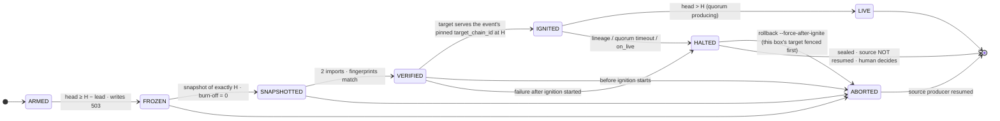

# Reference: the ceremony agent for builders

The builders' half of the [README](../README.md): the state machine, each mode in detail, the commands, the
production profile, the manifest and config, the installers, and the supporting tools. You do not need any of it to
rehearse. The web-edge side (what `doctor` detects, the supported setups, nginx and HAProxy flips) is in
[EDGES.md](EDGES.md); the design rationale, failure table and import backends are in [DESIGN.md](DESIGN.md).

Contents: [State machine](#the-state-machine) · [Modes in detail](#modes-in-detail) ·
[Abort and rollback](#abort-and-rollback-in-detail) · [Commands](#commands) ·
[Production profile](#production-profile) · [Getting the binary](#getting-the-binary) ·
[Files on the box](#files-on-the-box) · [The ceremony.json manifest](#the-ceremonyjson-manifest) ·
[`install.sh` internals](#installsh-internals) · [`/v1` gateway modes](#v1-edge-native-or-legacy-gateway) ·
[scan-contracts](#pulse-cutover-scan-contracts--stubbed-intrinsic-preflight) ·
[report](#pulse-cutover-report--the-feedback-loop) · [Loop harness](#loop-harness) · [Build](#build)

## The state machine



This is the simplified view; the full diagram, with STRANDED, `join` and FLIPPED, is in
[DESIGN.md §3](DESIGN.md#3-state-machine).

On its own the agent reaches `ABORTED` only **before ignition starts**; for this agent rollback is
resuming its source producer. The one other way in is an operator's `rollback --force-after-ignite`
on the coordinator's fleet-wide order, from `HALTED`, after this box's target was fenced
(`target.stop_cmd`); the beacon reports that ABORTED as `forced_rollback`. From the moment ignition starts (journaled
first), any failure goes to a durable `HALTED` instead: nothing is rolled back and the source is never resumed
(`unhalt --i-understand` to clear). That is the local point of no return. There is no fleet-wide "target authorized"
state yet, so one BP aborting before its ignition cannot know whether another has ignited (ATOMICITY Known
limits #1; design in [DESIGN-authority-boundary.md](DESIGN-authority-boundary.md)).

Per-mode ceremony:

```
bp        ARMED → FROZEN → SNAPSHOTTED → VERIFIED → IGNITED → LIVE
api       ARMED → FROZEN → SNAPSHOTTED → VERIFIED → IGNITED → FLIPPED → LIVE
hyperion  ARMED → FROZEN → SNAPSHOTTED → VERIFIED → IGNITED* → FLIPPED† → LIVE
          * + hyperion-rs hydration gate   † flips /v1 and /v2 in one stage
```

- **ARMED** — preflight, watch the source chain head until freeze height `H`.
- **FROZEN** — writes are closed at the edge before H (`freeze_lead_blocks`). With
  `schedule_at_h` the source keeps producing empty blocks through H to finality and is
  paused only after the snapshot; the cut is pinned by height *and block id*.
- **SNAPSHOTTED** — nodeos `create_snapshot`, hard-asserted to be *of the pinned cut*.
- **VERIFIED** — fork backend: streaming sha256 + the 19-table state fingerprints computed by
  importing the snapshot into **two fresh arenas** (two runs of the same importer) through the exact
  code path a PulseVM node boots with (`pulsevm_snapshot_import`); compared
  against pre-published goldens (multi-BP) or captured with provenance (rehearsal). Upstream backend: the official
  tools ([DESIGN.md §8](DESIGN.md#8-upstream-alignment-and-import-backends)).
- **IGNITED** — verified snapshot staged into the pre-staged PulseVM chain config,
  metalgo (re)started; the target must report **the event's pinned `target_chain_id`, a height ≥ H and the cut's
  block id at H** ([DESIGN.md §2c](DESIGN.md#2c-a-new-chain_id-pinned-in-the-signed-event-rc33); without a pin,
  rehearsals and other chains only, the source id unless `rehearsal_allow_chain_id_change`). Ignition start is
  journaled before the restart; any failure after it HALTS.
- **LIVE** — local target head keeps advancing for `live_sustain_secs` (default 60) with no gap over
  `live_max_gap_secs` (20); in bp mode `on_live` flips the edge first and must succeed, in api mode the
  flip already happened at FLIPPED. It is still a local check, not all-validator health or inclusion.
- **After LIVE** (reporting only) — the beacon and `pulse-cutover status` keep asking the target for
  its head. Once no new block has appeared for `target.post_live_max_idle_secs` (default 60; 0 = off),
  or the optional `target.post_live_probe_cmd` (run by the beacon at most every 30 s, 5 s timeout,
  exit 0 = healthy) fails, the HEALTH check `target_live` fails ("no new block for N s since LIVE")
  and mission control shows the node red; `status` prints `target_live: FAILING (...)`. PulseVM
  builds blocks only when there are transactions, so on a chain with traffic a still head means
  admitted transactions are not being included (stage-2 run 2: the chain stopped two seconds
  after LIVE while everything still said LIVE). Nothing is rolled back after LIVE: that is an
  operator decision.

Every transition is an fsynced JSONL journal line with timestamps and evidence
(hashes, block ids, fingerprints, durations). A restarted agent resumes from the
journal and re-runs its current step. Crash recovery is implemented but not yet
certified on real boxes: an exclusive journal lock, torn-tail repair (only a fragment
after the last newline; a complete corrupt record is fatal), journaled side-effect
records (staged artifact, ignition start, flips), a durable HALTED, and hooks run in
their own process group with a deadline (`hooks.timeout_secs`). A Linux fault-injection
run (real systemd, stubbed nodeos and metalgo) passed on rc.10
([EVIDENCE.md](EVIDENCE.md#linux-fault-injection-rc9-and-rc10)); none of it has
been exercised against real chain services or a fleet yet (ATOMICITY Known limits #6).

## Modes in detail

Which mode to pick is the table in the README ([Which mode am I?](../README.md#which-mode-am-i)). What each does:

- **bp** — you help freeze the chain and become a producer/validator of the
  migrated chain. Writes reject at the API edge while empty blocks carry the
  chain to H; the snapshot is scheduled at exactly the declared block.
  Recorded: real XPR state, cut at exactly H, gap 197.0 s.
- **api** — your job is `/v1` continuity: nodeos serving the public URL →
  PulseVM serving the *same URL*. Your nodeos outlives ignition and retires
  *last*, so reads never gap; the flip is a one-line health-gated nginx swap.
  Recorded: live XPR testnet, **99.8% read availability, 0.75 s flip, 22/22
  loop runs LIVE**.
- **hyperion** — everything api does, plus `/v2` history continuity: post-cut
  history from local hyperion-rs, pre-cut history from the legacy archive,
  merged behind the same URL — **the URL keeps its memory**. Recorded: one
  public `/v2` call returning post-cut + 3,206 pre-cut rows minutes after the
  cut.

### API-provider mode (`mode = "api"`)

A producer freezes the chain; an **API provider follows it**. api mode is the
ceremony for the operator whose job is `/v1` continuity:

```
ARMED → FROZEN → SNAPSHOTTED → VERIFIED → IGNITED → FLIPPED → LIVE
```

The state order is deliberately different from producer mode: **the source
nodeos outlives ignition**. Reads must never gap, so nodeos keeps answering
the public URL while PulseVM boots and verifies; the only user-visible step is
the **FLIPPED** transition (nginx upstream swap, health-checked: the edge and the target serve the expected chain_id,
the event's pinned `target_chain_id` when there is one, and the head agrees with the target RPC), and only after that
does the operator's own `source.stop_cmd` retire nodeos. An abort before ignition
touches nothing public. The flip runs after ignition, so a failure at FLIPPED
HALTS (nothing is reverted automatically; nodeos was still running) and the
operator decides; a coordinator-ordered `rollback --force-after-ignite` then
reverts the swap after fencing this box's target.

- No producer pause: the freeze is observed (`LIB ≥ H`), not caused.
- Snapshot via the node's **own** `producer_api` `create_snapshot` (works
  read-only on non-producers; keep it localhost-bound — R10).
- `simulate_freeze = true` rehearses against a live chain that will *not*
  stop: when LIB ≥ H the agent proceeds as if frozen, accepts its own cut
  height (it can be later than H) and journals the actual cut block. Without
  it, api mode schedules the snapshot at exactly H through its own nodeos
  (`snapshot.dir`, picked up as `snapshot-<id of H>.bin`), like a producer.
  That exact-H path has not been rehearsed under a real freeze in API mode
  (ATOMICITY Known limits #2); an API provider should still verify its
  artifact against the published goldens rather than trust its own snapshot.

### hyperion mode (`mode = "api"` + `[hyperion]`)

/v2 history continuity rides the api ceremony: after IGNITED the agent stands up
**hyperion-rs** against the new chain's SHiP (`start_cmd` gets the ceremony's
`{first_post_cut_block}` substituted — an imported chain must index from cut+1,
never from 0), writes the **history boundary file** for the federating router,
and holds until `/v2/health` reports the indexer hydrated (with an *idle-at-cut*
allowance: a chain with zero post-cut blocks reports `Indexer: Warning,
last_indexed_block: 0` and is caught up by definition). The FLIP stage then
swaps `/v2` to the **federating router** (`federator/server.js`) in the same
user-visible moment as `/v1`, and both public gates must go green before the
source may be stopped.

The router serves ONE timeline through one URL: pre-cut rows from the legacy
Hyperion (`LEGACY=` the source chain's public archive — or your own old ES if
you kept full history; same knob), post-cut rows from local hyperion-rs, merged
and paginated across the boundary. See [federator/README.md](../federator/README.md).

### bp mode (`mode = "producer"`)

The producer-side ceremony from [DESIGN.md](DESIGN.md): freeze writes at the API edge,
**schedule the snapshot at exactly H** (`freeze_strategy = "schedule_at_h"` —
nodeos writes `snapshot-<block_id(H)>.bin` when H finalizes and the agent picks
it up by that exact name), pause after, quiescence-pin the cut, verify, ignite
as the new chain's producer/validator. Writes close `freeze_lead_blocks`
(default 24) *before* H so nothing in flight lands after the cut; from rc.32 the admission lock also closes the
producer itself ([DESIGN.md §2a](DESIGN.md#2a-the-admission-lock-rc32)); a
`post_ignite` hook gives the on-demand chain its first blocks and `on_live`
flips the API edge (see the [multi-producer rehearsal](EVIDENCE.md#multi-producer-rehearsal-5-bps-september-2026)).
`source.quiesce_cmd` exists for
single-node rehearsals against a live-syncing replica (sever p2p to emulate
"every producer paused"); a real multi-BP ceremony does not need it. The
burn-off audit journals every transaction between the cut and the pause head —
in a real freeze those blocks are empty and the audit proves it.

## Abort and rollback in detail

**What ABORT looks like:** the run stops, prints `[ABORTED]` with the reason,
and exits non-zero. Some errors exit non-zero *without* writing `ABORTED` or
finishing rollback, so after any non-zero exit check the journal and the
actual state of nodeos and the edge. On a single box the ceremony changes
nothing public before FLIPPED; before ignition starts the agent aborts and rolls back itself (bp mode:
resumes your producer; api mode: reverts what it changed) and moves the snapshot it staged aside, so the
box is clean for the next run. `./cutover.sh abort` does the same for a stuck/^C'd run (it first stops a
hook the killed agent left running), but only when the journal proves ignition has not started: it
refuses (exit 3, nothing changed) on a missing, corrupt or locked journal, when an orphaned hook cannot be
stopped, or after ignition; and exits 4 if a rollback step failed (the source may NOT be producing).
Each step is journaled as it completes, so re-running after a failure or crash redoes only what is left;
"already rolled back" means the journal proves every step, `on_abort` included, finished.

`--force-after-ignite` (coordinator's fleet-wide order only) first stops this box's target with
`target.stop_cmd` (default `systemctl stop <metalgo_unit> && ! systemctl is-active --quiet <metalgo_unit>`;
set it if your target runs elsewhere or under another supervisor; it runs under `hooks.timeout_secs`, so a
unit with a longer stop timeout counts as a failed fence) and refuses to resume the source if that fails; the
fence runs on every forced attempt, never reused from an earlier one. A rollback records its intent first:
if it dies before finishing, `run` refuses to carry on (`status` shows `rollback_pending: yes`; `unhalt` does
not clear it) until `rollback` is re-run, or, only while no rollback step has completed,
`rollback --cancel-intent --i-understand` withdraws it (journaled). `run` on an ABORTED journal whose rollback
the journal does not prove finished exits 4 ("rollback INCOMPLETE").

An abort is not a fleet guarantee: once other producers may have ignited, a local abort that resumes the old chain
can split the network, which is why a coordinated producer's rollback runs the fleet resume guard first (ATOMICITY
Known limits #1 and #14; STRANDED and `join` in [DESIGN.md §3](DESIGN.md#3-state-machine) and
[OPERATOR-QUICKSTART.md](OPERATOR-QUICKSTART.md)).

## Commands

Read-only, safe anywhere (including production):

```sh
pulse-cutover doctor [--json]                       # environment survey + per-mode verdicts
pulse-cutover status --config ceremony.toml         # how far the ceremony got, from the journal
pulse-cutover scan-contracts snap.bin [--json]      # stubbed-intrinsic exposure (advisory)
pulse-cutover report [--paranoid] [--out f.tar.gz]  # sanitized feedback bundle
pulse-cutover beacon --config ceremony.toml [--once]   # readiness + evidence to mission control ([beacon])
pulse-cutover await  --config ceremony.toml         # arm from the coordinator's SIGNED event ([coordination])
pulse-cutover verify --snapshot snap.bin [--cpu-scale 143] [--golden g.txt | --capture g.txt]   # CPU/RAM heavy
```

Mutating (normally driven by `install.sh` / `cutover.sh`):

```sh
pulse-cutover run      --config ceremony.toml       # run the ceremony to LIVE (0), ABORTED or HALTED (1)
pulse-cutover loop     --config ceremony.toml --runs N
pulse-cutover rollback --config ceremony.toml [--wait S] [--force-after-ignite] [--force-stranded --i-understand]
                                                    # what cutover.sh abort runs (exit 3 = refused, 4 = incomplete)
pulse-cutover unhalt   --config ceremony.toml --i-understand   # clear a HALTED (sealed) journal after a fleet decision
pulse-cutover join     --config ceremony-<event>.toml --event <id> [--reverify]   # a STRANDED/ABORTED producer joins
                                                    # the chain a quorum of the event already runs LIVE
```

`pulse-cutover <command> --help` prints examples for each; `--cpu-scale` must equal the ceremony's
`import_cpu_scale` for `verify` fingerprints to be comparable.

`cutover.sh` validates the manifest against the live chain, runs the agent,
and streams each state transition in plain language. Exit 0 = LIVE. A non-zero
exit usually means ABORTED (the journal path is printed), but some errors exit
without writing ABORTED or finishing rollback: check the journal and the actual
state of nodeos, metalgo and the edge before assuming the source is authoritative.
`cutover.sh status` and `cutover.sh abort` do what they say.

## Production profile

A ceremony config is either fit for a real cut or explicitly a rehearsal. Without `[ceremony] rehearsal = true`,
`pulse-cutover` refuses (at load, and again right before the write freeze) any config that has: a rehearsal
override (`rehearsal_allow_chain_id_change`, `rehearsal_allow_compare_mismatch`), `allow_inexact_cut`,
`simulate_freeze`, `derive_h_at_arm`, `require_lineage_check = false`, `live_sustain_secs = 0`,
`post_live_max_idle_secs = 0`, no `post_live_probe_cmd`, no state comparison (upstream `compare_bin`; fork
`golden_roots`), and in producer mode a missing `on_freeze` / `post_ignite` / `on_live` / `on_abort` hook,
`pause_at_h`, the `quiesce_cmd` stand-in, or the admission lock turned off. A rehearsal is journaled, shown by
`status`, reported as the beacon setup check `rehearsal_overrides` (mission control labels it REHEARSAL) and refused
for XPR mainnet. The example configs are all rehearsals. For a real cut the operator's `on_freeze` must close
**every** write path into the producer's nodeos (public and private APIs, relays, bots and other direct clients); the
admission lock and the burn-off audit back it up, and the audit aborts the cut if anything slipped through.
`install.sh` writes `rehearsal = true` only when the manifest says `.ceremony.rehearsal: true`, and takes `.hooks.*`,
`.target.post_live_probe_cmd` and `.ceremony.boundary_path` from the manifest.

## Getting the binary

Every release ships **static musl binaries** (x86_64 + aarch64) that run on any supported Ubuntu regardless of glibc,
with a `sha256sums.txt`. Always name an exact release tag: GitHub's `latest` alias skips pre-releases and resolves to
an old build. **Don't build from source on a producing node**: compiling takes minutes of full CPU.

From v0.5.0-rc.29 every release also attaches the operator scripts and lists them in its `sha256sums.txt`, so the
download can be checked before it runs (`curl -fsSLO …/releases/download/$V/sha256sums.txt && sha256sum -c
sha256sums.txt --ignore-missing`); for older tags, `git clone --branch $V --depth 1` gives you the same files
verified by git against the tag.

`beacon-install.sh` ends by printing `token_sha256=…`: send that line to the mission-control operator to be listed.
Only the hash is enrolled and stored by mission control; the token itself is sent (over HTTPS) with every report,
which is how mission control authenticates it. See [control/README.md](../control/README.md).

`install.sh` fetches the release binary itself (sha256-verified against that release's sums) whenever the ceremony
manifest pins no agent artifact: it uses the manifest's `artifacts.agent_release_tag`, else the tag pinned in the
script (`AGENT_RELEASE_DEFAULT`, bumped with every release together with `beacon-install.sh`), and refuses `latest`.
A manifest-pinned binary (`artifacts.agent`) still wins, fail-closed, in a real event.

## Files on the box

The beacon installer and the ceremony installer share one layout:

| File | Written by | What it is |
|---|---|---|
| `/usr/local/bin/pulse-cutover` | both installers | the agent (release binary, sha256-verified) |
| `/etc/pulse-cutover/beacon.toml` | `beacon-install.sh` | readiness-only config for the beacon (`profile = "readiness"`; `run` refuses it) |
| `/etc/pulse-cutover/beacon.token`, `beacon.instance` | `beacon-install.sh` | the beacon's token (mode 600) and stable instance id |
| `/etc/pulse-cutover/ceremony.toml` | `install.sh` | **the ceremony config** `cutover.sh` runs, generated from the manifest + the doctor survey |
| `/etc/pulse-cutover/ceremony.json` | `install.sh` | a copy of the manifest it was generated from |
| `/opt/pulse-cutover/flip-*.sh`, `source-*.sh` | `install.sh` | the templated flip/revert and (script-managed nodeos) stop/start scripts |
| `<paths.work_dir>/` (`/var/lib/pulse-cutover` in the example) | `install.sh`, the agent | `doctor.json`, `journal.jsonl`, the staged snapshot (absent until VERIFIED), captured fingerprints |
| `/opt/pulsevm/plugins/<vm_id>`, `/opt/metalgo/metalgo`, `/etc/metalgo/chains/<id>/config.json` | `install.sh` | the pinned PulseVM plugin, metalgo, and the target chain config (unit `metalgo-pulse`) |
| `/var/lib/metalgo/` | `tools/metal-install.sh` | a standalone Metal validator (unit `metalgo`) with its identity in `staking/` |

A sample ARMED-READY banner (from a rehearsal box; ids shortened):

```
============================================================
 ARMED-READY (mode: api) — installed, verified, staged.

 Doctor:  survey + per-mode verdicts in /root/api-cutover/doctor.json
          flip scripts templated from the detected nginx layout
          source stop: systemctl stop nodeos
 Source:  nodeos at http://127.0.0.1:8888 serving 71ee83bc... (untouched)
 Target:  metalgo-pulse tracking subnet <subnet-id>
          NodeID NodeID-<node-id>
          chain <blockchain-id>: waiting for the
          verified snapshot at /root/api-cutover/snapshot-cut.bin (absent by design)
 Public:  nginx /v1/chain -> nodeos:8888 (flip staged, NOT flipped)

 What happens at H (run: ./cutover.sh --manifest ceremony.json):
   1. agent watches the source chain to the freeze height
   2. snapshot via your nodeos producer_api at ~finality
   3. sha256 + dual-import 19-table fingerprint verification
   4. PulseVM ignites from the verified snapshot (the event's NEW chain_id)
   5. /v1 URL flips to PulseVM + health check   <- only visible step
   6. YOUR stop command retires nodeos (reads never gapped)
============================================================
```

## The ceremony.json manifest

The complete, documented example is [`examples/ceremony.json`](../examples/ceremony.json)
(JSON has no comments, so its `_`-prefixed keys carry the documentation and
are ignored). The shape, abridged:

```json
{
  "mode": "api",
  "ceremony": { "rehearsal": true, "chain_id": "…", "freeze_height": 0, "freeze_margin": 240,
                "simulate_freeze": true, "import_cpu_scale": 143 },
  "source":   { "rpc_url": "http://127.0.0.1:8888",
                "producer_api_url": "http://127.0.0.1:8888",
                "stop_cmd": "systemctl stop nodeos",          // optional: derived from the doctor survey
                "start_cmd": "systemctl start nodeos" },
  "snapshot": { "dir": "…", "golden_roots": "…", "expected_sha256": "…", "prescan_path": "…" },   // all optional
  "target":   { "network_id": "tahoe", "subnet_id": "…", "blockchain_id": "…",
                "vm_id": "…", "producer_name": "…", "producer_key": "PVT_K1_…",
                "staking_dir": "/var/lib/metalgo/staking", "post_live_probe_cmd": "…" },
  "flip":     { "public_host": "<public-ip-or-domain>", "edge": "auto" },
  "gateway":  { "mode": "edge" },
  "artifacts": { "agent_release_tag": "v0.5.0-rc.33",      // or "agent": {"url", "sha256"}, which wins
                 "plugin":    {"url": "…", "sha256": "…"},
                 "metalgo":   {"url": "…", "sha256": "…"},
                 "edge":      {"url": "…", "sha256": "…"},    // gateway.mode = edge
                 "gateway":   {"url": "…", "sha256": "…"},    // gateway.mode = legacy
                 "hyperion":  {"url": "…", "sha256": "…"},    // hyperion mode
                 "federator": {"url": "…", "sha256": "…"} },  // hyperion mode
  "hyperion": { "legacy_url": "…", "es_heap": "2g", "es_image": "…", "ship_ws": "ws://127.0.0.1:9090" },
  "hooks":    { "on_freeze": "…", "post_ignite": "…", "on_live": "…", "on_abort": "…", "on_halt": "…" },
  "paths":    { "work_dir": "/var/lib/pulse-cutover" }
}
```

`install.sh` reads exactly these keys (the mode-specific ones only in their
mode) and turns them into `/etc/pulse-cutover/ceremony.toml`; every TOML field
that results is documented in [`examples/ceremony.toml`](../examples/ceremony.toml)
(every field of every section in `src/config.rs`, with its default; `tools/test/run.sh` fails when one is missing).
[`examples/ceremony-bp.toml`](../examples/ceremony-bp.toml) is the coordinated producer shape with `[coordination]`
and `[beacon]` filled in.
`flip.edge` picks which web edge the ceremony flips when the box runs more
than one: `"nginx"`, `"haproxy"`, or `"auto"` (default — auto-picks the one
edge that routes /v1 to your nodeos, and refuses to guess if both do).
Boxes with a single edge can omit it entirely.

For a rehearsal with us, the testing group publishes the current rehearsal bundle: the target chain's
subnet/blockchain/VM ids, the pinned PulseVM plugin and metalgo binaries with their sha256, and the shared rehearsal
producer identity (there is no PulseVM chain for XPR testnet itself; rehearsals run on a private Metal network).
In a real multi-operator ceremony every operator gets the same manifest from the
coordinator, and H (and, from rc.33, the target chain_id and the producer gate) comes from the signed coordinator
event (`pulse-cutover await`). The on-chain msig declaration in the original design was not built; see
[DESIGN.md](DESIGN.md) (§4 and finding R6).

## `install.sh` internals

`install.sh` runs **doctor first** and consumes its JSON:

- refuses per the doctor verdict — UNSUPPORTED prints the precise reason and
  points at `report`; NEEDS prints the exact missing list (needs the
  manifest or the installer itself satisfies — an explicit `stop_cmd`, a
  declared `flip.edge`, socat — are filtered out, not ignored);
- resolves **which edge the ceremony flips**: manifest `flip.edge`
  (`nginx` | `haproxy` | `auto`, default `auto` = the one edge that routes
  /v1 to your nodeos; refuses if both do);
- templates the flip/revert scripts from the **detected** map — nginx:
  domain -> upstream, byte-exact against your own config files; haproxy:
  backend/server names + the chosen strategy (runtime-socket or
  cfg-reload, see [EDGES.md](EDGES.md#haproxy-notes)). Your edge is untouched
  until the ceremony's flip stage — except haproxy's one install-time
  staging reload. Only on a box with no /v1 routes at all
  does it stage the managed nginx layout from the recorded runs. If the
  edge has routes but none reach your nodeos, it refuses and says so;
- defaults `source.stop_cmd`/`start_cmd` from the detected systemd unit or
  docker container when the manifest doesn't declare them;
- runs the stubbed-intrinsic scan (advisory) when a prescan snapshot is
  staged.

Beyond that it installs the agent, PulseVM plugin, metalgo, and (api mode)
the /v1 edge or gateway from the manifest's artifacts, each **sha256-verified,
failing closed on a mismatch** (`tools/metal-install.sh` carries its metalgo
checksums inside the script and reads mission control's manifest only for the
network ids; see [METAL-QUICKSTART.md](METAL-QUICKSTART.md));
extracts any tarball safely (`--no-same-owner`, staging dir); stages the
metalgo/chain configs with the manifest's values; enforces R12 (no stale
staged snapshot); and ends with an ARMED-READY print of exactly what will
happen at H. Re-running it before a ceremony converges rather than duplicating;
don't re-run it during a ceremony.
It never touches your running nodeos and never flips traffic. Discovery supports specific layouts, and some files
are written before every check has run, so a refusal can leave a partial install behind: fix the reason and re-run.
It does not yet generate the full coordination, scheduling and mandatory-hook configuration a multi-producer event
needs.

## `/v1`: edge, native or legacy gateway

API mode puts something on `127.0.0.1:8899` for the public `/v1` route to flip to. Which one is set by
`gateway.mode` in the manifest. [`examples/ceremony.json`](../examples/ceremony.json) sets `edge`; when the manifest
names no mode, `install.sh` falls back to `legacy`, which exists for PulseVM builds without the in-node API (before
MetalBlockchain/pulsevm #98).

- **`edge`** (recommended with PulseVM v1.0.0+, and what the example manifest sets): the /v1 edge from
  `artifacts.edge` (`gateway/server.js` in this repo, dependency-free Node). It forwards the 14 `/v1/chain` endpoints
  the node serves natively (normalizing requests nodeos accepts but the node's parser rejects), polyfills the rest of
  the Leap 5 `/v1/chain` surface (`send_transaction2`, `push_transactions`, `get_raw_block`,
  `get_block_header(_state)`, `get_producers`, `get_accounts_by_authorizers`, `get_transaction_id`, …), serves
  `get_activated_protocol_features` / `get_consensus_parameters` from a capture of the source chain, and proxies
  `/v1/history/*` to the federator. What cannot be served yet is a nodeos-shaped 501. Values always come from the new
  chain; history indexes are used only to discover accounts. Full table and upstream asks:
  [V1-COVERAGE.md](V1-COVERAGE.md).
- **`native`**: a dependency-free pass-through of `/v1/chain/*` to the node's own nodeos-style API
  (MetalBlockchain/pulsevm #98, at `/ext/bc/<BID>/v1/chain/`) with `Host: localhost` for metalgo's host check. Only
  the 14 native endpoints answer. `artifacts.gateway` is not needed.
- **`legacy`** (the fallback when no mode is set): the translating gateway from `artifacts.gateway`, which turns
  nodeos-style `/v1/chain/*` calls into `pulsevm.*` JSON-RPC. Needed only for pre-#98 PulseVM builds, including
  v0.7.1.

The flip and revert are identical in all modes: the public route swaps its backend to `127.0.0.1:8899`.

**Edge: capture the at-cut facts.** Run `node tools/capture-static.mjs <source-rpc> /etc/pulse-cutover/static` while
the source nodeos still answers (the installer does it once at install time; run it again during the freeze, before
nodeos stops). Without the capture those two endpoints answer 501.

## `pulse-cutover scan-contracts` — stubbed-intrinsic preflight

Since PulseVM's arena-import branch, a contract importing an unserved host
function **loads** (the import gets a stub) but **traps if it ever calls
it**. The exposure is exactly enumerable from the snapshot:

```sh
pulse-cutover scan-contracts snapshot.bin          # at-risk table
pulse-cutover scan-contracts snapshot.bin --json   # machine-readable
```

Parses every code object's wasm import section (wasmparser) and diffs `env`
function imports against the served host-function table embedded from
[`src/served_imports.txt`](../src/served_imports.txt) (`--served file` to override). **Advisory, never a gate** — a
referenced import is a real code path but not necessarily a reachable one (the
`send_deferred` cluster on XPR testnet is the canonical example: 20+ legacy
contracts reference it, few can still reach it). The ceremony runs this scan
automatically on the **actual cut snapshot** after verification and journals
the table; declare `snapshot.prescan_path` (manifest `.snapshot.prescan_path`)
to additionally scan a staged rehearsal snapshot at ARM time.

## `pulse-cutover report` — the feedback loop

One command produces a sanitized tar.gz with everything we need to debug a
rehearsal or add support for a setup (see Step 5 of the README walkthrough for the operator view).

Collected: doctor JSON + table, ceremony journal(s) and loop metrics, the
staged manifest/config, the last ~200 lines of every relevant service log it
detects (nodeos — native or docker —, metalgo-pulse, pulse-gateway,
hyperion-rs units, federator), the stubbed-intrinsic scan table, agent
version.

**Sanitization is non-negotiable and always on**: private keys
(`PVT_K1_...`, `PVT_R1_...`, legacy WIF), bearer/authorization tokens,
passwords (config values, `user:pass@` URLs, ES credentials) and labeled hex
secrets are replaced with `[REDACTED-<type>]` before anything is written
into the bundle. Chain ids, block ids and sha256 digests are kept — they are
the evidence. The command ends by printing exactly what was redacted and the
full file list so you can review before sharing (`tar -tzf`). Hostnames/IPs
stay by default (so we can talk about your box); `--paranoid` placeholders
them too. The sanitizer is covered by dedicated unit tests with planted fake
secrets — that test suite is the review gate for this repo.

Sample output (trimmed):

```
== pulse-cutover report bundle ==
  pulse-cutover-report-api-cutover-test-20260821-083145.tar.gz (28890 bytes)
  sha256 5f38ea34c7a1908099bdd63e3526a841b2fa6f1773568ff681223cd0252351fe

files in the bundle:
  - doctor.json
  - doctor.txt
  - ceremony.toml
  - journal.jsonl
  - logs/metalgo-pulse.log
  - logs/nodeos.log
  ...

redactions applied (review before sharing — nothing listed leaves the box unredacted):
      1 x private-key -> [REDACTED-private-key]
```

## Loop harness

"It works, with numbers":

```sh
pulse-cutover loop --config ceremony.toml --runs 100
```

Each iteration: `[loop].reset_cmd` returns both sides to a pre-ARM state
(source restored, fresh target chain, staged snapshot removed — R12 enforced
by preflight), then a full ceremony runs with H re-derived from live LIB
(`freeze_margin`). Failures don't stop the loop — they're data, categorized in
the summary. Output: per-run JSONL metrics (`[loop].metrics_path`) + aggregate
mean/median/p95/max for the ceremony gap and every phase duration.

The reference loop deployment (scripts + gotchas from the recorded 22-run
series) is in `examples/loop/`. To reproduce the single-box numbers: walk the README's Steps 0–5, then
`pulse-cutover loop --runs N` with `examples/ceremony-api.toml`.

## Build

```sh
cargo build --release --locked && cargo test --locked
```

The PulseVM import crates (`pulsevm_snapshot`, `pulsevm_snapshot_import`,
`pulsevm_chaindb`) are git dependencies pinned to an exact commit in
`Cargo.toml`; cargo fetches them, no second checkout is needed.
`Cargo.lock` is committed and CI/release builds use `--locked`. Release
binaries are static musl builds made by `.github/workflows/release.yml`.
Build on a non-producing box.
